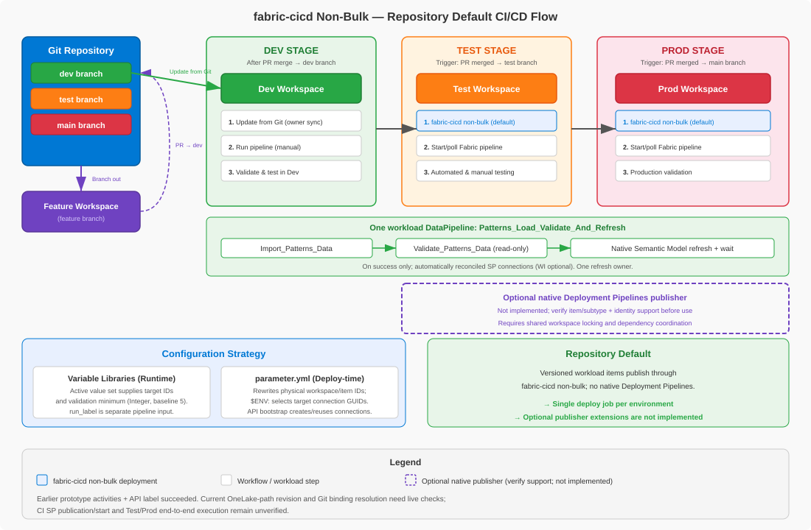

**English** | [Español](translations/es/README.md)

# Microsoft Fabric SDLC Patterns

A reference implementation for Microsoft Fabric development and CI/CD using GitHub Actions and the [fabric-cicd](https://microsoft.github.io/fabric-cicd) Python library. It includes a Branch Out developer workflow, four selectable deployment implementations, and one Fabric DataPipeline that loads data, validates it, and refreshes a semantic model. The guides also discuss production controls and architectural extensions that are not all implemented by the examples.

*Based on field experience with Microsoft Fabric customers and partners. Opinions expressed here are my own and do not represent Microsoft's official guidance.*

---

## Who is this for?

This repository serves four common tasks:

| If you need to... | Start with... |
|---|---|
| Set up a fork and its Fabric environments | [Setup](SETUP.md) |
| Develop in an isolated Branch Out workspace | [Development Process](fabric-development-process.md) |
| Promote Dev to Test and Test to `main`/Prod | [Release Process](fabric-release-process.md) |
| Choose an architecture or define production controls | [Release Options](fabric-cicd-release-options.md), [Governance](fabric-cicd-governance-considerations.md), and [Quality Gates](fabric-cicd-quality-gates-and-release-controls.md) |

## Start Here

Start with fabric-cicd non-bulk, the repository default. Prove that path in
your own Test workspace before evaluating another publisher.

### Lifecycle in one minute

1. A GitHub repository administrator configures the fork and GitHub
   Environments; Entra/Fabric administrators configure identities, tenant
   settings, workspaces, and permissions.
2. The repository administrator manually provisions Dev's Workspace Identity
   connection pair. A named Dev workspace operator initializes the Git-connected
   workspace and records canonical Dev IDs.
3. A developer Branches Out from Dev. A feature workspace administrator creates
   its Workspace Identity and connections; the developer swaps references and
   tests.
4. Before the feature PR, the developer restores Dev references. After merge,
   the Dev workspace operator selects **Update all** and runs the Fabric
   DataPipeline.
5. A reviewed `dev` to `test` merge starts the selected release job. It ensures
   Test connections, publishes definitions, and runs the same-revision
   DataPipeline.
6. After Test acceptance, a reviewed `test` to `main` merge applies the same
   contract to Prod under configured Prod protection.

See [Release Process](fabric-release-process.md) for the workflow and identity
boundaries behind steps 5 and 6.

## Choose a Deployment Method

Set the repository variable `DEPLOY_METHOD` to select the deployment job for
both Test and Prod. Unset selects `fabric-cicd`. These capabilities describe
the implementations shipped here, not every feature of the underlying APIs.
Yes/No indicates use, not a quality ranking.

Find the exact values and GitHub UI locations in
[Setup: deployment method variables](SETUP.md#deployment-method-variables).
For fabric-cicd bulk specifically, use the
[fabric-cicd-bulk settings](SETUP.md#fabric-cicd-bulk-settings).

| `DEPLOY_METHOD` | Publisher | Bulk definitions | Ordering / plan handling | Replacement file | Live evidence for this revision |
|---|---|---|---|---|---|
| [`fabric-cicd`](fabric-hybrid-cicd-guide.md) - non-bulk default | fabric-cicd | No | Custom Python phases + fabric-cicd order | [parameter.yml](data/fabric/parameter.yml) | Default Test verified |
| [`fabric-cicd-plan`](fabric-deployment-plan-guide.md#how-it-works) | fabric-cicd | No | Deployment Plan (client-read) | [parameter.yml](data/fabric/parameter.yml) | Not yet live-verified |
| [`fabric-cicd-bulk`](fabric-deployment-plan-guide.md#isolated-bulk-adapter-14x) | fabric-cicd | Yes | Deployment Plan (client-read) | [parameter.yml](data/fabric/parameter.yml) | Not yet live-verified |
| [`bulk`](fabric-bulk-cicd-guide.md) | Direct REST - custom Python | Yes | Custom Python phases | [bulk-parameter.yml](data/fabric/bulk-parameter.yml) | Not yet live-verified |

Ordering labels:

- **Custom Python phases:** the runner chooses phases without reading a Deployment Plan.
- **Deployment Plan (client-read):** our adapters parse `DEPLOYMENT_PLAN_PATH`, normally [this plan.yml](data/fabric/DeploymentPlan.DeploymentPlan/plan.yml), to choose fabric-cicd item selections. Non-bulk uses sequential groups; bulk combines ready groups. The plan is not passed to fabric-cicd or included in REST requests.
- **Deployment Plan (platform-executed):** reserved for a future route that includes the plan in the REST request so Fabric executes its ordering. Not implemented or selectable today.

- The fabric-cicd Python library also calls REST APIs. "Direct REST" means the repository owns publishing and substitutions without fabric-cicd.
- None of these routes uses native **Fabric Deployment Pipelines**, a workspace-promotion service distinct from Deployment Plans and the **DataPipeline** that runs this sample's workload.
- **Hybrid** describes an optional architecture that combines publishers for a workload's needs; it is not another `DEPLOY_METHOD` value or the default recommendation.
- fabric-cicd non-bulk is this repository's recommended starting point. Both
  plan adapters use experimental selective deployment. Current Microsoft
  documentation shows the raw Bulk Import v1 endpoint without `?beta=true`,
  while this repository's raw caller still sends that legacy query and is not
  live-verified. Reconcile it before use.
- The fabric-cicd workflows use `fabric-cicd>=1.4.0,<1.5.0` and Python 3.12. fabric-cicd bulk supports the filtered dynamic replacements in this repository; the raw REST route owns a separate replacement engine.
- Both plan routes require `DEPLOYMENT_PLAN_PATH`. A route change alone does
  not start a run; see [workflow triggers](fabric-release-process.md#what-triggers-what).

### Implemented Examples versus Production Guidance

The workflows currently use service-principal client secrets. Fork owners must
configure GitHub branch rules and Environment protection; workflow YAML does
not create those policies. Completing load, source validation, and native model
refresh is not a complete enterprise quality-gate suite. The [release guidance](fabric-cicd-quality-gates-and-release-controls.md)
describes the additional evidence and controls to design for your workloads.
Dedicated [approval](https://github.com/michaeldeongreen/microsoft-fabric-sdlc-patterns/issues/82),
[rollback](https://github.com/michaeldeongreen/microsoft-fabric-sdlc-patterns/issues/81),
[OIDC](https://github.com/michaeldeongreen/microsoft-fabric-sdlc-patterns/issues/84), and
[Azure DevOps](https://github.com/michaeldeongreen/microsoft-fabric-sdlc-patterns/issues/85)
examples are tracked as future work.

On 2026-10-14, the default fabric-cicd Test release completed GitHub preflight,
Workspace Identity connection ensure, connections-admin Owner verification,
ID persistence, publication, and the same-revision Fabric DataPipeline in
[run 38581072000](https://github.com/michaeldeongreen/microsoft-fabric-sdlc-patterns/actions/runs/38581072000).
That result does not certify Prod, the three alternative methods, a complete
current-revision Branch Out cycle, cold-versus-reuse behavior, model ownership,
DAX/report results, or consumer permissions. See the
[verification matrix](fabric-release-process.md#verification-status).

---

## Architecture

The default fabric-cicd non-bulk route is shown below. The other methods replace its
deployment implementation and share the same-revision ETL template. GitHub starts
`Patterns_Load_Validate_And_Refresh` and polls its pipeline job. Fabric owns the
success-dependent activities and the only model refresh.

For this sample, default non-bulk publication uses three calls: Lakehouse +
Ontology → non-pipeline dependents → DataPipeline. The third call discovers the
new notebook/model IDs with fresh workspace state. Publishing definitions does
not execute the pipeline's activities.

```
Feature branch (feature/*)
  │
  │  PR → dev branch
  ▼
Git repo (dev branch)
  │  Fabric UX: Update all → run the Dev pipeline manually
  │
  │  PR merge → test branch (source must be dev)
  ▼
┌─────────────────────────────────────────────────────┐
│  deploy-test.yml                                    │
│    ├─ ensure Test WI connections + persist IDs      │
│    ├─ fabric-cicd: publish_all_items()              │
│    └─ needs: deploy                                 │
│  run-etl (same workflow revision)                   │
│       └─ Fabric REST API: run DataPipeline + wait   │
└─────────────────────────────────────────────────────┘
  │
  │  PR merge → main branch (source must be test)
  ▼
┌─────────────────────────────────────────────────────┐
│  deploy-prod.yml                                    │
│    ├─ ensure Prod WI connections + persist IDs      │
│    ├─ fabric-cicd: publish_all_items()              │
│    └─ needs: deploy                                 │
│  run-etl (same workflow revision)                   │
│       └─ Fabric REST API: run DataPipeline + wait   │
└─────────────────────────────────────────────────────┘
```

Inside Fabric:

```text
Patterns_Load_Validate_And_Refresh
  Import_Patterns_Data
    -> Validate_Patterns_Data
      -> native refresh of Patterns_Semantic_Model (wait for completion)
```

The existing loader is unchanged. The new notebook is read-only: it checks
schemas, required keys, appointment references, source date-column types, and a
configurable patient minimum—not exact sample row counts. Refresh is skipped
if load or validation fails; refresh failure fails the pipeline. GitHub does
not perform a second refresh.

| Parameter example | Source | Purpose |
|---|---|---|
| `minimum_patient_count` | Positive **Integer** in the active `Patterns_Variables` value set; baseline `5` | Environment policy, passed to the validation notebook by the pipeline's Library binding |
| `run_label` | Independent **String** pipeline parameter; default `manual` | Per-run context, optionally supplied by CI through `RUN_LABEL` and forwarded to validation |

For this sample's **Direct Lake on OneLake** model, refresh performs framing of
the Delta table references after ETL; it is not another data load or a storage
mode conversion. Source validation and refresh completion do not prove model
date-field queries, DAX results, or consumer access.
See the [shared follow-up contract](fabric-release-process.md#post-etl-semantic-model-refresh)
and [refresh permissions](SETUP.md#post-etl-refresh-permissions).

Each deployment workflow runs the shared pipeline job through `needs` after
successful publication. Deployment and ETL use the same branch revision:
Test no longer depends on an ETL listener stored on `main`. The separately
dispatchable ETL workflows are recovery tools, not automatic listeners.
The deployment workflow display names changed to `Deploy and Run Pipeline`
so legacy default-branch listeners do not trigger a second ETL during rollout.

Branch protection (PR required, source-branch restrictions, status checks) is enforced by GitHub branch rulesets and the [enforce-promotion-path.yml](.github/workflows/enforce-promotion-path.yml) workflow — see the [Governance Considerations](fabric-cicd-governance-considerations.md).

### Optional Architecture Extensions

Start with the non-bulk route above. If the selected publisher cannot cover a
workload, verify another route's item and identity support before adding it.
Native Deployment Pipelines are one possible extension, not an automatic
fallback for items outside Git integration.



The illustration includes an optional native Deployment Pipelines extension.
See [Optional Extensions for Unsupported Items](fabric-cicd-release-options.md#optional-extensions-for-unsupported-items)
for its support and implementation boundaries; none of the four shipped
methods invokes it.

---

## Documentation

| Document | Description |
|---|---|
| [Setup Guide](SETUP.md) | Start here to run your own fork. Covers actors, prerequisites, Fabric workspaces, GitHub configuration, Dev initialization, and the first promotion. |
| [Development Process](fabric-development-process.md) | Branch Out, feature connections and reference swaps, return to Dev, and the manual Dev update/run. |
| [Release Process](fabric-release-process.md) | Shared Dev-to-Test and Test-to-`main`/Prod flow, automatic connection ensure, workflow callers, DataPipeline handoff, recovery, and verification status. |
| [CI/CD Release Options](fabric-cicd-release-options.md) | Compares Fabric deployment architectures and explains why this repository starts with fabric-cicd non-bulk. |
| [fabric-cicd Non-Bulk CI/CD Guide](fabric-hybrid-cicd-guide.md) | Default publisher mechanics: three publication phases, parameterization, clean-target behavior, and route-specific limitations. |
| [Raw REST Bulk CI/CD Guide](fabric-bulk-cicd-guide.md) | Direct Bulk Import API comparison: custom substitutions, value-set activation, caller phases, and limitations. Not the fabric-cicd bulk route. |
| [Deployment Plan CI/CD Guide](fabric-deployment-plan-guide.md) | Independent non-bulk and grouped bulk ordering adapters, remaining-item discovery, configuration, and validation boundaries. |
| [CI/CD Governance Considerations](fabric-cicd-governance-considerations.md) | Considerations on identities, RBAC, branch protection, and approval gates for the CI/CD pipeline. Includes pointers to adjacent controls owned outside the pipeline (security/compliance topics). |
| [CI/CD Quality Gates and Release Controls](fabric-cicd-quality-gates-and-release-controls.md) | Practical automated artifact validation, test evidence, staged approvals, release tags, support checks, and rollback examples. Complements the governance controls. |
| [Maintained Presentation](presentations/fabric-sdlc-cd.md) | A presentation-ready summary derived from the canonical guides. |

---

## Key Concepts

Before choosing a CI/CD approach or development workflow, understand these two realities about Fabric items.

### Item Tracking Categories

Git integration, file-based publishing, and native deployment support are
independent capabilities, not mutually exclusive item categories. Check each
one for the item subtype, tool version, and identity you intend to use:

| Capability | What to verify | Effect on your workflow |
|---|---|---|
| **Git integration** | Is the item supported by [Fabric Git integration](https://learn.microsoft.com/en-us/fabric/cicd/git-integration/intro-to-git-integration#supported-items)? | Supported definitions sync to Git for branching and review. Lack of Git integration does not establish whether another API can export or deploy the item. |
| **Selected publisher** | Does the chosen fabric-cicd version or item API support the item and identity? See [fabric-cicd item types](https://microsoft.github.io/fabric-cicd/latest/reference/item_types/). | Determines whether that route can publish retained definitions and apply the required configuration. |
| **Native Deployment Pipelines** | Is the item supported by [Fabric Deployment Pipelines](https://learn.microsoft.com/en-us/fabric/cicd/deployment-pipelines/intro-to-deployment-pipelines#supported-items) under the intended identity? | Can provide workspace-to-workspace promotion where supported. This is an optional separate route, not proof that Git or file-based publishing is unavailable. |

> **Important:** Support evolves. Check the official documentation for every selected surface; do not infer one support boundary from another.

The [fabric-cicd Non-Bulk CI/CD Guide](fabric-hybrid-cicd-guide.md) explains the
default route. If it cannot cover your workload, see the
[optional extensions](fabric-cicd-release-options.md#optional-extensions-for-unsupported-items)
and retain a reviewed source and recovery method for every item. The default
route covers this repository's workload definitions without native Deployment Pipelines;
DeploymentPlan is ordering configuration, not published by the client-read adapters.

### Variable Libraries: Dynamic vs Static Metadata

Some Fabric items resolve environment-specific values **at runtime** through [Variable Libraries](https://learn.microsoft.com/en-us/fabric/cicd/variable-library/variable-library-cicd), while others have environment-specific IDs **hardcoded in their definitions**.

| Type | How it works | Examples |
|---|---|---|
| **Dynamic (Variable Library)** | The workload resolves values from the active value set at runtime. This does not rewrite literal activity references. | Loader/validation target configuration via `notebookutils.variableLibrary.getLibrary()`; pipeline Library binding for `minimum_patient_count` |
| **Static (hardcoded)** | The definition contains physical workspace/item/connection GUIDs that need target-specific replacement, distinct from portable logical IDs. | Semantic Model Direct Lake URL, Notebook META lakehouse dependencies, DataPipeline model and connection references |

When designing your development and CI/CD processes, identify which items in your workspace are dynamic vs static. Static items need either deploy-time parameterization (`parameter.yml` for CI/CD) or script-based rewriting (`workspace_swap.py` for feature branches). The [Development Process](fabric-development-process.md) doc covers how this repo handles both.

---

## Quick Start

### Prerequisites

1. A Fabric capacity appropriate for the item types and API route. Raw bulk
   import of Fabric item types requires an F SKU or Fabric Trial.
2. Dev, Test, and Prod Fabric workspaces; only Dev is Git-connected.
3. A deployment service principal with Contributor in each workspace and one
   Workspace Identity per workspace with its required resource access.
4. `Dev`, `Test`, and `Prod` GitHub Environments, a trusted connections-admin
   group, and a repository-scoped Environment-variable PAT.
5. Fabric tenant settings that authorize the approved users and service
   principal for Git integration, public APIs, and connection creation.

### Setup

Fork owners should follow the [Setup Guide](SETUP.md). It provides one ordered
path through required access, workspace creation, Git initialization, reference
ID replacement, GitHub configuration, and first deployment.

After setup, use [Development Process](fabric-development-process.md) for
feature work and [Release Process](fabric-release-process.md) for promotion.

The explicit **Provision Fabric Connections** action creates/reuses two WI
connections for Dev, verifies the trusted group's Owner access, and saves
their IDs in GitHub Environment variables. Feature connections are created by
a human. Selected Test and Prod releases run the same connection ensure and
create-only persistence before publication.

The PAT is on the Test/Prod release path, restricted to GitHub preflight and
variable-persistence steps. The deployment service principal performs Fabric
connection, connection-role, publication, and job-submission operations.
The publisher subprocess then validates and consumes the resolved pair
read-only.

Local Dev IDs are recorded in the existing parameter rules, not an extra JSON
manifest or downloaded artifact. Later swaps/readiness stay offline.
See [Provision Dev connections](SETUP.md#4-provision-dev-connections).
Developers never need deployment-SP secrets. Shared administration across
stages and PAT reuse/non-expiration are sample compromises, not production
recommendations.

Use the [method matrix](#choose-a-deployment-method) when evaluating an
alternative after the default non-bulk route works. The [plan guide](fabric-deployment-plan-guide.md)
documents fabric-cicd bulk's fallback checks and validation boundaries. Do not
infer Production readiness from source tests or from the verified default Test
route.
