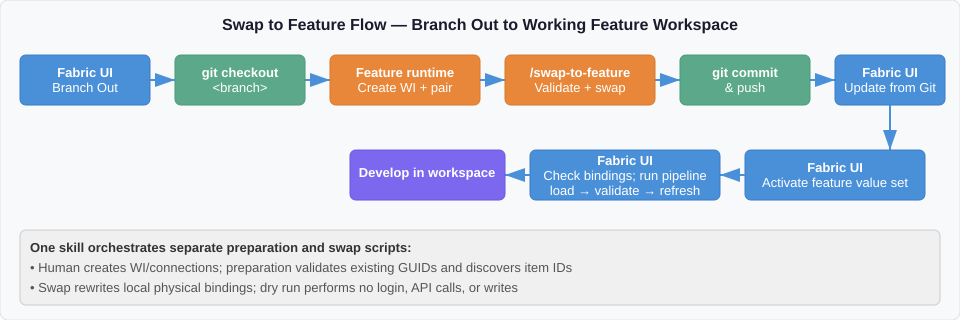
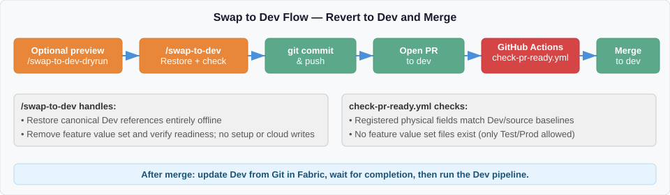

# Development Process

This document describes the two primary approaches for feature branch development in Microsoft Fabric with Git integration, the tradeoffs of each, and how this repository implements the **Branch Out** pattern.

## Scenario Comparison

### Scenario A: Short-Lived Feature Workspaces (Not Git-Synced)

In this scenario, `dev` is the only workspace connected to Git. Feature workspaces are created independently and are **not** git-synced. Code is deployed into them using [fabric-cicd](https://microsoft.github.io/fabric-cicd/latest/).

**How it works:**

1. Developer creates a feature branch in Git from `dev`.
2. A standalone Fabric workspace is created for the feature (not connected to Git).
3. A CI/CD pipeline uses `fabric-cicd` to deploy items from the feature branch into the workspace.
4. `fabric-cicd` handles metadata replacement (workspace IDs, lakehouse IDs) via `parameter.yml` at deploy time.
5. Developer works in the Fabric UI, then commits changes back to the feature branch.
6. PR is opened to merge the feature branch into `dev`.

**Positive:** You can use `fabric-cicd` to update metadata because the target workspace is not git-synced. Deployed workspaces are only updated through script-based deployments — this is the [recommended flow from fabric-cicd](https://microsoft.github.io/fabric-cicd/latest/how_to/getting_started/#git-flow):

> *"Deployed branches are not connected to workspaces via GIT Sync. Feature branches are connected to workspaces via GIT Sync. Deployed workspaces are only updated through script-based deployments."*
> — [fabric-cicd Getting Started: GIT Flow](https://microsoft.github.io/fabric-cicd/latest/how_to/getting_started/#git-flow)

**Issue:** All development happens in the Fabric UI. Syncing changes back to the feature branch is manual and error-prone, especially for items that cannot be fully tracked in Git.

---

### Scenario B: Branch Out (Git-Synced Feature Workspaces)

In this scenario, you use Fabric's [Branch Out](https://learn.microsoft.com/en-us/fabric/cicd/git-integration/manage-branches#scenario-2---branch-out-to-another-workspace) feature. The feature workspace **is** git-synced to the feature branch.

**How it works:**

1. Developer uses the Fabric UI Source Control panel to **Branch out to another workspace**.
2. Fabric creates a new branch and a new workspace, syncing all items automatically.
3. The workspace is connected to the feature branch via Git Sync.
4. Developer works in the workspace, commits changes directly to the feature branch.
5. PR is opened to merge the feature branch into `dev`.

**Positive:** Fabric moves all supported items to the feature workspace automatically. Development and source control are tightly integrated.

**Issue:** You **cannot** use `fabric-cicd` to deploy into a git-synced workspace. `fabric-cicd` pushes changes directly via Fabric APIs, which creates **workspace drift** — the workspace state diverges from what Git expects. When Git Sync next runs, it can overwrite the `fabric-cicd` changes or produce conflicts, destabilizing the workspace.

This is explicitly documented:

> *"Deployed branches are not connected to workspaces via GIT Sync ... Deployed workspaces are only updated through script-based deployments, such as through the fabric-cicd library."*
> — [fabric-cicd Getting Started: GIT Flow](https://microsoft.github.io/fabric-cicd/latest/how_to/getting_started/#git-flow)

The inverse is also true: **git-synced workspaces should not be targets for `fabric-cicd` deployments.**

Additionally, when branching out, only [Git-supported items](https://learn.microsoft.com/en-us/fabric/cicd/git-integration/intro-to-git-integration#supported-items) are available in the new workspace, and certain workspace settings are not copied:

> *"When branching out, a new branch is created and the settings from the original branch aren't copied. Adjust any settings or definitions to ensure that the new meets your organization's policies."*
> — [Basic concepts in Git integration: Branching out limitations](https://learn.microsoft.com/en-us/fabric/cicd/git-integration/git-integration-process#branching-out-limitations)

---

## How This Repository Implements Branch Out

This repository uses **Scenario B (Branch Out)** for feature development. Since `fabric-cicd` cannot be used on git-synced workspaces, a Python script handles the metadata updates that would normally be done by `fabric-cicd` at deploy time.

### The Problem

When you branch out from `dev`, supported Fabric definitions are copied to the
feature workspace. Several contain **physical environment references**:

- **Semantic Model** (`expressions.tmdl`) — Direct Lake connection URL contains dev workspace and lakehouse GUIDs.
- **Notebooks with attached Lakehouses** (`notebook-content.py`) — META dependency blocks reference dev workspace and lakehouse GUIDs.
- **DataPipeline** (`Patterns_Load_Validate_And_Refresh`) — activity workspace/model
  IDs and connection GUIDs require feature-specific bindings. Source connection
  markers are not runnable connections.
- **Variable Library** (`variables.json`) — Default value set contains dev IDs (this is expected and not modified).

Without intervention, the feature model/notebooks can target Dev, and native
refresh can target the wrong model. A feature pipeline must never refresh Dev.
Branch Out does not provision its own unattended runtime connections for you.

### The Solution: `workspace_swap.py`

The everyday workflow has **two commands to remember**:

> After Branch Out: `/swap-to-feature`. Before the PR back to Dev: `/swap-to-dev`.

Each skill handles preparation when needed. The implementation still has two
separate jobs, so the scripts remain easy to test and troubleshoot:

| Job | Script | Purpose | When needed |
|---|---|---|---|
| **Prepare feature resources** | [prepare_fabric_workspace.py](scripts/prepare_fabric_workspace.py) | Use the developer's Fabric API session to discover feature items and ensure its runtime connections | Each new feature workspace |
| **Bootstrap Dev resources** | [bootstrap-dev.yml](.github/workflows/bootstrap-dev.yml) | Use GitHub Environment secrets to create/reuse Dev connections; export only non-secret bindings | Facilitator setup or deliberate resource recovery |
| **Import Dev metadata** | [prepare_fabric_workspace.py](scripts/prepare_fabric_workspace.py) | Obtain and validate the bootstrap artifact through `gh`; no local SPN credentials or Fabric calls | First local return while the canonical baseline is uninitialized |
| **Swap references** | [workspace_swap.py](scripts/workspace_swap.py) | Rewrite local tracked references and add/remove the feature value set; no Fabric API calls | Going to feature or returning to Dev |

Use this decision guide:

| Situation | Copilot command | What happens |
|---|---|---|
| New feature workspace after Branch Out | `/swap-to-feature` | Prepare the selected feature resources, discover IDs, then swap local references |
| Returning from feature, with real Dev bindings already initialized | `/swap-to-dev` | Restore references offline and verify local readiness |
| First return while the Dev manifest is absent or entirely uninitialized | `/swap-to-dev` | Import trusted Actions-created IDs, then restore references and verify readiness |
| Resuming the same known prepared feature workspace | `/swap-to-feature` | Use the complete valid local bindings; no new setup is needed |
| Optional preview | `/swap-to-feature-dryrun` or `/swap-to-dev-dryrun` | Local preview only; unknown IDs are reported, never invented |

Preparation establishes the connections; swapping changes which connections
the tracked pipeline references. Neither skill commits, pushes, syncs Fabric,
activates a value set, or runs the pipeline. Invalid or partially initialized
Dev configuration fails explicitly rather than being silently regenerated.

#### Facilitator Setup: Dev Connection Bootstrap

Complete this once before participants need to return their first pipeline
feature to Dev. Participants never need the application's client secret:

1. Configure the `Dev` GitHub Environment with the existing service principal's
   `AZURE_TENANT_ID`, `AZURE_CLIENT_ID`, `AZURE_CLIENT_SECRET`, and the explicit
   Dev `FABRIC_WORKSPACE_ID`. Restrict it to branch `dev`. Give that SP the
   documented workspace/tenant access and keep the sample capacity active.
   The Dev Semantic Model must already exist from initial Git setup.
2. Run [Bootstrap Dev Connections](.github/workflows/bootstrap-dev.yml) from
   the reviewed `dev` branch. It discovers the model, creates/reuses the two
   supported ServicePrincipal activity connections, and uploads
   `fabric-dev-bindings` containing `dev-bindings.json`. Only resource IDs and
   run provenance are exported; no SPN credentials or access tokens are included.
   For manual Dev use, configure the non-secret `DEV_CONNECTION_GROUP_ID`
   Environment variable with an explicitly trusted operator group's object ID.
   Bootstrap grants that group **User** on exactly the two Dev activity
   connections, idempotently preserving existing stronger assignments.
   The actual Git updater/runner must belong to the group. Approved existing
   grants are an alternative; without the variable, bootstrap warns that human
   access has not been established or verified. Confirm access before Update
   all or pipeline execution; workspace roles and Git credentials do not imply it.
3. For this repository's initial migration only, introduce that workflow and
   its source-independent helpers through a **bootstrap-only PR to Dev**.
   Its merge triggers the first bootstrap through `push`; it does not include
   the Fabric feature definitions or new readiness requirements. Do not
   promote an older workload through Test/Prod just to make
   the setup workflow available. A fork of the completed sample already has
   this infrastructure; future pipeline features do not need another setup PR.
4. Let the first `/swap-to-dev` import the output. The helper verifies the
   repository, exact workflow, Dev ref, approved source commit, successful run,
   artifact provenance, and agreement with the local Dev workspace/model.
   If no run exists but the workflow is registered, it can dispatch the Dev
   bootstrap and wait. Missing setup, failed runs, approval waits, or invalid
   metadata are surfaced; there is no fallback to local SPN credentials.

Bootstrap does not publish items, perform Update from Git, or start the
pipeline. Those belong to the later workload deployment. This separates the
one-time facilitator prerequisite from the participant's two commands.

#### Step-by-Step: Swap to Feature Workspace



1. **Branch out** from the Fabric UI Source Control panel.
2. **Clone/pull** the feature branch locally:
   ```
   git fetch origin
   git checkout <feature-branch-name>
   ```
3. **Select the feature target:** use the gitignored `.env` with the explicit
   `FEATURE_WORKSPACE_ID`. For a different workspace, start with fresh feature
   values from `.env.sample`; do not retain the previous workspace's connection
   IDs. Preserve unrelated local settings. If the target is missing, the skill
   asks for its GUID, not an additional confirmation to proceed.
4. **Run `/swap-to-feature`.** For a new target, it:
   - Uses the approved Azure CLI user identity. Reuses a valid sign-in or
     requests device-code login when needed; it never displays access tokens.
   - Discovers the Lakehouse and model, provisions/reuses the feature's
     Workspace Identity connections, and writes the remaining IDs to `.env`.
   - Stops before swapping if setup fails. Existing valid connections
     intentionally supplied for the same target are preserved.
   - Runs the local swap, satisfying its terminal `YES` prompt automatically.

   No separate preparation skill is required. The API setup needs the
   bootstrap permissions documented in
   [Setup](SETUP.md#post-etl-refresh-permissions).
   For an optional preview, use `/swap-to-feature-dryrun`; it performs no login,
   API calls, or writes. It reports unknown IDs if setup has not yet run.

   The underlying swap script:
   - Detects the current branch name (no arguments needed).
   - Reads dev IDs from `variables.json` (the default value set).
   - Uses real canonical Dev model/connection IDs from the generated
     [Dev manifest](data/fabric-dev-bindings.json) as restoration baselines.
   - Reads feature workspace/item/connection IDs from `.env`. Missing, empty,
     or malformed required GUIDs fail explicitly; there is no interactive discovery fallback.
   - Displays the planned changes; direct terminal callers still type `YES`,
     while the skill supplies it automatically.
   - Creates a feature branch value set (e.g., `valueSets/<branch-name>.json`).
   - Adds the value set to `settings.json`.
   - Rewrites the semantic model Direct Lake connection in `expressions.tmdl`.
   - Rewrites notebook META dependency blocks in all `notebook-content.py` files.
   - Rewrites the DataPipeline's physical workspace/model/connection references;
     exported portable logical references remain unchanged.
   - Sweeps stale feature IDs from a previous swap if `.env` was changed since the last run (recovery pass).
   - Validates no dev IDs remain in critical files.
5. **Commit and push** the changes to the feature branch:
   ```
   git add -A
   git commit -m "Swap to feature workspace for <branch-name>"
   git push
   ```
6. **Sync** the feature workspace from the Fabric UI (Update from Git).
   Use the pipeline definition supplied by Git, not a manually recreated copy;
   its runtime connections were prepared by the skill in step 4.
7. **Activate the feature value set** in the Fabric UI: open the Variable Library → select the feature value set → activate it.
8. **Verify the pipeline bindings, then run `Patterns_Load_Validate_And_Refresh`:**
   check both Notebook connections, the native refresh connection, and the
   actual feature model/workspace IDs before execution. Do not also run the
   loader as a second ETL.
9. **Check load → validation → native refresh success.** Validation receives
   `minimum_patient_count` from the active Library (positive Integer, baseline
   `5`) and an independent `run_label` String (default `manual`). Query the
   model's required date fields and check the report separately. Direct Lake
   refresh frames Delta references; source validation is not a DAX or consumer
   permission check.

#### Step-by-Step: Swap to Dev Before PR



Before merging back to `dev`, all feature-specific changes must be reverted so dev IDs are restored:

1. **Run `/swap-to-dev`.** The skill chooses the correct path:
   - **Initialized Dev:** use the recorded real IDs and perform the ordinary
     offline swap. No login or Fabric API calls.
   - **First migration:** when the
     [Dev manifest](data/fabric-dev-bindings.json) is absent or has its expected
     resource IDs all null, obtain the trusted bootstrap metadata through the
     developer's authenticated GitHub CLI. Record its real IDs and align both
     parameter files, then invoke the existing swap. No Azure login or local
     SPN credentials are needed.
   - **Invalid or partially initialized Dev configuration:** report the error
     and stop. Do not silently replace canonical connections or generate fake
     GUIDs.

   No separate participant preparation command is needed. Actions uses the
   SPN credentials stored in GitHub; the local helper downloads only its
   non-secret output. If the facilitator's bootstrap prerequisite is missing,
   the skill reports it and stops before swapping.

   The underlying swap:
   - Reads feature IDs from the branch value set.
   - Reverts the semantic model connection to dev IDs.
   - Reverts notebook META blocks to dev IDs.
   - Restores the DataPipeline's real Dev model/workspace/connection references,
     not feature GUIDs or fake source markers.
   - Deletes the feature value set file.
   - Removes the feature entry from `settings.json`.
   - Validates no feature IDs remain in critical files.
   The skill verifies local readiness automatically after restoration. If
   verification fails, it reports the error instead of claiming PR readiness.
   For diagnostics, run the readiness script directly with `--check-ready`;
   this is not a required extra development step.
   `/swap-to-dev-dryrun` is an optional local preview; it never prepares Dev and
   cannot calculate exact replacements while real baseline IDs are unknown.
2. **Review, commit, and push**:
   ```
   git add -A
   git commit -m "Swap to dev for merge"
   git push
   ```
3. **Open a PR** to `dev`. GitHub automatically runs the readiness check again.
   Configure it as a required branch-protection status check to block an unsafe
   merge; workflow YAML alone does not enforce that policy.

4. **After merge, update Dev manually:** open the Dev workspace's Source
   control pane in Fabric and select **Update all / Update from Git**. Review
   incoming changes or conflicts and wait for synchronization to complete.
   Use the existing user-configured Git connection; no SP-owned Git credential
   or extra automation PAT is required.
5. **Run `Patterns_Load_Validate_And_Refresh` in Dev.** The pipeline performs
   load -> read-only validation -> native Semantic Model refresh. Wait for all
   three activities, then check the model's date fields and report. Do not
   also run the loader, validation notebook, or another refresh separately.

The human Git updater and pipeline runner must have the one-time activity
connection access described in [Setup](SETUP.md#post-etl-refresh-permissions).
Dev is intentionally manual; merging a PR does not import its definitions or
start the Dev pipeline. Test/Prod publication and their dependent pipeline jobs
remain automated.

Git sync reapplies the real Dev IDs recorded in source; there is no post-sync
patching or recurring manual connection selection. A missing canonical
connection fails without silently changing its GUID. Deliberately regenerate
changed resources with `--replace-dev-bindings`, restore source, and submit the
generated changes through the normal reviewed Git process.

Use the same load → validation → native refresh pipeline for Dev/feature
execution after binding checks. The loader remains independently runnable,
but does not validate or refresh the model. The shared
[Test/Prod follow-up](fabric-hybrid-cicd-guide.md#post-etl-semantic-model-refresh)
starts and polls the pipeline only. The earlier user-started feature prototype
does not live-verify the current explicit-OneLake-path validation revision,
Git sync/Branch Out resolution of the exported pipeline references, CI
service-principal publication/start, or Test/Prod end-to-end execution.

#### PR Validation

A GitHub Actions workflow (`.github/workflows/check-pr-ready.yml`) runs on every PR targeting `dev`. It verifies:

- The semantic model contains dev workspace and lakehouse IDs.
- Notebooks with lakehouse dependencies contain dev IDs.
- Registered DataPipeline physical references are restored to their canonical
  Dev/source baselines, with no feature model or connection IDs left behind.
- No feature branch value set files exist (only `Test.json` and `Prod.json` are allowed).

When the readiness status is required by branch protection, a failed check
blocks the PR. Resolve the reported issue; the local `/swap-to-dev` skill
handles normal restoration and first-time preparation.

#### Running the Script with GitHub Copilot Chat

The repo ships agent skills in [.github/skills/](.github/skills/) that wrap the CLI and are also available as slash commands. In Copilot Chat (Agent mode) you can type:

- [/swap-to-feature](.github/skills/swap-to-feature/SKILL.md) — prepare a new
  feature target when needed, then swap its local references
- [/swap-to-dev](.github/skills/swap-to-dev/SKILL.md) — prepare Dev only on the
  first migration by importing Actions metadata, restore references, and
  verify readiness
- [/swap-to-feature-dryrun](.github/skills/swap-to-feature-dryrun/SKILL.md) and
  [/swap-to-dev-dryrun](.github/skills/swap-to-dev-dryrun/SKILL.md) — optional
  local previews, never login/API/write operations

Advanced standalone tools remain available:

- [/prepare-feature-workspace](.github/skills/prepare-feature-workspace/SKILL.md)
  and [/prepare-dev-workspace](.github/skills/prepare-dev-workspace/SKILL.md) —
  deliberate preparation-only setup or troubleshooting
- [workspace_swap.py](scripts/workspace_swap.py) with `--check-ready` — optional
  local diagnostic using the same check as the PR Action

Feature API setup uses the approved user's Azure CLI identity and device-code
login when needed. Dev uses GitHub metadata retrieval, not a local Fabric
session. SPN credentials remain in GitHub Environment secrets; Actions creates
and manages the SPN activity connections.

Invoking a skill is the request to execute it: there is no additional `YES` or
`NO` question in chat. Copilot runs the script and shows its output. For
`/swap-to-feature`, the skill supplies the CLI's confirmation automatically, so
the terminal does not wait for input. ID validation and configuration checks
still run; missing or invalid configuration fails explicitly.

The dry-run skills are optional previews, not mandatory confirmation gates.
They never apply the swap afterward. The write-enabled swap skills are
user-invoked, so mentioning one in an explanation does not trigger a rewrite.
The standalone preparation skills do not swap; the two normal swap skills
orchestrate preparation when needed. A preparation failure stops before
rewriting item references. Commit, push, and Fabric sync remain separate actions.

Note: Copilot cannot auto-trigger the script on branch checkout. You still need to invoke a slash command or run it yourself after pulling a feature branch.

### Local `.env` Setup

`workspace_swap.py` reads feature bindings from `.env` at the repo root.
This file is gitignored; each developer maintains its explicit feature
workspace target. Preparation discovers the remaining IDs and ensures the
intended runtime identity without display-name workspace guessing.

1. Copy `.env.sample` to `.env`.
2. Set `FEATURE_WORKSPACE_ID` from the explicitly selected Branch Out workspace.
   Invoke `/swap-to-feature`; its preparation phase discovers:

   | `.env` key | Feature binding |
   |---|---|
   | `FEATURE_WORKSPACE_ID` | Workspace GUID from Workspace settings / URL |
   | `FEATURE_LAKEHOUSE_ID` | `PatternsLakehouse` item GUID |
   | `FEATURE_SEMANTIC_MODEL_ID` | Physical `Patterns_Semantic_Model` item GUID |
   | `FEATURE_NOTEBOOK_CONNECTION_ID` | Workspace Identity Notebook connection GUID |
   | `FEATURE_REFRESH_CONNECTION_ID` | Workspace Identity Power BI datasets connection GUID |

3. If using preexisting connections, supply their physical GUIDs before
   preparation. Do not substitute `.platform` logical IDs.
4. The same `/swap-to-feature` invocation applies the local swap after successful
   preparation. There is no second skill to run.

The Python swap script still fails on absent/invalid values and never calls
Fabric. The skill first invokes the separate preparation script when needed;
`.env` remains the offline swap script's source of truth.

For swap-to-feature, the script always reads `.env` (the existing value-set file does not override it). The value set on disk is read by swap-to-dev (to know which feature IDs to revert) and by the recovery pass (to detect previously-applied stale IDs that need rewriting). When running the script directly in a terminal, it displays the planned dev → feature change and waits for literal `YES`. When invoked through `/swap-to-feature`, the skill supplies that answer automatically; no further user input is required.

The swap intentionally performs no API discovery. Preparation uses an explicit
workspace GUID and exact, unambiguous item names; it does not repeat the earlier
unsafe substring matching of workspace names. It rejects Dev as a feature
target and refuses duplicate item/connection matches.

### Standalone CLI (Advanced)

The CLI scripts remain independently usable, without Copilot. For a new
feature workspace:

```powershell
python scripts\prepare_fabric_workspace.py --feature --use-azure-cli
python scripts\workspace_swap.py
```

For the first return to Dev, obtain validated Actions metadata and invoke the
existing swap:

```powershell
python scripts\prepare_fabric_workspace.py --dev --swap-to-dev
```

For later returns with an initialized Dev baseline:

```powershell
python scripts\workspace_swap.py --swap-to-dev
```

Only feature API preparation needs the approved Azure CLI session. If its
sign-in is needed, use device code with the approved tenant and Fabric scope.
Dev import uses authenticated `gh` access and never loads local Azure/SPN
credentials. No interactive login is used in Actions. Advanced recovery can
select a reviewed output with `--bootstrap-run-id <run-id>`; changing a recorded
canonical GUID also requires the deliberate `--replace-dev-bindings` option.

Add `--dry-run` to either preparation mode for a local setup preview. Add
`--dry-run` to the ordinary swap for an exact local diff only when the required
IDs are already known. Previewing cannot create missing baseline resources.

### Scope of Metadata Rewriting

The script uses an **item type registry** to manage branch environment references.
Each registered type declares file patterns, rewrite behavior, and validation.
Types using existing bindings can be added as registry entries; a type with
new physical references also needs explicit baseline/configuration mappings
and regression coverage.

Not all item types need rewriting. Fabric items fall into two categories based on how they reference environment-specific resources:

- **Actual IDs** (e.g., Semantic Models, Notebooks, DataPipeline refresh/connection
  references): These embed workspace, item, or connection GUIDs that differ
  per environment. Rewrite the registered fields for feature execution and
  restore their canonical source baselines before PR.
- **Logical IDs** (e.g., Ontology, Data Agent): These reference other items via the `.platform` `logicalId`, which Fabric resolves at runtime within the current workspace. These are portable across Branch Out workspaces and need no rewriting.

The pipeline's Notebook activities retain exported `notebookId` logical IDs
and zeroed `workspaceId` values. The native refresh `groupId`/`datasetId` and
activity connection GUIDs are physical bindings and require replacement.

### Item Type Reference

| Item Type | Files | ID Type | `workspace_swap.py` Rewrites? | `parameter.yml` Handles? | Notes |
|-----------|-------|---------|--------------------------|-------------------------|-------|
| **SemanticModel** | `*.SemanticModel/definition/expressions.tmdl` | Actual workspace + lakehouse IDs | Yes | Yes | Direct Lake connection URL contains real GUIDs |
| **Notebook** | `*.Notebook/notebook-content.py` | Actual workspace + lakehouse IDs | Yes (only if `default_lakehouse` present) | Yes | META dependency blocks reference real GUIDs |
| **DataPipeline** | `*.DataPipeline/pipeline-content.json` | Physical workspace/model/connection IDs; portable logical references retained | Yes — real recorded Dev baselines | Yes — target model and automatically resolved connections | Bootstrap manages runtime resources; Git-synced Dev retains runnable source bindings |
| **Ontology** | `*.Ontology/**/DataBindings/*.json`, `*.Ontology/**/Contextualizations/*.json` | Lakehouse logicalId (`b36b3bda-...`) + zeroed workspaceId | No — logicalIds are portable | Yes — logicalId replaced with `$items.Lakehouse...` for CI/CD | Uses `.platform` logicalId, resolved by Fabric at runtime |
| **DataAgent** | `*.DataAgent/**/datasource.json` | Ontology logicalId (`58a6c8ed-...`) + zeroed workspaceId | No — logicalIds are portable | No — references Ontology by logicalId | Cross-item logicalId reference, no environment-specific IDs |
| **VariableLibrary** | `valueSets/*.json`, `settings.json` | Dev lakehouse ID in default value set | Managed (creates/deletes value sets) | Yes — default value set lakehouse ID replaced | Value set files are created/deleted, not rewritten |
| DeploymentPlan | `*.DeploymentPlan/plan.yml` | Item logical IDs | No | No | Portable ordering configuration for the optional [plan-driven adapter](fabric-deployment-plan-guide.md) |

### Files Involved

| File | Role |
|------|------|
| `scripts/workspace_swap.py` | Swap workspace IDs in tracked files between dev and feature; CI readiness check |
| `scripts/pipeline_bindings.py` | Registered pipeline fields and canonical Dev model/source connection restoration baselines |
| `tests/test_workspace_swap.py` | Unit tests for the branch environment script |
| `data/fabric/Patterns_Variables.VariableLibrary/variables.json` | Default (dev) value set — read-only reference for dev IDs |
| `data/fabric/Patterns_Variables.VariableLibrary/valueSets/` | Per-environment value sets (Test, Prod, feature branches) |
| `data/fabric/Patterns_Variables.VariableLibrary/settings.json` | Value set ordering |
| `data/fabric/Patterns_Semantic_Model.SemanticModel/definition/expressions.tmdl` | Direct Lake connection — rewritten by the script |
| `data/fabric/Import_Patterns_Data.Notebook/notebook-content.py` | Notebook with hardcoded lakehouse dependency — rewritten by the script |
| `data/fabric/Validate_Patterns_Data.Notebook/notebook-content.py` | Read-only source validation with pipeline parameters and Variable Library-based OneLake paths; no attached Lakehouse |
| `data/fabric/Patterns_Load_Validate_And_Refresh.DataPipeline/` | Load/validation/native-refresh definition with registered environment references |
| `data/fabric/Patterns_Ontology.Ontology/EntityTypes/*/DataBindings/*.json` | Ontology data bindings — validated (not rewritten) by the script |
| `data/fabric/Patterns_Ontology.Ontology/RelationshipTypes/*/Contextualizations/*.json` | Ontology contextualizations — validated (not rewritten) by the script |
| `data/fabric/Patterns_Data_Agent.DataAgent/Files/Config/draft/ontology-*/datasource.json` | Data Agent datasource — registered but not scanned (no dev IDs) |
| `.github/workflows/check-pr-ready.yml` | PR check to block feature IDs from merging to dev |
| `.github/workflows/run-tests.yml` | Runs unit tests on every PR, without a path filter |
| `data/fabric/parameter.yml` | Deploy-time parameterization for fabric-cicd (used in CI/CD, not by `workspace_swap.py`) |

For deployment methods, reusable templates, and ETL handoffs beyond this
developer loop, use the [shared workflow reference](fabric-hybrid-cicd-guide.md#github-actions-workflows).

## References

- [fabric-cicd: Getting Started — GIT Flow](https://microsoft.github.io/fabric-cicd/latest/how_to/getting_started/#git-flow)
- [Microsoft Fabric: Manage branches — Branch out to another workspace](https://learn.microsoft.com/en-us/fabric/cicd/git-integration/manage-branches#scenario-2---branch-out-to-another-workspace)
- [Microsoft Fabric: Basic concepts in Git integration — Branching out limitations](https://learn.microsoft.com/en-us/fabric/cicd/git-integration/git-integration-process#branching-out-limitations)
- [Microsoft Fabric: Git integration best practices](https://learn.microsoft.com/en-us/fabric/cicd/best-practices-cicd)
