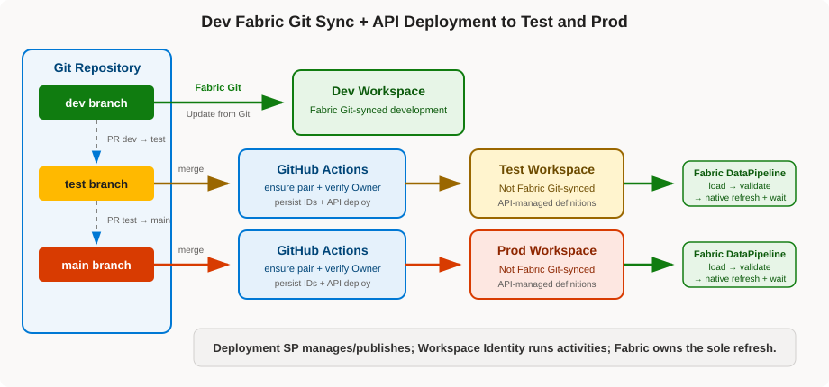
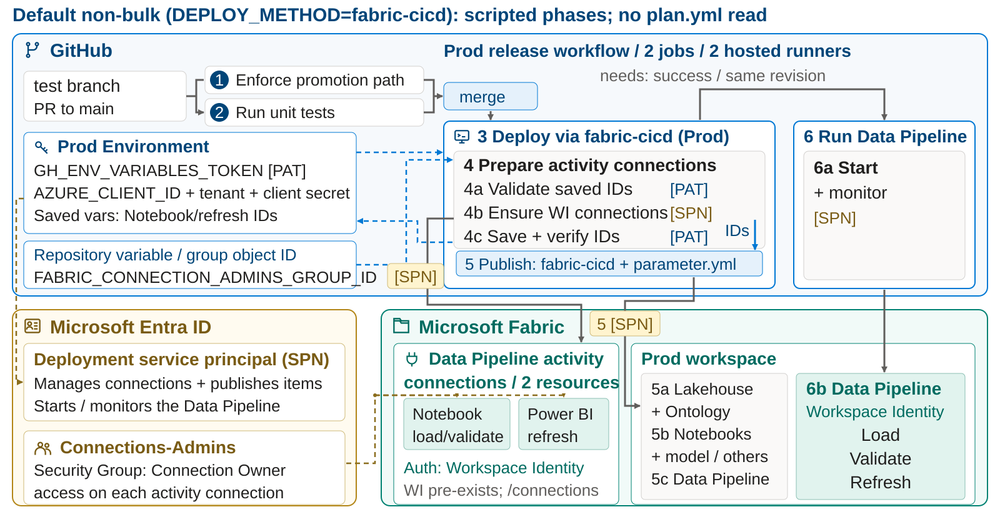

<!-- _class: title -->
<!-- _paginate: false -->
<!-- _header: "" -->
<!-- _footer: "" -->

# Continuous Delivery in Microsoft Fabric

## Why it is difficult, the options available, and a working GitHub implementation

**Michael Green**<br/>
*[CSA / DevSquad / MCSA]*

[Reference implementation](https://github.com/michaeldeongreen/microsoft-fabric-sdlc-patterns)

<!--
Introduce yourself and position the session as the CD follow-on to the earlier CI presentation.
Official Microsoft documentation is canonical; this repository is one opinionated GitHub implementation.
Recent additions to call out briefly, without naming a prior revision — DataPipeline deployment, DataPipeline activity connections with Connections-Admins as Owner, same-revision ETL, and AI-assisted Spanish resources.
Clock for 50 minutes — 0:00 S1–5 · 0:05 S6–11 · 0:10 S12–15 · 0:17 S16–17 · 0:20 LIVE (15) · 0:35 S18–20 · 0:40 S21–23 · 0:43 Q&A, which absorbs overrun. If behind at 0:20, skip S4, S7–8, S15 and S22.
-->

---

# The Fabric delivery problem

A Fabric workspace is both a **development surface** and a **live environment**.

One solution can span:

- Notebooks and pipelines
- Lakehouses and data
- Semantic models and reports
- Variable Libraries and connections
- Ontologies and agents

> **How do we reproduce a working solution in Test and Prod without rebuilding it by hand or allowing every workspace to become a different truth?**

<!--
Do not define generic CD. Start with the Fabric-specific operating problem.
Direct browser editing is powerful, but it makes a disciplined promotion path important.
-->

---

<!-- _class: customer-challenges dense -->

# Why Fabric CI/CD is hard

**For customers and partners:** Data & AI delivery spans infrastructure, platform items, data and state, bindings, identities, and operations—not just code. That coupling makes platform choice consequential: switching later is usually a migration program, not a tool swap.

| | |
|---|---|
| **Uneven lifecycle support**<br>Git, Deployment Pipelines, `fabric-cicd`, and APIs support different item sets. | **Dependencies become deployment logic**<br>Foundational items must exist before target IDs and dependent definitions can resolve. |
| **Configuration is fragmented**<br>Runtime variables, metadata, connections, rules, and secrets have different owners and timing. | **Definitions are not the whole environment**<br>Data, credentials, permissions, schedules, and first-deploy bindings need separate plans. |
| **Multiple writers create drift**<br>Direct edits, Fabric Git sync, and API deployment should not compete for the same workspace. | **Security and governance span systems**<br>Fabric roles and tenant settings must align with Entra identity, GitHub controls, approvals, audit, and enterprise data governance. |

<!--
This is the central customer-problem slide. Fabric CD is hard because the workspace is heterogeneous, not because YAML is difficult.
The challenge is not simply whether Fabric is secure. It must fit the customer's existing enterprise control model without creating a parallel process.
Use “vendor lock-in” carefully: every Data & AI platform creates coupling through data gravity, proprietary metadata, security/governance configuration, operational skills, and ecosystem integration.
The point is not that teams cannot move; it is that migration is a strategic program rather than a deployment-tool change.
-->

---

<!-- _class: dense -->

# Before choosing CI/CD tooling, define the delivery surface

**Start with the solution—not the deployment tool.**

| Question | Decide |
|---|---|
| **What is part of the solution?** | Inventory the Fabric items and the surrounding configuration or state required to run. |
| **What can each mechanism move?** | Record Git, publisher/API, native pipeline, and identity support independently for each item/subtype. |
| **How portable are the references?** | Distinguish runtime values, logical IDs, and physical IDs that require replacement. |
| **What must be provisioned?** | Map capacities, workspaces, private links, shortcuts/connections, roles, and tenant settings; select Bicep, Terraform, or APIs by coverage. |
| **What moves beyond definitions?** | Plan for data, credentials, permissions, connections, schedules, bindings, and target settings. |
| **Who owns the target and outcome?** | Establish one writer, post-deploy ETL or refresh, validation, and release evidence. |

> **Supported does not mean complete:** item definitions are only one part of a usable environment. Capture definitions where possible, even when the chosen publisher cannot deploy the item.

<!--
This checklist distills the README Key Concepts on item tracking/deployment capabilities and dynamic versus static metadata.
Supported-item lists evolve, so link to the official lists rather than freezing a detailed matrix in the deck.
Git tracking and publisher support are independent: a publishing gap does not imply no Git/version history.
Bicep/ARM primarily covers the Azure control plane, including Fabric capacity. The Microsoft Fabric Terraform provider has broader Fabric-plane coverage, but support evolves.
Shortcuts, connections, and private networking may cross content, workspace, Fabric admin, and Azure networking surfaces; verify current provider/API coverage before selecting the IaC path.
-->

---

<!-- _class: dependency-contract compact -->

# One challenge in depth: dependencies become deployment logic

From the broader CD problems, dependencies show why copying definitions is not enough. References determine deployment order and parameterization.

| Portable / logical references | Physical references requiring replacement |
|---|---|
| Report → Semantic Model via [`definition.pbir`](../data/fabric/Patterns_Report.Report/definition.pbir)<br><br>Ontology → Lakehouse logical ID via its [data binding](../data/fabric/Patterns_Ontology.Ontology/EntityTypes/2525121373138/DataBindings/6e4524f9-ea6d-4535-ab49-a72f73fc08a0.json)<br><br>Data Agent → Ontology logical ID via [`datasource.json`](../data/fabric/Patterns_Data_Agent.DataAgent/Files/Config/draft/ontology-Patterns_Ontology/datasource.json) | Direct Lake model → physical OneLake path in [`expressions.tmdl`](../data/fabric/Patterns_Semantic_Model.SemanticModel/definition/expressions.tmdl)<br><br>Notebook → workspace/lakehouse IDs in [`notebook-content.py`](../data/fabric/Import_Patterns_Data.Notebook/notebook-content.py)<br><br>DataPipeline → physical model/connection IDs |

```text
Phase 1:  Lakehouse ──▶ Variable Library / Notebooks / Semantic Model
          Ontology  ──▶ Data Agent

Phase 2:  Publish non-pipeline dependents
Phase 3:  Fresh Notebook/Model discovery → publish DataPipeline
```

<!--
Open the linked files if useful. The Data Agent directly references the Ontology—not the Lakehouse.
Lakehouse and Ontology are Phase 1 foundations for different dependency chains.
fabric-cicd workspace state is cached within a call; phase 3 discovers the phase 2 pipeline dependencies afresh.
This is one concrete example of the broader challenges on the earlier slide, not a new topic.
-->

---

<!-- _class: divider -->
<!-- _paginate: false -->
<!-- _header: "" -->
<!-- _footer: "" -->

# Three Fabric delivery options

## Each optimizes for a different operating model

---

<!-- _class: diagram -->

# Option 1

## Fabric Deployment Pipelines


**Strengths**

- Portal UX, REST API automation, comparison, and history
- Lowest setup cost
- Full or selective deployment
- Deployment rules and autobinding

**Trade-offs**

- Git is not necessarily the direct source for Test and Prod
- Linear stage topology
- Rules do not cover every target-specific value
- API-based selective deployment requires dependency planning

**Best fit:** Fabric-native operations with minimal custom automation.

<!--
Deployment Pipelines are available through the Fabric portal and REST APIs. The APIs can create/manage pipelines, assign workspaces to stages, deploy stage content, and inspect operations.
Treat the APIs as the automation surface of this option—not as a separate fourth delivery option.
-->

---

<!-- _class: diagram -->

# Option 2

## Fabric Git integration for every stage


**Strengths**

- Fabric Git directly represents every stage
- One branch/PR model for development and promotion
- No separate deployment library

**Trade-offs**

- Fabric Git sync becomes part of the production deployment path
- Every target workspace must be Fabric Git-connected and governed
- Some customers report platform-generated or semantically insignificant definition churn (“ghost commits”)
- Long-lived branches, drift, and competing writers increase operational complexity

**Best fit:** teams comfortable operating all stages through Fabric Git integration.

<!--
Frame “ghost commits” as a customer/field concern, not a universal official platform claim:
some customers report semantically insignificant or platform-generated definition churn in source control.
-->

---

<!-- _class: diagram -->

# Option 3

## Git-based deployment: Dev Git sync + APIs for Test and Prod



**Strengths**

- Dev can remain Fabric Git-synced for development
- Test and Prod deploy from stage branches through APIs
- Build-time parameterization
- CI/CD-platform approvals, secrets, and logs
- Deployment, ETL, and validation can be chained

**Trade-offs**

- Highest engineering ownership
- The team owns identity, diagnostics, and failure handling
- Tool/API support still varies
- Full-state deployment can be slower than a small diff

**Best fit:** teams needing repeatability and configuration control.

<!--
Option 3 can use a build environment for every stage. This repository uses a Git-based development/release variant:
Dev is Fabric Git-synced; Test and Prod are deployed through APIs.
That separation is not a multi-publisher hybrid. The default publisher is fabric-cicd non-bulk.
Another publisher is an optional architectural extension only with verified item/identity support and implemented coordination; native Deployment Pipelines are not shipped here.
-->

---

<!-- _class: dense -->

# Compare the operating models

| | Deployment Pipelines | Fabric Git per stage | Build environment / APIs |
|---|---|---|---|
| Test/Prod source | Prior workspace stage | Stage branch | Stage branch + deployment config |
| Built-in comparison | Adjacent Fabric stages | Workspace ↔ connected branch | None |
| Build-time transformation | Limited rules | No | **Yes** |
| Test/Prod Fabric Git connection | No | **Yes** | No |
| Engineering effort | Low | Medium | High |
| Who operates the release | Fabric workspace/release operators | Fabric solution owners + repo maintainers | DevOps/DevSecOps + Fabric solution owners |
| Deployment evidence | Fabric deployment history; Git if used | Git history + workspace Fabric Git status | Git history + CI/CD run logs |

**Choose based on source-of-truth, configuration, supported items, governance, and how much deployment code the team wants to own.**

> Automation does not eliminate Fabric expertise—it changes where that knowledge is encoded and who maintains it.

<!--
Deployment Pipelines: Fabric rules, bindings, and operator knowledge.
Fabric Git: definitions, branches, and workspace Git state.
Build/APIs: parameterization, deployment phases, validation, and runbooks.
Built-in comparison is not the same across columns: Deployment Pipelines compares adjacent stages, while Fabric Git compares a workspace with its connected branch.
Git history can support every Git-backed option; the evidence row highlights the additional proof that a revision reached its target.
-->

---

<!-- _class: dense -->

# Inside Option 3: ordering and target bindings

**Two non-bulk routes:** `fabric-cicd` (default) uses **scripted phases, no plan**.
With `fabric-cicd-plan` (experimental), **our script reads `plan.yml`** to order per-item publishing.

| | `fabric-cicd` (default)<br>Python library, per-item calls | `fabric-cicd-bulk` (experimental)<br>Library bulk; our script reads the plan | `bulk`<br>Raw Bulk API example |
|---|---|---|---|
| Reads `plan.yml`? | No | Yes: **our script** parses the YAML | No: the API supports plans; this caller attaches none |
| Order between calls | **Our script**: 3 phased calls, foundations → dependents → Data Pipeline after re-reading the workspace | **Our script**: dependency-ordered batches from `plan.yml` | **Our script**: 3 manual batches; captures physical target IDs |
| Order within a call | **fabric-cicd** orders individual items | **fabric-cicd** stages `$items` dependencies and groups linked items; **Fabric service** resolves logical-ID links | **Fabric service** resolves supported logical-ID dependencies |
| Binding + Library value set | **fabric-cicd** applies `parameter.yml` before upload and selects the target-environment value set | **fabric-cicd** applies the same `parameter.yml` and selects the value set; literal rules work, dynamic rules need filters | **Our script** replaces IDs using `bulk-parameter.yml`; PATCH activates the value set after import |
| Cleanup | **fabric-cicd** removes eligible orphans after publication | Same, after all batches | Not implemented in this sample |

**Plan = publication order; parameter configuration = target IDs. Our script owns dependency completeness.**

<!--
fabric-cicd is a Python deployment library. Use three actor names consistently: our script, fabric-cicd library, and Fabric service. The default non-bulk route remains the recommended starting point.
The repository bounds fabric-cicd to >=1.4.0,<1.5.0. The pre-1.4 dynamic-variable fallback is historical; parameter-file presence alone is not a fallback condition in 1.4.0. Installed 1.4.0 has the enable_bulk_publish flag and no native deployment-plan flag.
The authored plan is YAML at data/fabric/DeploymentPlan.DeploymentPlan/plan.yml, located by the DEPLOYMENT_PLAN_PATH variable. The default path never reads it. fabric-cicd-plan reads it for sequential non-bulk calls; fabric-cicd-bulk parses it with PyYAML to batch ready groups. Both are ordering-only client adapters, not Fabric executing a deployed plan. The Bulk Import API can support native plan attachment; this raw caller sends definitionParts with allowPairingByName=false, attaches none, and leaves the DeploymentPlan control items out of the upload.
Ordering has three layers. Our script owns order between calls and completeness. Within a call the fabric-cicd library orders items, and only its bulk path computes dynamic $items stages and keeps linked items together. Fabric service resolves supported logical-ID links within a bulk request. fabric-cicd-plan also performs eligible orphan cleanup after its ordered groups and remaining items.
Offline dry-run previews of both adapters passed against the real plan. Bulk gives ready batches [1,5,2] plus 3 unlisted items, which is four selections and an expected four bulk definition-import POSTs in the offline contract, not four total HTTP requests. Non-bulk plan gives 8 ordered groups plus the same 3. 323 focused caller, plan and binding tests passed offline. Mocked HTTP and local previews are not live evidence for the bulk or plan routes.
The raw script first captures Lakehouse and Ontology IDs, then the model ID, then publishes the DataPipeline; supported logical-ID dependencies are a separate service capability. Library, Import, Validation, and Model are explicit DataPipeline prerequisites. Preview after plan or inventory changes. Live Report byPath bindings still require validation.
Binding is not deletion — binding fixes target references; orphan cleanup removes source-absent items. Current Bulk Import docs show v1 without ?beta=true; the repository's legacy-query raw caller remains unverified.
-->

---

<!-- _class: divider -->
<!-- _paginate: false -->
<!-- _header: "" -->
<!-- _footer: "" -->

# What this repository implements

## Dev through Fabric Git; Test and Prod through GitHub Actions

---

<!-- _class: diagram -->

# Dev uses Fabric Git sync; Test and Prod use APIs


| Branch | Workspace | Delivery |
|---|---|---|
| `dev` | Dev | Fabric Git integration |
| `test` | Test | GitHub Actions |
| `main` | Prod | GitHub Actions |

One definition writer per workspace

- Dev is Fabric Git-managed.
- Test and Prod definitions are API-managed.
- Selected Test/Prod jobs ensure DataPipeline activity connections before
  publication.
- GitHub starts one Fabric DataPipeline: load → validate → native refresh.

---

<!-- _class: dense -->

# Fabric knowledge is encoded in the delivery contract

| | Variable Libraries | `parameter.yml` |
|---|---|---|
| Applied | At runtime | Before upload |
| Handles | Values workloads can resolve dynamically | Physical IDs and metadata that cannot be deferred |
| Examples | Loader values; Library patient-minimum binding | Notebook/Direct Lake IDs; pipeline model/connections |

```text
Publish 1: Lakehouse + Ontology
Publish 2: Library + Notebooks + Model + Report + Agent
Publish 3: DataPipeline (fresh Notebook/Model discovery)
          ↓ eligible orphan cleanup
Post-deploy: one DataPipeline — load → validate → native refresh
```

Also encoded: item scope, DataPipeline activity connection ensure,
Owner grant + readback, create-only ID persistence, pipeline name lookup,
success dependencies, and failure behavior. The default path reads no
DeploymentPlan; experimental adapters use one to order publication only.

> The pipeline does not need tribal Fabric knowledge when that knowledge is made explicit and testable in the repository.

<!--
The two DataPipeline activity connections are shareable Fabric connections managed at /connections in the Fabric control plane, outside the Prod workspace items. The Notebook connection serves the load and validation activities and the Power BI datasets connection serves the native semantic-model refresh; both use Workspace Identity credentials. They are not Git connections and not the semantic model's own data-source binding. Existing Workspace Identity and workload access are prerequisites, and the release grants no workspace roles. Current-run connection IDs reach parameter.yml as $ENV values through step outputs inside the deploy job, and the stored Environment variables are reused on later runs.
-->

---

<!-- _class: dense -->

# Four selectable deployment paths

Compare capabilities in the [README method matrix](../README.md#choose-a-deployment-method);
locate files in the [shared workflow reference](../fabric-release-process.md#github-actions-workflows).

| `DEPLOY_METHOD` | Result |
|---|---|
| unset or `fabric-cicd` | fabric-cicd non-bulk — default and recommended starting point |
| `fabric-cicd-bulk` | Experimental fabric-cicd bulk + client-read plan; requires `DEPLOYMENT_PLAN_PATH` |
| `bulk` | Raw REST Bulk Import example; current endpoint compatibility must be revalidated |
| `fabric-cicd-plan` | Experimental independent sequential non-bulk plan adapter |
| anything else | All deployment jobs skip |

All successful paths converge on the same ETL workflow.
Plan adapters are experimental, ordering-only examples, not native plan execution.
Native Deployment Pipelines are separate and not invoked here; an optional
second publisher needs verified item/identity support and shared release coordination.

### Why direct Bulk requires more code

The caller packages definitions, substitutes IDs from its own `bulk-parameter.yml` before import, polls imports, PATCHes the active value set, and checks item results. It does not read `parameter.yml` or delete orphans.

---

<!-- _class: divider -->
<!-- _paginate: false -->
<!-- _header: "" -->
<!-- _footer: "" -->

# Live walkthrough

## Follow one release: `test` → `main` → Prod

<!--
Switch from the deck to GitHub after the next flow slide.
Recheck first, because settings can change — DEPLOY_METHOD is fabric-cicd, the main ruleset requires both checks, the Test run for this content is green, and the PR has no data/fabric changes (the workflow-comment edit supplies the Prod path match).
Last checked 2026-10-20 — no Prod Environment approval gate and 0 required approvals, so the merge starts the run at once.
Say aloud that the trigger-eligible change is only a workflow comment, yet the full redeploy, orphan cleanup and ETL still run.
In Fabric use read-only monitoring only — no edits, rebinding, second pipeline or secret values.
-->

---

<!-- _class: architecture -->

# From pull request to usable workspace



<!--
Switch to GitHub here; t0 is the merge click. Show the two parallel required checks (Enforce promotion path, Run unit tests), merge, then follow jobs "Deploy via fabric-cicd (Prod)" (recorded about 2.5 min) and "Run ETL (Prod)" (about 3 min) against the diagram numbers.
Pivot — unfinished at t0+9, go to S18 and return at S19. Red, or still running at t0+12, say so first, then open the recorded Prod run, labelled recorded. No second pipeline, no Fabric edits.
This is the default fabric-cicd non-bulk route: our script sets three publication phases and does not read plan.yml, even if DEPLOYMENT_PLAN_PATH is configured. The separate experimental fabric-cicd-plan route reads that file; do not add a plan input to this diagram or switch the deployment selection to match it.
The Prod deployment and pipeline-control jobs run on separate hosted runners, linked by needs on success and the same revision. GitHub runs the scripts; the deployment service principal authenticates connection management, publication, and pipeline start/status calls to Fabric. Workspace Identity authenticates the activities inside Fabric. The PAT and step outputs stay in the deploy job; the pipeline-control job finds the Data Pipeline by name and uses no PAT. This lookup is an implementation detail, not a separate audience-facing action.
Step 4 starts at Prepare activity connections and contains only 4a-c. Step 5 is a separate publication action. Current-run connection IDs flow from 4b to 5 through steps.connections.outputs; 4c persists them for later releases and its success gates publication, but it produces no ID outputs.
Step 5's three calls publish Lakehouse and Ontology, then Variable Library, notebooks, model, report and agent, then the Data Pipeline after re-reading the workspace. Eligible orphan cleanup follows all publishing and must succeed before step 6; that detail remains in notes rather than crowding the execution frame.
Step 6 is Run Data Pipeline: 6a starts and monitors one Data Pipeline; 6b is that run's load, read-only validation and native semantic-model refresh, not a second trigger. The 6b frame is separate from published items but stays inside the Prod workspace, directly under the step-6 job. The actual GitHub job remains "Run ETL (Prod)" and its step remains "Run Fabric item job"; those log names are notes, not diagram labels.
Step cues — 1 enforce-promotion-path and 2 run-tests run in parallel; 3 deploy-prod selects the Prod workflow; 4a "Validate saved connection IDs and GitHub access", 4b "Ensure WI connections and verify admin-group Owner", 4c "Save and verify connection IDs for future releases" in reusable-deploy-fabric-cicd; 5 "Deploy with fabric-cicd" is the deploy script with parameter.yml, three calls, then eligible cleanup; 6 reusable-fabric-etl "Run Fabric item job" starts and monitors the Data Pipeline.
Files — [1 Source check](../.github/workflows/enforce-promotion-path.yml) · [2 Tests](../.github/workflows/run-tests.yml) · [3 Prod workflow](../.github/workflows/deploy-prod.yml) · [4 Activity connections](../.github/workflows/reusable-deploy-fabric-cicd.yml) · [5 Publisher](../scripts/deploy_fabric_cicd_non_bulk.py) + [rules](../data/fabric/parameter.yml) · [6 ETL](../.github/workflows/reusable-fabric-etl.yml).
-->

---

<!-- _class: compact -->

# Governance appears at each step

| Step | Control |
|---|---|
| Promote to `main` | Ruleset requires PR, **Enforce promotion path**, **Run unit tests** |
| Select + enter Prod | `DEPLOY_METHOD`; Environment secrets; workflow gates `main` |
| Connections + publish | Deployment service principal (SPN); Contributor on target |
| Own activity connections | Connections-Admins security group (Owner) |
| Persist connection IDs | GitHub PAT only reads/creates two ID variables; `GITHUB_TOKEN` read-only |
| Run activities | Prod Workspace Identity |
| Prove outcome | Commit SHA, run logs, ETL result, Fabric audit |

### Recommended for production

- Environment reviewers + deployment-branch policy
- Separate deployment identity per environment
- Evaluate GitHub OIDC instead of a stored client secret

<!--
Before presenting live Settings, recheck branch rules, Environment protection,
and DEPLOY_METHOD. Do not present an earlier demo-time setting as current.
As last checked on 2026-10-20 the Prod Environment has no reviewers or deployment-branch policy, so main is restricted only in the workflow, and the Protect main ruleset requires a PR and both checks with 0 approvals. The reviewers and branch policy on the slide are recommendations, not configured controls.
The PAT is used only to read/create the two Environment ID variables; its token scopes and whether it is a separate PAT are not verified, so do not claim either. Per-stage client IDs are not verified either.
Connections-Admins are trusted human admins with Connection Owner access on each of the two activity connections: Notebook for load/validation, and Power BI datasets for native model refresh. This is not workspace Admin, pipeline ownership, exclusive ownership, or a runtime identity. Workspace Identity, workload access, the SPN's Contributor role and the tenant API allow-list are set up beforehand.
Config sources, names only and never values — repository variable FABRIC_CONNECTION_ADMINS_GROUP_ID (Settings → Secrets and variables → Actions → Variables; no Prod Environment override today, though one would win) reaches the workflow as vars, then the script process env, where the GUID is validated and the group is granted or updated to Owner on each connection with readback; no group-name or Graph lookup. DEPLOY_METHOD is also a repository variable.
The Prod Environment holds the SPN credential tuple AZURE_TENANT_ID, AZURE_CLIENT_ID and AZURE_CLIENT_SECRET (the client ID alone does not authenticate), the PAT secret GH_ENV_VARIABLES_TOKEN, and the stored variables NOTEBOOK_CONNECTION_ID and SEMANTIC_MODEL_REFRESH_CONNECTION_ID. The ETL job uses no PAT, and the SPN also starts and polls the pipeline.
-->

---

<!-- _class: dense -->

# Deployment is not the end

The deployment caller's dependent `run-etl` job starts/polls
`Patterns_Load_Validate_And_Refresh` after publication succeeds, using the
same workflow revision.

- Fabric owns **load → read-only validation → native refresh**. No second refresh.

```text
publish definitions + target bindings
  → pipeline terminal success (including native refresh)
  → separate model date / DAX / consumer checks
```

> **Recorded evidence:** successful Test and Prod runs of the default `fabric-cicd` path—connection ensure, three-phase publication, same-revision DataPipeline. Consumer checks are separate.

<!--
Model-owner source access and consumer date-field/DAX checks remain separate.
The same-revision needs chain replaces default-branch workflow_run listeners.
Standalone ETL workflows remain manual recovery tools; changed workflow names
prevent old listeners from starting duplicate pipeline jobs during rollout.
Parameters — Library minimum_patient_count is a positive Integer policy with baseline 5; pipeline run_label is an independent String input, default manual, with a CI override.
Recorded runs are historic evidence, not today's run and not certification of every state or publisher. Test cold setup https://github.com/michaeldeongreen/microsoft-fabric-sdlc-patterns/actions/runs/38581072000 at e87f435. Test saved-pair reuse https://github.com/michaeldeongreen/microsoft-fabric-sdlc-patterns/actions/runs/38614382201 at cdfc4e8. Prod https://github.com/michaeldeongreen/microsoft-fabric-sdlc-patterns/actions/runs/38616456778 at d0987a9 on 2026-10-14, deploy about 2m38 and ETL about 3m11.
Keep recorded and live separate; if the live run fails, say so before showing these. Do not extend them to consumer DAX/date checks or alternative publishers.
-->

---

<!-- _class: compact -->

# The audit thread is the commit SHA

| Question | Evidence |
|---|---|
| What changed and why? | Git diff, commit, pull request |
| Who reviewed and promoted it? | PR and branch-rule history |
| What revision deployed? | Actions run commit SHA |
| Who authorized deployment? | Environment review, when enabled |
| What did automation do? | Workflow and script logs |
| Did data preparation succeed? | ETL result |
| What happened inside Fabric? | Fabric and organizational audit sources |

GitHub Actions provides deployment evidence. It does not replace:

- Fabric workspace auditing;
- data-quality validation;
- organizational log-retention policy.

---

<!-- _class: divider -->
<!-- _paginate: false -->
<!-- _header: "" -->
<!-- _footer: "" -->

# Rollback

## Definitions are easier to reverse than data

---

# Roll definitions forward to a known-good state

```text
identify the bad change
  → create a git revert commit
  → review and promote it
  → run the same deployment path
  → validate the target
```

The revert preserves history and uses the same controls as any other release.

### Data recovery is separate

Git cannot reverse lakehouse mutations, refresh state, downstream side effects, or writes to external systems.

Plan for reprocessing, snapshots, retention, point-in-time capabilities, or workload-specific backout procedures.

---

<!-- _class: title compact -->
<!-- _paginate: false -->
<!-- _header: "" -->
<!-- _footer: "" -->

# The difficult part is not uploading files

It is reproducing a working Fabric solution across item types whose definitions, dependencies, environment bindings, data, and automation support do not behave uniformly.

## Choose deliberately

- Fabric-native stages: **Deployment Pipelines**
- Fabric Git-connected stages: **Fabric Git per workspace**
- Build-time control: **Git + APIs**

## Then make the release easy to prove—and safe to repeat

**Questions?**

[Repository](https://github.com/michaeldeongreen/microsoft-fabric-sdlc-patterns)

---

<!-- _class: dense -->

# Appendix — best practices and references

### Practices to carry forward

- Establish one source of truth and one deployment writer per workspace.
- Prefer full, repeatable deployments; use selective deployment only with dependency awareness.
- Separate item delivery, environment binding, identity and permissions, and data validation.
- Use environment-scoped identities, approval gates, and the commit SHA as the release thread.

**New from the Fabric product group:** [CI/CD resource hub](https://learn.microsoft.com/en-us/fabric/cicd/cicd-overview) · [resource announcement](https://community.fabric.microsoft.com/blog/fbc_fabricupdatesblogs/new-cicd-resources-for-microsoft-fabric-from-concepts-to-end-to-end-automation/5358502)

| Official guidance | This repository |
|---|---|
| [Plan CI/CD for Fabric solutions](https://learn.microsoft.com/en-us/fabric/fundamentals/understand-best-practices-fabric-cicd)<br>[Choose a Fabric CI/CD workflow](https://learn.microsoft.com/en-us/fabric/cicd/manage-deployment)<br>[End-to-end automation tutorial](https://learn.microsoft.com/en-us/fabric/cicd/tutorial-end-to-end-automation) | [Setup](../SETUP.md)<br>[Development process](../fabric-development-process.md)<br>[Release process](../fabric-release-process.md)<br>[Quality gates and recovery](../fabric-cicd-quality-gates-and-release-controls.md) |
| [`fabric-cicd` parameterization](https://microsoft.github.io/fabric-cicd/1.4.0/how_to/parameterization/)<br>[Optional and selective features](https://microsoft.github.io/fabric-cicd/1.4.0/how_to/optional_feature/)<br>[Code reference](https://microsoft.github.io/fabric-cicd/1.4.0/reference/code_reference/) | [Direct Bulk API implementation](../fabric-bulk-cicd-guide.md)<br>[Deployment Plan adapters](../fabric-deployment-plan-guide.md)<br>[Reference implementation](https://github.com/michaeldeongreen/microsoft-fabric-sdlc-patterns) |

**Español** (AI-assisted, human review pending; may trail English): [docs](../translations/es/README.md) · [deck](../translations/es/presentations/fabric-sdlc-cd.md)
