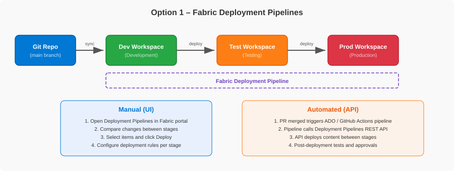
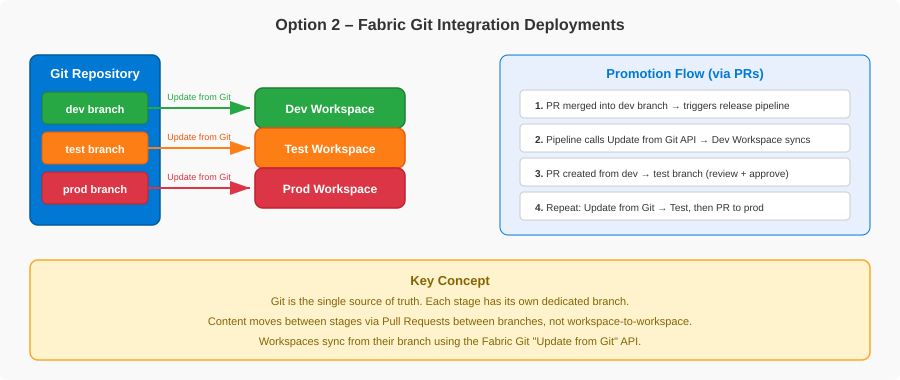
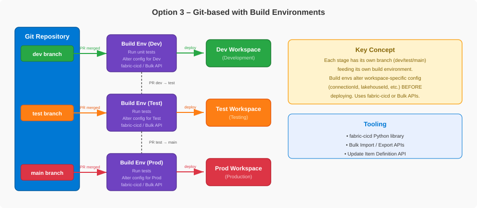

# Microsoft Fabric — SDLC & CI/CD

<div align="center">

**[▶ Start the walkthrough](#1-why-cicd-in-fabric)**  ·  **[Jump to the agenda](#agenda)**  ·  **[One‑slide summary](#one-slide-summary)**

</div>

---

## One-slide summary

| | |
|---|---|
| **The problem** | A Fabric workspace is a *shared, live* environment. Editing it directly affects everyone. You need a disciplined way to move items **and data** from Dev → Test → Prod. |
| **The building blocks** | Git integration (version control), a development process (isolated feature work), and a release strategy (how content is promoted). |
| **The decision** | Three release options exist. This repo uses **Option 3 — Git‑based with a build environment**, with **fabric-cicd non-bulk** as its default and recommended starting point. |
| **The shape** | Three branches (`dev`, `test`, `main`) → three workspaces (Dev, Test, Prod). Dev is Git‑connected; Test/Prod receive deployments via CI/CD. |
| **The guardrails** | Branch protection + an enforced `dev → test → main` promotion path, environment approvals on Prod, least‑privilege service principals, and a full audit trail in Git + GitHub Actions. |
| **The payoff** | Versioned definitions and a traceable release path. Retained definitions/configuration support recovery; data requires a separate plan. |
| **The implementation** | Branch Out tools and GitHub deployment/ETL examples. Native-pipeline extensions are optional design guidance, not shipped workflows; broader enterprise controls also need owner configuration. |

<div align="center">

**[▶ Begin: Why CI/CD in Fabric](#1-why-cicd-in-fabric)**

</div>

---

## Agenda

| # | Section | What you'll take away |
|---|---------|------------------------|
| 1 | [Why CI/CD in Fabric](#1-why-cicd-in-fabric) | The core problem CI/CD solves in Fabric |
| 2 | [Two realities to understand first](#2-two-realities-to-understand-first) | How Fabric items differ — and why it drives everything |
| 3 | [How Git integration works in Fabric](#3-how-git-integration-works-in-fabric) | The foundation all release options build on |
| 4 | [How developers work day to day](#4-how-developers-work-day-to-day) | Isolated feature work with Branch Out |
| 5 | [Choosing a release strategy](#5-choosing-a-release-strategy) | The three options, compared honestly |
| 6 | [Repository default and optional extensions](#6-repository-default-and-optional-extensions) | The starting point and when another publisher might be needed |
| 7 | [Reference architecture](#7-reference-architecture) | Branches, workspaces, and the end‑to‑end flow |
| 8 | [How the deployment actually works](#8-how-the-deployment-actually-works) | Three-phase publication, config strategy, workflows |
| 9 | [fabric-cicd versus the Bulk APIs](#9-fabric-cicd-versus-the-bulk-apis) | The tooling choice inside Option 3 |
| 10 | [Governance and guardrails](#10-governance-and-guardrails) | Identity, RBAC, approvals, audit |
| 11 | [Where Bicep and Terraform fit](#11-where-bicep-and-terraform-fit) | Infrastructure vs content — a key distinction |
| 12 | [When things go wrong](#12-when-things-go-wrong) | Hotfix and rollback playbooks |
| 13 | [Recap and next steps](#13-recap-and-next-steps) | The punchline and where to start |

---

## 1. Why CI/CD in Fabric

> **Takeaway:** A Fabric workspace is a shared, live environment. Any change made directly in it affects every user. CI/CD gives you a disciplined path to move both **items and data** across Dev, Test, and Prod.

Microsoft Fabric workspaces contain **items** — notebooks, pipelines, lakehouses, semantic models, reports, and more — that must move reliably between development, test, and production. But there is a second half most teams forget: **data** must also be ingested and transformed at each stage so you can validate that everything works end to end.

CI/CD in Fabric provides the mechanisms to:

- **Version‑control** items and track changes over time.
- **Automate** their deployment across stages.
- **Run the data workflows** (ETL) that make each stage a realistic test of the last.

The single most important idea to internalize:

> **The Fabric workspace is a shared, live environment.** Any change made directly in it affects all users. Always work in an isolated feature workspace or local environment and merge changes through Pull Requests.

Everything else in this walkthrough is a consequence of taking that idea seriously.

<div align="center">

[▲ Agenda](#agenda) · [Next: Two realities ▶](#2-two-realities-to-understand-first)

</div>

---

## 2. Two realities to understand first

> **Takeaway:** Not all Fabric items can be managed the same way, and not all of them store their environment‑specific IDs the same way. These two facts shape your entire CI/CD strategy.

### Reality 1 — Source control and deployment support are independent

| Capability | Check for each item/subtype | What it establishes |
|---|---|---|
| **Fabric Git integration** | Can Fabric serialize and sync the definition? Check the [Git supported-items list](https://learn.microsoft.com/en-us/fabric/cicd/git-integration/intro-to-git-integration#supported-items). | Native Git tracking, branching, and code review — not publisher support. |
| **fabric-cicd publishing** | Does the chosen [library version](https://microsoft.github.io/fabric-cicd/latest/) support definition deployment with the intended identity? | A library-based release route — not proof of Git or native pipeline support. |
| **Native Deployment Pipelines** | Does the [native service](https://learn.microsoft.com/en-us/fabric/cicd/deployment-pipelines/intro-to-deployment-pipelines#supported-items) support the item and identity? | A possible separate publisher, not an automatic fallback for a library gap. |
| **Other routes / manual exceptions** | Is another approved definition export/deployment API available? What still needs manual configuration? | Capture available definitions/configuration and retain release evidence for exceptions. |

> **Important:** Verify these support surfaces independently for the item/subtype, tool version, and identity. An item unsupported by fabric-cicd may still be Git-tracked or exportable; version definitions/configuration where possible. This repository versions its workload definitions and publishes them with **fabric-cicd non-bulk** by default.

### Reality 2 — Environment IDs are either dynamic or static

Some items resolve environment‑specific values **at runtime**; others have IDs **hardcoded** in their definition files.

| Type | How it works | Examples |
|---|---|---|
| **Dynamic (Variable Library)** | The item reads IDs from a Variable Library at runtime. Switch the active value set → the environment context switches. No file changes. | Notebooks using `notebookutils.variableLibrary.getLibrary()` |
| **Static (hardcoded)** | Physical workspace/item/connection GUIDs need environment-specific replacement; logical IDs remain portable. | Semantic Model Direct Lake URL ([`expressions.tmdl`](../data/fabric/Patterns_Semantic_Model.SemanticModel/definition/expressions.tmdl)), Notebook META lakehouse dependencies, and native-refresh model/connection references in the DataPipeline |

<details>
<summary><b>▸ Deep dive: Actual IDs vs Logical IDs</b></summary>

<br/>

Within the *static* category, there is a further split that determines whether a file must be rewritten at all:

- **Actual IDs** (Semantic Models, Notebook dependencies, DataPipeline model/connections)
  embed physical environment GUIDs. Rewrite the registered references for the target.
- **Logical IDs** (e.g., Ontology, Data Agent) reference other items via the `.platform` `logicalId`, which **Fabric resolves at runtime** within the current workspace. They are **portable** across workspaces and need **no** rewriting.

The tooling rewrites model, Notebook, and registered pipeline physical fields;
Ontology and Data Agent logical references travel unchanged.

</details>

> **Why this matters:** static items need either **deploy‑time parameterization** (`parameter.yml` for CI/CD) or **script‑based rewriting** (for feature branches). Dynamic items just need the right value set activated. Knowing which is which tells you exactly how much work each item type needs.

<div align="center">

[◀ Prev](#1-why-cicd-in-fabric) · [▲ Agenda](#agenda) · [Next: Git integration ▶](#3-how-git-integration-works-in-fabric)

</div>

---

## 3. How Git integration works in Fabric

> **Takeaway:** Git integration connects a *workspace* to a *branch* and syncs all supported items two ways. It is the foundation every release option builds on.

- **Workspace‑level.** You connect a Fabric workspace to a repo, branch, and folder. All supported items sync in one operation.
- **Providers.** Azure DevOps (cloud), GitHub (cloud), GitHub Enterprise (cloud).
- **Two‑way sync.** Changes in the workspace are **committed** to the branch; changes in the repo are **pulled** into the workspace via *Update*. Only one direction syncs at a time.
- **Item definitions become files.** Items are serialized to file‑based definitions (JSON, Python, etc.), preserving folder structure.
- **Items unsupported by Fabric Git integration are ignored by its sync** — they stay in the workspace but are not synced, committed, or deleted by Fabric Git integration. Other export or publishing routes may still be supported.
- **Branch out.** A developer can spin up a new branch *and* a new workspace from a connected workspace, for isolated development.
- **Prerequisites.** Tenant admin switches (Git sync, provider sync, workspace creation) must be enabled, and a Fabric/Premium capacity is required.

> **Important:** Not every item type is supported by Git integration. Always check the official supported‑items list before assuming an item is tracked.

<div align="center">

[◀ Prev](#2-two-realities-to-understand-first) · [▲ Agenda](#agenda) · [Next: Developer workflow ▶](#4-how-developers-work-day-to-day)

</div>

---

## 4. How developers work day to day

> **Takeaway:** Developers never work in the shared workspace. They **branch out** to an isolated workspace, do their work, and merge back through a PR.

The development process is the **same regardless of which release option you choose**. Isolation is the rule.

There are two ways to do isolated feature work:

<details>
<summary><b>▸ Scenario A: Short‑lived feature workspaces (not Git‑synced)</b></summary>

<br/>

`dev` is the only Git‑connected workspace. Feature workspaces are created independently and deployed into with `fabric-cicd`.

- **Positive:** Because the target workspace is *not* Git‑synced, `fabric-cicd` can freely update metadata (this is the flow `fabric-cicd` officially recommends).
- **Issue:** All development happens in the Fabric UI, and syncing changes back to the feature branch is **manual and error‑prone**.

</details>

<details>
<summary><b>▸ Scenario B: Branch Out (Git‑synced feature workspaces) — what this repo uses</b></summary>

<br/>

Fabric's **Branch Out** feature creates a new branch *and* a new workspace, syncing all supported items automatically and connecting the workspace to the feature branch.

- **Positive:** Fabric moves all supported items for you; development and source control are tightly integrated.
- **Issue:** You **cannot** use `fabric-cicd` against a Git‑synced workspace — it pushes directly via APIs and causes **workspace drift** that Git Sync then fights with. The inverse is also true: Git‑synced workspaces should not be `fabric-cicd` targets.

Because of that constraint, this repo uses a Python script to do the metadata rewrites `fabric-cicd` would otherwise handle.

</details>

### The Branch Out lifecycle in this repo

When you branch out from `dev`, several definitions retain **physical Dev/source
references**: the model, Notebook dependencies, and DataPipeline model/connections.
Provision the feature workspace's own Workspace Identity runtime connections
and enter the five feature GUIDs in `.env`; `workspace_swap.py` rewrites the
registered fields, not portable logical IDs.

**Swap to a feature workspace** (after branching out):

<p align="center"></p>

**Swap back to dev** (before opening a PR):

<p align="center"></p>

- **Swap to feature:** uses canonical Dev/source baselines and feature `.env`
  bindings, creates a feature value set, and rewrites model, Notebook, and
  DataPipeline physical references. Connection provisioning is separate.
- **Swap to dev:** reverts everything — restoring dev IDs and deleting the feature value set — **before** you open a PR.
- **PR gate:** `check-pr-ready.yml` blocks the merge to `dev` if dev IDs are not restored or a stray feature value set remains.

<details>
<summary><b>▸ Deep dive: the item‑type registry</b></summary>

<br/>

The **item-type registry** declares file patterns, rewriting, and validation.
New physical reference kinds also need explicit baseline/configuration mappings.

| Item Type | ID Type | Rewritten by the script? | Why |
|---|---|---|---|
| **SemanticModel** | Actual workspace + lakehouse IDs | **Yes** | Direct Lake URL contains real GUIDs |
| **Notebook** | Actual workspace + lakehouse IDs | **Yes** (only if `default_lakehouse` present) | META blocks reference real GUIDs |
| **DataPipeline** | Physical workspace/model/connection IDs | **Yes**, registered fields | Feature IDs restored to Dev/source baselines before PR |
| **Ontology** | Lakehouse logicalId | **No** | Logical IDs are portable |
| **DataAgent** | Ontology logicalId | **No** | Cross‑item logical reference, no env‑specific IDs |
| **VariableLibrary** | Dev lakehouse ID in default set | **Managed** | Value sets created/deleted, not rewritten |

</details>

<div align="center">

[◀ Prev](#3-how-git-integration-works-in-fabric) · [▲ Agenda](#agenda) · [Next: Release strategy ▶](#5-choosing-a-release-strategy)

</div>

---

## 5. Choosing a release strategy

> **Takeaway:** There are three ways to promote content across environments. They trade off Fabric‑native convenience against Git‑as‑source‑of‑truth and configuration power.

<details>
<summary><b>▸ Option 1 — Fabric Deployment Pipelines</b></summary>

<br/>

Git is connected only to **Dev**. Promotion happens **workspace‑to‑workspace** (Dev → Test → Prod) using Fabric's built‑in Deployment Pipelines.

<p align="center"></p>

**Good for:** teams that want Fabric‑native tooling with minimal setup — visual change comparison and deployment history out of the box.

**Watch out for:**
- API lacks "related‑items" awareness — you deploy all content or list every item + dependency by hand.
- Linear structure only — no skipping stages.
- Git directly versions **Dev**; retain known-good definitions/configuration for stage recovery. Deployment history is not a backup, and data recovery is separate.
- Deployment rules cover a limited subset of properties.

</details>

<details>
<summary><b>▸ Option 2 — Fabric Git Integration on every stage</b></summary>

<br/>

Every stage has its own branch, and **each branch is Git‑connected to its workspace**. Promotion is PR‑between‑branches, then *Update from Git*.

<p align="center"></p>

**Good for:** teams that want Git as the **single source of truth** for every stage and follow Gitflow.

**Watch out for:**
- Multiple long‑lived branches → merge complexity and cherry‑pick overhead.
- No Fabric‑native visual comparison or deployment rules.
- Relies on Fabric Git integration on **every** workspace, including Prod — some teams are uncomfortable putting that on the production path (known "ghost commit" drift behaviors).

</details>

<details>
<summary><b>▸ Option 3 — Git‑based with a build environment (this repository's architecture)</b></summary>

<br/>

Every stage has its own branch, and each stage's pipeline spins up a **build environment** that runs tests and applies environment‑specific configuration **before** deploying via REST APIs.

<p align="center"></p>

**Good for:** teams that want Git as source of truth **and** the power to transform config per stage (rewrite connection strings, lakehouse IDs) before deploy. With **`fabric-cicd`**, this is declarative via `parameter.yml` — not custom scripts.

**Watch out for:**
- Most engineering effort upfront (build/release pipelines per stage).
- `parameter.yml` must be kept in sync with item definitions.
- Full deploy every run — `fabric-cicd` does not calculate diffs.
- Test/Prod do **not** require Fabric Git integration — a plus for teams wary of it on the prod path.

</details>

### The honest comparison

| | **Option 1 — Deployment Pipelines** | **Option 2 — Git Integration** | **Option 3 — Build Env** |
|---|---|---|---|
| **Source of truth** | Git (Dev only) + workspaces | Git (all stages) | Git (all stages) |
| **Deployment mechanism** | Deployment Pipelines (UI/API) | Update from Git API | fabric-cicd non-bulk (repository starting point) or alternative API/library routes |
| **Config management** | Deployment rules + autobinding | Post‑deploy API calls | Declarative `parameter.yml` |
| **Visual comparison** | **Yes** | No | No |
| **Deployment history** | **Yes** | No | No |
| **Definition recovery** | Retained known-good source-stage content/configuration | Retained Git revision + target configuration | Retained source/bundle + tool version + target configuration |
| **Setup complexity** | **Low** | Medium | High |
| **Key limitation** | Linear; no dependency resolution in API | Multi‑branch merge complexity | Full deploy every run; param upkeep |
| **Best for** | Fabric‑native, minimal setup | Git as full source of truth (Gitflow) | Build‑time config transformation per stage |

<details>
<summary><b>▸ Common questions</b></summary>

<br/>

**Q - Why not just use Deployment Pipelines? It is Fabric-native with a nice UI.**

It gives visual comparison and deployment history, but Git directly versions Dev only. Retain known-good definitions/configuration for recovery; operation history is not a backup and does not restore data. API scope/dependencies and the linear stage structure also need deliberate design.

**Q - Why not connect every workspace with Git integration (Option 2)?**

That makes Git the source of truth for every stage, which is attractive. The hesitation is putting Fabric Git integration on the **production** path - teams report "ghost commits" (semantically-insignificant changes re-introduced on commit) and Source Control drift they did not make - plus multi-branch merge and cherry-pick overhead.

**Q - Isn't Option 3 the most work?**

Yes, it needs a build/release pipeline per stage. But `fabric-cicd`'s declarative `parameter.yml` removes most of the custom code, and in return you get Git as the source of truth for every stage plus build-time config transformation.

</details>

<div align="center">

[◀ Prev](#4-how-developers-work-day-to-day) · [▲ Agenda](#agenda) · [Next: Default and extensions ▶](#6-repository-default-and-optional-extensions)

</div>

---

## 6. Repository default and optional extensions

> **Takeaway:** **fabric-cicd non-bulk** is this repository's default and recommended starting point. Choose any additional publisher only for a workload requirement with verified item and identity support.

The default implements Option 3's **Git-based deployment**, not a multi-publisher hybrid. Dev Git integration plus API-based releases does not itself combine publishers. The four current repository implementations do not invoke native Fabric Deployment Pipelines; compare them in the [README matrix](../README.md#choose-a-deployment-method). The client-read Deployment Plan adapters are alternative ordering examples, not native Deployment Pipelines.

<p align="center"></p>

- **Three branches:** `dev`, `test`, `main` (production).
- **Three workspaces:** Dev, Test, Prod.
- **Dev** is Git‑connected (the shared development workspace).
- **Test and Prod are NOT Git‑connected** — they receive deployments via fabric-cicd non-bulk by default.

> **The repository default uses one fabric-cicd non-bulk deploy job per environment.** Native Deployment Pipelines are neither required by this default nor implemented by the current routes.

<details>
<summary><b>▸ Deep dive: an optional multi-publisher "sandwich" pattern</b></summary>

<br/>

Only consider a **hybrid publisher extension** when the workload needs another mechanism and its item/subtype, identity, and version support have been verified. A fabric-cicd support gap does not establish native pipeline support. With an approved additional publisher, a conceptual three-layer sandwich could be:

1. Deploy fabric-cicd-owned prerequisites that do not depend on the additional publisher's items.
2. Deploy the separately owned items through the verified additional mechanism — native Deployment Pipelines only if that route supports them and the intended identity.
3. Deploy fabric-cicd-owned items that depend on those results.

Assign one publisher per item and implement cross-publisher dependency ordering, target binding, failure handling, shared workspace locking through validation, and release evidence. That orchestration is **not shipped here**. Retain available definitions/configuration regardless of the publishing route; a publisher gap does not imply no Git history. If the primary publisher later covers the workload, evaluate removing the extension after Test validation.

See [Optional Extensions for Unsupported Items](../fabric-cicd-release-options.md#optional-extensions-for-unsupported-items). Native Deployment Pipelines and Deployment Plans are separate features.

</details>

<details>
<summary><b>▸ Common questions</b></summary>

<br/>

**Q - What about item types `fabric-cicd` doesn't support yet?**

Check Git, library/API, and native pipeline support independently. Version any available definitions and choose an approved alternate route or documented manual exception. A native pipeline is an option only with verified item/identity support and implemented release coordination — not a guaranteed fallback. The repository's default workload does not need that extension.

**Q - Does `fabric-cicd` do incremental (diff) deploys?**

No. It performs a **full deploy every run** by design, so the workspace always matches Git exactly. For very large workspaces this increases deploy time.

</details>

<div align="center">

[◀ Prev](#5-choosing-a-release-strategy) · [▲ Agenda](#agenda) · [Next: Reference architecture ▶](#7-reference-architecture)

</div>

---

## 7. Reference architecture

> **Takeaway:** Feature work flows into `dev`; a PR into `test` triggers an automated deploy + ETL; a PR into `main` does the same for Prod. Source‑branch restrictions enforce the path.

```text
feature/* workspace  (Branch Out, Git-synced to a feature branch)
  │  swap-to-dev, then open a PR
  ▼
dev branch  ──────────▶  Dev workspace  (Update from Git)
  │
  │  PR merge → test    (source branch must be dev)
  ▼
TEST STAGE  (automated)
  • deploy-test.yml   →  fabric-cicd: publish_all_items()
  • on success        →  etl-test.yml: start/poll one DataPipeline
  │
  │  PR merge → main    (source branch must be test)
  ▼
PROD STAGE  (automated + required Prod approval)
  • deploy-prod.yml   →  fabric-cicd: publish_all_items()
  • on success        →  etl-prod.yml: start/poll the same DataPipeline
```

Inside `Patterns_Load_Validate_And_Refresh`: existing load → read-only validation
→ native model refresh, with success dependencies and wait-on-completion.
Fabric is the only refresh owner; GitHub does not run the loader or refresh again.

| Branch | Workspace | Deployment method |
|---|---|---|
| `dev` | Dev | Git‑connected via Fabric Git integration |
| `test` | Test | fabric-cicd non-bulk via GitHub Actions (default) |
| `main` | Prod | fabric-cicd non-bulk via GitHub Actions (default) |

The deploy and ETL are **chained**: the ETL workflow only runs after its deploy workflow succeeds. If the deploy fails, no ETL runs.

`workflow_run` still loads the listener from the default branch. During rollout,
manually dispatch Test ETL from `test` after old automatic runs finish; rerunning
an old main run does not select changed Test code. A same-stage `needs` chain
is a separate follow-up.

<details>
<summary><b>▸ Deep dive: the demo solution being deployed</b></summary>

<br/>

The repository ships a small **healthcare** scenario so the pipeline has something real to move:

- **PatternsLakehouse** (Lakehouse) — holds `doctors`, `patients`, `appointments` Delta tables.
- **Patterns_Ontology** (Ontology) + **Patterns_Data_Agent** (Data Agent) — graph model and a queryable agent over it.
- **Patterns_Variables** (Variable Library) — per‑environment value sets.
- **Import_Patterns_Data**, **Patterns_Patients_Data**, **Patterns_Demo** (Notebooks) — the ETL and demo logic.
- **Validate_Patterns_Data** (Notebook) — read-only schema/key/reference/source-date
  checks and a configurable positive patient minimum, not exact fixture counts.
- **Patterns_Load_Validate_And_Refresh** (DataPipeline) — one load/validation/native-refresh sequence.
- **Patterns_Semantic_Model** (Semantic Model) + **Patterns_Report** (Report) — Direct Lake model and its report.

This mix demonstrates physical IDs, portable logical references, runtime
configuration, and failure-dependent orchestration. `minimum_patient_count`
comes from the active Library (Integer, baseline `5`); `run_label` is an
independent String pipeline parameter (default `manual`, CI override).

Both Notebook activities and refresh use Workspace Identity connections.
An earlier user-started feature prototype completed all three activities and
the API label override. The current explicit-OneLake-path validation revision
is only offline-validated. Git binding resolution, CI service-principal
publication/start, and Test/Prod end-to-end execution remain live-verification
gates. Model-owner source access and consumer/model date queries are separate
checks.

</details>

<div align="center">

[◀ Prev](#6-repository-default-and-optional-extensions) · [▲ Agenda](#agenda) · [Next: How deployment works ▶](#8-how-the-deployment-actually-works)

</div>

---

## 8. How the deployment actually works

> **Takeaway:** Two mechanisms handle configuration (runtime + deploy-time).
> The default non-bulk route publishes this sample in three phases so fresh
> workspace discovery can resolve each dependency chain.

### Configuration strategy — two complementary mechanisms

| | **Variable Libraries (runtime)** | **`parameter.yml` (deploy‑time)** |
|---|---|---|
| **When** | At workload execution | Before items upload to the workspace |
| **Handles** | Loader/validation target values; pipeline Library binding for the validation minimum | Notebook GUIDs and physical pipeline model/connection references |
| **How** | Workloads read the active set; tooling/operator selects and verifies it | `find_replace`, `$items` dynamic replacement rewrite definitions |

> **Rule of thumb:** use **Variable Libraries as the primary mechanism** (clean runtime auto‑binding), and fall back to `parameter.yml` only for deploy‑time metadata that Variable Libraries cannot reach.

<a id="the-twophase-deploy"></a>

### The three-phase publish

fabric-cicd caches workspace state within a publish call. Internal item order
does not expose newly created notebook/model IDs to the pipeline in that same
call. The default runner uses **three publish phases** when DataPipeline is present:

```text
deploy-*.yml triggered
  │
  ▼
PHASE 1 — publish_all_items()     scope: Lakehouse + Ontology
  │   Lakehouse now exists  →  $items.Lakehouse.$id resolves
  │   Ontology now exists    →  Data Agent logicalId resolves
  ▼
PHASE 2 — publish_all_items()     scope: Variable Library, Notebooks,
                                      Semantic Model, Report, Data Agent
  │   Those definitions now exist in the target
  ▼
PHASE 3 — publish_all_items()     scope: DataPipeline
  │   Fresh workspace state resolves Notebook/Model IDs
  │
  ▼
unpublish_all_orphan_items()   →   reconcile eligible repository-managed items
```

Without DataPipeline, the default runner retains two phases. Raw REST also
defers DataPipeline to a third batch but captures IDs from response bodies.
Both plan adapters instead use explicit Library/Import/Validation/Model
prerequisite edges and a current remainder of the Report plus two demo notebooks.
Target Workspace Identity connections are
created outside Git, shared with CI, and supplied through the two
[Environment variables](../SETUP.md#environment-variables).

<details>
<summary><b>▸ Deep dive: first deployment to a clean workspace</b></summary>

<br/>

The very first deploy to a brand-new Test or Prod workspace needs a few **manual** steps that later deploys do not. After the automated deploy + ETL run:

1. **Bind the Ontology's Graph Model to data** - open the Ontology and use **Get data** to point the Graph Model at the lakehouse tables.
2. **Nudge the Ontology to finish initializing** - if it stays on "Setting up your ontology," rename any Entity Type and rename it back. This is a known Fabric platform behavior on first deploy.

Then verify the pipeline, model date fields, calculations, report, and Data Agent.
Publication and pipeline execution do not replace those checks; changed
connections or prerequisites require revalidation on later deployments too.

</details>

<details>
<summary><b>▸ Deep dive: the chicken‑and‑egg problems (and the ETL twist)</b></summary>

<br/>

- **Lakehouse ID.** The Variable Library and Semantic Model need the lakehouse ID, but the lakehouse doesn't exist until the first deploy creates it. Phase 1 creates it so `$items.Lakehouse.PatternsLakehouse.$id` can resolve in Phase 2.
- **Ontology logicalId.** The Data Agent references the Ontology by logical ID. `fabric-cicd` caches workspace state once per call, so the Ontology must already exist (Phase 1) for the Data Agent's reference to resolve (Phase 2).
- **Pipeline activity dependencies.** Library, loader, validation, and model
  precede the pipeline. A fresh phase 3 call resolves phase 2 notebook/model
  IDs rather than relying on order inside one cached call.
- **Pipeline job ID.** The ETL runner resolves `Patterns_Load_Validate_And_Refresh`
  by display name/type via List Items. That lookup does not repair the physical
  activity model/connection IDs, which deployment must parameterize.

Publication phases are repeatable, but publication does not restore data
or verify connections. `fabric-cicd` publishes retained definitions, not an
exact copy of every aspect of workspace state.

</details>

<details>
<summary><b>▸ Deep dive: the GitHub Actions workflows</b></summary>

<br/>

| Workflow | Role |
|---|---|
| `deploy-test.yml` / `deploy-prod.yml` | Standard callers — qualifying pushes to `test` / `main` (Fabric definition or workflow changes) |
| `reusable-deploy-fabric-cicd.yml` | Three publish phases with DataPipeline; two when absent |
| `reusable-fabric-etl.yml` | Starts/polls one Fabric job; passes `run_label` as safe JSON for the pipeline |
| `etl-test.yml` / `etl-prod.yml` | Chain after a successful deploy via `workflow_run` |
| `check-pr-ready.yml` | Blocks feature IDs from merging to `dev` |
| `run-tests.yml` | Runs pytest on every PR, without a path filter |
| `enforce-promotion-path.yml` | Enforces the `dev → test → main` source‑branch path |

This table traces the standard route. Use the
[shared workflow reference](../fabric-hybrid-cicd-guide.md#github-actions-workflows)
for every method's callers, templates, manual triggers, and ETL handoffs.

**Why reusable workflows (not composite actions)?** They support job-level `environment:` and scoped secrets. Reviewers and branch restrictions apply when configured by the owner. Deployment callers filter paths; documentation-only changes do not trigger them.

</details>

<div align="center">

[◀ Prev](#7-reference-architecture) · [▲ Agenda](#agenda) · [Next: fabric-cicd vs Bulk ▶](#9-fabric-cicd-versus-the-bulk-apis)

</div>

---

## 9. fabric-cicd versus the Bulk APIs

> **Takeaway:** Inside Option 3, **fabric-cicd non-bulk** is this repository's default and recommended starting point. The plan adapters and raw REST bulk route remain alternative examples with experimental/preview boundaries.

Both sit inside Option 3 — branch per stage, build environment per stage, deploy from Git. The choice is: a library that solves the common CI/CD problems for you, or a lower‑level API surface you wrap yourself. The library's GA status does not make the experimental plan adapters or bulk publishing route GA; use the [method matrix](../README.md#choose-a-deployment-method) for their support boundaries.

| Dimension | `fabric-cicd` | Bulk Import / Export APIs |
|---|---|---|
| **Maturity** | **GA** | Preview (`?beta=true` required) |
| **Env‑specific config** | `parameter.yml` (declarative) | None at the API level — caller preprocesses |
| **Orphan cleanup** | `unpublish_all_orphan_items()` built in | None — caller's responsibility |
| **Dependency ordering** | Standard order + caller phases; optional plan adapters | Service resolves supported logical relationships; caller may still supply ordering |
| **API call shape** | Non-bulk per-item calls; experimental fabric-cicd bulk also available | One or more caller-managed POSTs |
| **Service principal coverage** | Per item (one unsupported type fails only itself) | Per request (every item must support SPNs or the call fails) |

> **Repository recommendation: start with fabric-cicd non-bulk.** The raw Bulk APIs are still Preview with no parameterization or orphan‑cleanup at the API level — the caller must implement substitution, value‑set activation, and delete logic themselves. Evaluate alternatives against your workload's requirements and verified item/identity support, not a universal ranking. Logical IDs + Variable Libraries or fewer import round trips can change the trade-offs.

<details>
<summary><b>▸ Deep dive: four alternative repository routes</b></summary>

<br/>

A `DEPLOY_METHOD` repository variable selects which deploy method runs:

| `DEPLOY_METHOD` | Behavior |
|---|---|
| `fabric-cicd` *(or unset)* | fabric-cicd non-bulk — the repository default and recommended starting point |
| `fabric-cicd-bulk` | Experimental fabric-cicd bulk + client-read plan, with 1.4.x dynamic replacements; requires `DEPLOYMENT_PLAN_PATH` |
| `bulk` | The Bulk Import API workflows run instead (Preview) |
| `fabric-cicd-plan` | Experimental independent sequential non-bulk ordering adapter; requires `DEPLOYMENT_PLAN_PATH` |
| any other value | All deploy workflows skip (safe default) |

The raw REST bulk path bridges two of the API's gaps in **caller code** — substitution (`bulk-parameter.yml` + `deploy_fabric_rest_bulk.py`) and value‑set activation (a post‑deploy `PATCH`). These remain comparison workarounds. fabric-cicd bulk delegates replacements/activation to the library and preserves eligible fabric-cicd cleanup.

The isolated bulk adapter combines authored ready groups, not native plan execution. Cold/warm Test/Prod fixtures using actual fabric-cicd with mocked HTTP prove sixteen bulk imports total and zero standard definition POSTs with the parameter file present. Live bindings and ETL still require Test validation.

</details>

<details>
<summary><b>▸ Common questions</b></summary>

<br/>

**Q - Should we just wait for the Bulk APIs?**

Not to adopt this repository's starting point: fabric-cicd non-bulk already provides parameterization, value-set activation, and orphan cleanup. Raw REST Bulk APIs are Preview (`?beta=true`); their caller must implement those capabilities. Evaluate that alternative only with ownership of the extra code and validation of its preview and item/identity boundaries.

**Q - When would the Bulk APIs actually make sense?**

When your repo is fully on logical IDs + Variable Library value sets (so you don't need caller-side substitution), when fewer import round trips matter, or when you need a workspace-level export for disaster-recovery snapshots. A bulk operation is not an atomic rollback guarantee. fabric-cicd bulk 1.4.x is a separate experimental option that retains the library's parameterization.

**Q - Any gotcha unique to Bulk?**

Service principal coverage is **per request** - if even one item type doesn't support service principals, the whole call fails. `fabric-cicd` fails only the unsupported item and continues.

</details>

<div align="center">

[◀ Prev](#8-how-the-deployment-actually-works) · [▲ Agenda](#agenda) · [Next: Governance ▶](#10-governance-and-guardrails)

</div>

---

## 10. Governance and guardrails

> **Takeaway:** Configure GitHub-native controls around the pipeline: least-privilege identities, branch rules, required checks, and Production approvals. Fork owners supply these policies; workflow YAML does not create them.

### Pick the right identity for the job

Separate author/job-submitter, deployer, activity, model-owner, and consumer
permissions. Optional application identities are another actor, not a substitute
for the activity credentials.

| Identity | Purpose | Authentication |
|---|---|---|
| **CI/CD service principal** | Publishes definitions and starts/polls the pipeline job from GitHub Actions | Client secret today; **evaluate GitHub OIDC federation** |
| **Fabric Workspace Identity** | Runtime Notebook and native-refresh credentials in this sample; distinct from CI's job-submitter identity | Managed by Fabric; configured in target connections |
| **Runtime workload UAMI** | Apps/Functions calling Fabric APIs at runtime — **not** deploying items | Secretless, managed by Azure |

The feature run was user-submitted with Workspace Identity activities.
CI SP-start and model-owner/consumer compatibility still require live checks.

> **OIDC is the direction for production.** With GitHub OIDC, the workflow exchanges a short‑lived token for an Azure token — no stored client secret, and the trust policy can bind to a specific repo + branch + environment so a feature branch cannot assume the Prod identity.

### The two gates every change passes through

```text
Pull Request
  │
  ▼
GATE 1 — PR checks (before merge)
  • check-pr-ready · run-tests · enforce-promotion-path
  • required code review
  │  pass + merge
  ▼
Deploy workflow
  │
  ▼
GATE 2 — Environment protection (before deploy)
  • Prod: required reviewers
  • deployment branch restricted to main
  │  approved
  ▼
Target workspace
```

- **Environment isolation.** One workspace per environment; one GitHub Environment per workspace with siloed secrets. `test` can only deploy to Test, `main` to Prod.
- **Least privilege.** The CI/CD SP gets **Contributor** (the minimum to publish) on **only** its own workspace — a Test compromise cannot touch Prod. Dev is human‑only; Test/Prod are SP‑only.
- **Promotion path enforced.** PRs into `test` must come from `dev`; PRs into `main` must come from `test`. No direct pushes to protected branches.
- **Deploy‑time approval.** Prod requires designated reviewers to click "Approve and deploy," with an optional wait‑timer abort window. Approvers are independent of PR reviewers (separation of duties).

<details>
<summary><b>▸ Deep dive: audit, separation of duties, and rollback</b></summary>

<br/>

- **Audit trail.** Every PR, review, merge, and deploy approval is recorded with actor, timestamp, and commit SHA. Git history answers "who changed this and why"; Actions run history answers "who deployed it and when."
- **Separation of duties.** Authors can't approve their own PRs (when required approvals are on); the deploy SP cannot grant workspace roles or push to the repo (`GITHUB_TOKEN` locked to `contents: read`).
- **Rollback.** Code rollback is a reviewed `git revert` + redeploy — same gates apply. **Data effects are harder** and company‑specific: plan snapshots/point‑in‑time restore before risky deploys, and *test your rollback path in Test before you need it in Prod.*

</details>

<details>
<summary><b>▸ Deep dive: controls owned outside the pipeline</b></summary>

<br/>

These are part of any mature production Fabric deployment but owned by your **platform / security team**, not the CI/CD pipeline owner. Surface them early so the right specialists can scope them:

- **Network** — Conditional Access, Private Links, Trusted Workspace Access.
- **Encryption & residency** — OneLake encryption at rest (default), customer‑managed keys, multi‑geo.
- **Workspace‑level audit** — item access/sharing via the M365 unified audit log (Purview).
- **Data classification & DLP** — sensitivity labels, DLP policies (note: labels are stripped on Git export).
- **Fine‑grained access** — OneLake security and row/column/object‑level security.
- **Repo & supply‑chain hardening** — secret scanning, CodeQL, Dependabot, dependency review; pin actions to commit SHAs.

</details>

<details>
<summary><b>▸ Common questions</b></summary>

<br/>

**Q - Client secrets in GitHub - is that safe enough for production?**

The demo uses a client secret. For production, evaluate **GitHub OIDC federation**: short-lived tokens replace a stored client secret. Restrict trust to the approved repository/environment and configure deployment-branch rules separately; an environment-based subject alone does not enforce a branch restriction.

**Q - Can a developer deploy straight to Prod, by accident or otherwise?**

With the documented protections configured, branch rules block direct pushes, the source-branch check requires `test → main`, and the protected Prod Environment restricts deployment and requires approval. These controls are not established by cloning YAML alone. The workflow's `GITHUB_TOKEN` has `contents: read`.

**Q - If Test is compromised, can it reach Prod?**

In production you use one service principal per environment, each Contributor on only its own workspace, with secrets siloed in per-environment GitHub Environments. A Test compromise cannot touch Prod.

</details>

<div align="center">

[◀ Prev](#9-fabric-cicd-versus-the-bulk-apis) · [▲ Agenda](#agenda) · [Next: Bicep & Terraform ▶](#11-where-bicep-and-terraform-fit)

</div>

---

## 11. Where Bicep and Terraform fit

> **Takeaway:** Infrastructure‑as‑code provisions the *containers* Fabric runs on. It is a **different layer** from content deployment — don't confuse the two.

> **Key distinction:** Bicep/Terraform provision **infrastructure** (capacities, workspaces, role assignments). `fabric-cicd`, Deployment Pipelines, and Git APIs handle **content deployment** (notebooks, models, reports moving Dev → Test → Prod).

- **Bicep / ARM** — can provision **Fabric capacities only** (`Microsoft.Fabric/capacities`); an Azure Verified Module exists. It does **not** manage workspaces or items.
- **Terraform (microsoft/fabric provider)** — broader: capacities, workspaces, role assignments, domains, gateways, connections, deployment pipelines, Git connections — and it *can* create individual items.

**Can Terraform promote content between environments?** Technically it can *create* items, but it is **not designed for CI/CD promotion**: no parameterization equivalent, state‑drift conflicts when developers edit in the UI, and no concept of "promoting" between stages. Microsoft built `fabric-cicd` specifically for content deployment.

> **Repository starting point:** use **Bicep** for provisioning capacities in your existing Azure IaC pipelines; use Terraform / REST / portal for workspace + role setup; use **fabric-cicd non-bulk** for content. Evaluate other publishers, including native Deployment Pipelines, only where workload requirements and verified support justify them; that extension is not shipped here.

<div align="center">

[◀ Prev](#10-governance-and-guardrails) · [▲ Agenda](#agenda) · [Next: When things go wrong ▶](#12-when-things-go-wrong)

</div>

---

## 12. When things go wrong

> **Takeaway:** Urgent fixes and reviewed reverts follow `dev → test → main` in this repository. Definition recovery and data recovery remain separate.

<details>
<summary><b>▸ Hotfix flow</b></summary>

<br/>

1. Reproduce and fix in an isolated feature workspace/branch; open a reviewed PR into `dev`.
2. Promote `dev → test`, validate the candidate, then promote `test → main` with configured Production authorization.
3. The selected deployment publishes its defined scope; verify configuration, execution, and required smoke checks.

A direct feature/hotfix PR into `main` fails the promotion-path check.
Emergency overrides need a separately approved policy; none is implemented here.

</details>

<details>
<summary><b>▸ Rollback playbook</b></summary>

<br/>

**Code (supported items):**
1. Identify the last fully validated release and its retained definitions, tool version, and target configuration.
2. Create a reviewed corrective/revert commit and promote it through `dev → test → main`, preserving protected history.
3. Check schema compatibility, scope/deletion behavior, and post-recovery results.

**Data:** definitions do not undo data writes. Recovery needs retained restore points/history, source watermarks, and authorized restore/replay with reconciliation. Never reseed Production as a shortcut. See the [Quality Gates recovery guidance](../fabric-cicd-quality-gates-and-release-controls.md#6-failure-handling-and-recovery).

> A rollback you've never exercised is a hope, not a plan. Test it in Test first.

</details>

<div align="center">

[◀ Prev](#11-where-bicep-and-terraform-fit) · [▲ Agenda](#agenda) · [Next: Recap ▶](#13-recap-and-next-steps)

</div>

---

## 13. Recap and next steps

> **Takeaway:** Git as the single source of truth, an enforced promotion path, and automated deploy + ETL at each stage — that's the whole system in one sentence.

**What we covered:**

1. A Fabric workspace is shared and live → work in isolation, merge through PRs.
2. Independent source-control/publishing capabilities and dynamic‑vs‑static IDs drive the strategy.
3. Git integration is the foundation; developers **Branch Out** for isolated work.
4. Three release options exist; this repo uses **Option 3** with **fabric-cicd non-bulk** as its default and recommended starting point.
5. Three branches, three workspaces, automated deploy + ETL per stage.
6. Configuration is handled by Variable Libraries (runtime) + `parameter.yml` (deploy‑time).
7. Governance is GitHub‑native: least privilege, enforced promotion path, Prod approvals, full audit.

> **Use this as a reference implementation.** Four publishers share one Fabric workload pipeline. Configure and verify identities, connections, bindings, and release evidence in your own targets; optional native Deployment Pipelines publisher extensions, OIDC, and broader release demonstrations are not implemented here.

**A newcomer's starting checklist:**

- [ ] Provision a Fabric/Premium capacity and three workspaces (Dev, Test, Prod).
- [ ] Connect the **Dev** workspace to the `dev` branch via Fabric Git integration.
- [ ] Create a CI/CD **service principal**; grant **Contributor** on Test and Prod.
- [ ] Create GitHub **Environments** (`Test`, `Prod`) with scoped secrets; add Prod approval.
- [ ] Create each target's Workspace Identity Notebook/Power BI connections,
      share use with CI, and set both Environment connection variables.
- [ ] Create `dev`, `test`, `main` branches with protection + the enforced promotion path.
- [ ] Leave `DEPLOY_METHOD` unset or set it to `fabric-cicd` for the default non-bulk route; evaluate alternatives only for specific requirements.
- [ ] Develop on a feature branch → merge to `dev` → `test` (deploys) → `main` (deploys).

<details>
<summary><b>▸ Where to go deeper in this repository</b></summary>

<br/>

| Document | What it covers |
|---|---|
| [README](../README.md) | Reader entry points and the four-method comparison |
| [Setup](../SETUP.md) | Ordered fork/workspace/configuration instructions |
| [Release options](../fabric-cicd-release-options.md) | Strategy and optional architectural extensions |
| [fabric-cicd Non-Bulk CI/CD Guide](../fabric-hybrid-cicd-guide.md#github-actions-workflows) | Default implementation and shared caller, trigger, template, runner, and ETL handoff reference |
| [Raw REST Bulk](../fabric-bulk-cicd-guide.md) | Direct API payload/substitution implementation |
| [Deployment Plan adapters](../fabric-deployment-plan-guide.md) | Independent fabric-cicd non-bulk/bulk ordering examples |
| [Development process](../fabric-development-process.md) | Branch Out and the post-merge shared-Dev handoff |
| [Governance](../fabric-cicd-governance-considerations.md) | Identity and administrator-configured protections |
| [Quality gates](../fabric-cicd-quality-gates-and-release-controls.md) | Recommended validation, release evidence, and recovery controls |

</details>

<div align="center">

**Thank you.**

[◀ Prev](#12-when-things-go-wrong) · [▲ Back to the agenda](#agenda) · [▲▲ Back to the top](#microsoft-fabric--sdlc--cicd)

</div>
