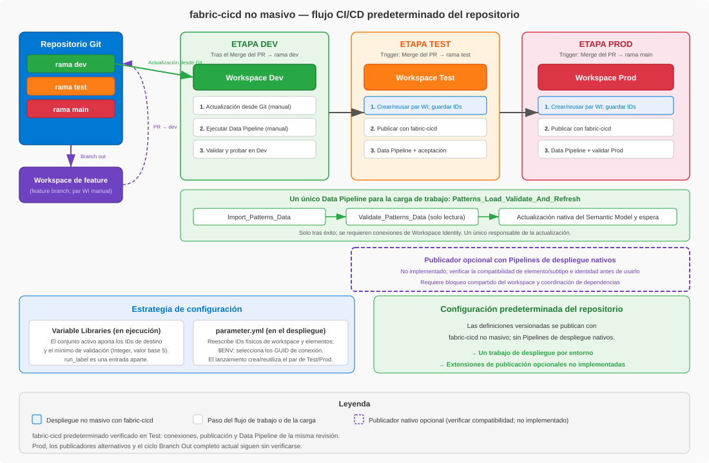

[English](../../README.md) | **Español**

<!-- source: README.md @ f7f949d | translated: 2026-10-15 -->

> 📄 **La versión en inglés de este documento es la de referencia.** En caso de discrepancia, [el original en inglés](../../README.md) tiene precedencia.

# Patrones de SDLC para Microsoft Fabric

Implementación de referencia para el desarrollo y CI/CD en Microsoft Fabric con GitHub Actions y la biblioteca de Python [fabric-cicd](https://microsoft.github.io/fabric-cicd). Incluye un flujo de desarrollo con **Branch Out**, cuatro implementaciones de despliegue seleccionables y un único *Data Pipeline* de Fabric que carga datos, los valida y actualiza un *Semantic Model*. Las guías también abordan controles de producción y extensiones de arquitectura que los ejemplos no implementan en su totalidad.

*Basado en la experiencia de campo con clientes y partners de Microsoft Fabric. Las opiniones aquí expresadas son propias y no representan la guía oficial de Microsoft.*

---

## ¿A quién está dirigido?

Este repositorio responde a cuatro necesidades habituales:

| Si se necesita… | Punto de partida |
|---|---|
| Configurar un fork y sus entornos de Fabric | [Configuración](SETUP.md) |
| Desarrollar en un workspace aislado mediante Branch Out | [Proceso de desarrollo](fabric-development-process.md) |
| Promover de Dev a Test y de Test a `main`/Prod | [Proceso de lanzamiento](fabric-release-process.md) |
| Elegir una arquitectura o definir controles de producción | [Opciones de lanzamiento](fabric-cicd-release-options.md), [Gobernanza](fabric-cicd-governance-considerations.md) y [Controles de calidad](fabric-cicd-quality-gates-and-release-controls.md) |

## Por dónde empezar

Conviene empezar con fabric-cicd sin publicación masiva, la opción predeterminada del repositorio. Antes de evaluar otro publicador, debe comprobarse que esa ruta funciona en el workspace de Test de la organización.

### El ciclo de vida en un minuto

1. Quien administra el repositorio de GitHub configura el fork y los entornos de GitHub; quienes administran Entra y Fabric configuran las identidades, las opciones de inquilino, los workspaces y los permisos.
2. Quien administra el repositorio aprovisiona manualmente el par de conexiones de la *Workspace Identity* de Dev. La persona designada para operar el workspace de Dev inicializa el workspace conectado a Git y registra los IDs canónicos de Dev.
3. Se hace Branch Out desde Dev para desarrollar una *feature*. Quien administra el workspace de feature crea su Workspace Identity y sus conexiones; después se cambian las referencias y se realizan las pruebas.
4. Antes del *pull request* (solicitud de cambios, PR) de la feature, se restauran las referencias de Dev. Tras el *Merge* del PR, la persona que opera el workspace de Dev selecciona **Update all** y ejecuta el Data Pipeline de Fabric.
5. El merge revisado de `dev` a `test` inicia el trabajo de lanzamiento seleccionado. Este crea o reutiliza y verifica las conexiones de Test, publica las definiciones y ejecuta el Data Pipeline de la misma revisión.
6. Una vez aceptado Test, el merge revisado de `test` a `main` aplica el mismo contrato a Prod, con las protecciones de Prod que se hayan configurado.

El [Proceso de lanzamiento](fabric-release-process.md) describe los límites entre flujos de trabajo e identidades de los pasos 5 y 6.

## Elegir un método de despliegue

La variable de repositorio `DEPLOY_METHOD` selecciona el trabajo de despliegue para Test y Prod. Si no se define, se selecciona `fabric-cicd`. La tabla describe las implementaciones incluidas aquí, no todas las funciones de las API subyacentes. «Sí» y «No» indican si el método usa esa capacidad; no indican si un método es mejor que otro.

Los valores exactos y su ubicación en la interfaz de GitHub están en [Configuración: variables del método de despliegue](SETUP.md#variables-del-método-de-despliegue). Para fabric-cicd masivo en concreto, véase la [configuración de fabric-cicd-bulk](SETUP.md#fabric-cicd-bulk-settings).

| `DEPLOY_METHOD` | Publicador | Definiciones en bloque | Orden y tratamiento del plan | Archivo de sustituciones | Verificación en un entorno real para esta revisión |
|---|---|---|---|---|---|
| [`fabric-cicd`](fabric-hybrid-cicd-guide.md): opción predeterminada, sin publicación masiva | fabric-cicd | No | Fases propias en Python + orden de fabric-cicd | [parameter.yml](../../data/fabric/parameter.yml) | Ruta predeterminada en Test verificada |
| [`fabric-cicd-plan`](fabric-deployment-plan-guide.md#cómo-funciona) | fabric-cicd | No | Deployment Plan interpretado por el adaptador | [parameter.yml](../../data/fabric/parameter.yml) | Aún sin verificar en un entorno real |
| [`fabric-cicd-bulk`](fabric-deployment-plan-guide.md#adaptador-masivo-independiente-14x) | fabric-cicd | Sí | Deployment Plan interpretado por el adaptador | [parameter.yml](../../data/fabric/parameter.yml) | Aún sin verificar en un entorno real |
| [`bulk`](fabric-bulk-cicd-guide.md) | REST directo: código Python propio | Sí | Fases propias en Python | [bulk-parameter.yml](../../data/fabric/bulk-parameter.yml) | Aún sin verificar en un entorno real |

Significado de las modalidades de ordenación:

- **Fases propias en Python:** el ejecutor elige las fases sin leer un *Deployment Plan*.
- **Deployment Plan interpretado por el adaptador:** el adaptador del repositorio lee el plan y calcula el orden de publicación. Fabric no ejecuta el plan de forma nativa en estas rutas. Los adaptadores leen el archivo indicado por `DEPLOYMENT_PLAN_PATH` —normalmente [este plan.yml](../../data/fabric/DeploymentPlan.DeploymentPlan/plan.yml)— para seleccionar los elementos que publicará fabric-cicd. La ruta sin publicación masiva usa grupos secuenciales; la masiva combina los grupos que ya pueden ejecutarse. El plan no se pasa a fabric-cicd ni se incluye en las solicitudes REST.
- **Deployment Plan ejecutado por la plataforma:** modalidad reservada para una ruta futura que incluiría el plan en la solicitud REST para que Fabric ejecutara su ordenación. Actualmente no está implementada ni se puede seleccionar.

- La biblioteca de Python fabric-cicd también llama a API REST. «REST directo» significa que el repositorio se encarga de la publicación y las sustituciones sin fabric-cicd.
- Ninguna de estas rutas utiliza los **Pipelines de despliegue de Fabric** nativos: son un servicio de promoción entre workspaces, distinto de los Deployment Plans y del **Data Pipeline** que ejecuta la carga de trabajo del ejemplo.
- **Híbrido** describe una arquitectura opcional que combina publicadores según las necesidades de la carga de trabajo; no es otro valor de `DEPLOY_METHOD` ni la recomendación predeterminada.
- La ruta de fabric-cicd sin publicación masiva es el punto de partida recomendado en este repositorio. Ambos adaptadores basados en planes usan el despliegue selectivo experimental. La documentación actual de Microsoft muestra el *endpoint* v1 de Bulk Import sin `?beta=true`, mientras que el cliente REST directo del repositorio sigue enviando ese parámetro antiguo y no se ha verificado en un entorno real. Debe ajustarse a la documentación actual antes de usarlo.
- Los flujos de trabajo de fabric-cicd usan `fabric-cicd>=1.4.0,<1.5.0` y Python 3.12. La publicación masiva de fabric-cicd admite las sustituciones dinámicas filtradas de este repositorio; la ruta REST directa tiene su propio motor de sustituciones.
- Las dos rutas basadas en planes requieren `DEPLOYMENT_PLAN_PATH`. Cambiar de ruta no inicia una ejecución por sí solo; véanse los [eventos que activan los flujos de trabajo](fabric-release-process.md#qué-activa-cada-ejecución).

### Ejemplos implementados frente a recomendaciones de producción

Los flujos de trabajo actuales usan secretos de cliente de *Service principals*. Quien mantiene el fork debe configurar las reglas de rama y la protección de entornos de GitHub; el YAML de los flujos de trabajo no crea esas políticas. Completar la carga, la validación del origen y la actualización nativa del modelo no equivale a disponer de todos los controles de calidad de una organización. Las [recomendaciones de lanzamiento](fabric-cicd-quality-gates-and-release-controls.md) describen las evidencias y los controles adicionales que deben diseñarse para cada carga de trabajo. Se han registrado como trabajo futuro ejemplos específicos de [aprobación](https://github.com/michaeldeongreen/microsoft-fabric-sdlc-patterns/issues/82), [reversión](https://github.com/michaeldeongreen/microsoft-fabric-sdlc-patterns/issues/81), [OIDC](https://github.com/michaeldeongreen/microsoft-fabric-sdlc-patterns/issues/84) y [Azure DevOps](https://github.com/michaeldeongreen/microsoft-fabric-sdlc-patterns/issues/85).

El 14 de octubre de 2026, el lanzamiento predeterminado de fabric-cicd en Test completó las comprobaciones previas de GitHub, la creación o reutilización y verificación de conexiones de Workspace Identity, la verificación del rol Owner del grupo administrador de conexiones, la persistencia de IDs, la publicación y la ejecución del Data Pipeline de Fabric de la misma revisión en la [ejecución 38581072000](https://github.com/michaeldeongreen/microsoft-fabric-sdlc-patterns/actions/runs/38581072000). Ese resultado no certifica Prod, los tres métodos alternativos, un ciclo completo de Branch Out con la revisión actual, el comportamiento con recursos nuevos frente a reutilizados, la propiedad del modelo, los resultados de DAX o de los informes, ni los permisos de quienes consumen los datos. Véase la [matriz de verificación](fabric-release-process.md#estado-de-la-verificación).

---

## Arquitectura

El diagrama siguiente muestra la ruta predeterminada de fabric-cicd sin publicación masiva. Los otros métodos sustituyen su implementación de despliegue y comparten la plantilla de ETL de la misma revisión. GitHub inicia `Patterns_Load_Validate_And_Refresh` y consulta periódicamente el estado del trabajo del pipeline. Fabric controla las actividades que dependen del éxito de las anteriores y la única actualización del modelo.

En este ejemplo, la publicación predeterminada, no masiva, usa tres llamadas: Lakehouse + Ontology → elementos dependientes distintos de Data Pipeline → Data Pipeline. La tercera llamada descubre los nuevos IDs de los Notebooks y del modelo a partir de un estado actualizado del workspace. Publicar las definiciones no ejecuta las actividades del pipeline.

```
Feature branch (feature/*)
  │
  │  PR → rama dev
  ▼
Repositorio Git (rama dev)
  │  Interfaz de Fabric: Update all → ejecutar el pipeline de Dev a mano
  │
  │  Merge del PR → rama test (el origen debe ser dev)
  ▼
┌──────────────────────────────────────────────────────────────┐
│  deploy-test.yml                                             │
│    ├─ conexiones WI de Test: crear/reutilizar y guardar IDs  │
│    ├─ fabric-cicd: publish_all_items()                       │
│    └─ needs: deploy                                          │
│  run-etl (misma revisión del flujo de trabajo)               │
│       └─ API REST de Fabric: ejecutar DataPipeline y esperar │
└──────────────────────────────────────────────────────────────┘
  │
  │  Merge del PR → rama main (el origen debe ser test)
  ▼
┌──────────────────────────────────────────────────────────────┐
│  deploy-prod.yml                                             │
│    ├─ conexiones WI de Prod: crear/reutilizar y guardar IDs  │
│    ├─ fabric-cicd: publish_all_items()                       │
│    └─ needs: deploy                                          │
│  run-etl (misma revisión del flujo de trabajo)               │
│       └─ API REST de Fabric: ejecutar DataPipeline y esperar │
└──────────────────────────────────────────────────────────────┘
```

Dentro de Fabric:

```text
Patterns_Load_Validate_And_Refresh
  Import_Patterns_Data
    -> Validate_Patterns_Data
      -> actualización nativa de Patterns_Semantic_Model (esperar a que termine)
```

El Notebook de carga existente no cambia. El nuevo Notebook es de solo lectura: comprueba los esquemas, las claves obligatorias, las referencias de citas médicas, los tipos de las columnas de fecha del origen y un mínimo configurable de pacientes, no recuentos exactos de filas del ejemplo. Si falla la carga o la validación, se omite la actualización; si falla la actualización, falla el pipeline. GitHub no realiza una segunda actualización.

| Parámetro del ejemplo | Origen | Propósito |
|---|---|---|
| `minimum_patient_count` | Valor positivo de tipo **Integer** en el conjunto de valores activo de `Patterns_Variables`; valor de referencia `5` | Política del entorno que el pipeline pasa al Notebook de validación mediante su vinculación con la Library |
| `run_label` | Parámetro independiente del pipeline de tipo **String**; valor predeterminado `manual` | Contexto de cada ejecución, que CI puede proporcionar mediante `RUN_LABEL` y que se reenvía a la validación |

Para el modelo **Direct Lake on OneLake** de este ejemplo, la actualización realiza el proceso de *framing* de las referencias a las tablas Delta después del ETL; no vuelve a cargar los datos ni cambia el modo de almacenamiento. La validación del origen y la finalización de la actualización no demuestran que funcionen las consultas sobre campos de fecha del modelo, los resultados de DAX ni el acceso de quienes consumen los datos. Véanse el [contrato común del proceso posterior al ETL](fabric-release-process.md#actualización-del-semantic-model-posterior-al-etl) y los [permisos de actualización](SETUP.md#permisos-para-la-actualización-posterior-al-etl).

Cada flujo de trabajo de despliegue ejecuta el trabajo compartido del pipeline mediante `needs` después de publicar correctamente. El despliegue y el ETL usan la misma revisión de la rama: Test ya no depende de un flujo receptor de ETL almacenado en `main`. Los flujos de trabajo de ETL que se pueden lanzar por separado son herramientas de recuperación, no receptores automáticos. Los nombres para mostrar de los flujos de despliegue cambiaron a `Deploy and Run Pipeline` para evitar que los receptores antiguos de la rama predeterminada activen un segundo ETL durante la transición.

La protección de ramas —PR obligatorio, restricciones de rama de origen y comprobaciones de estado— se aplica mediante los *rulesets* de ramas de GitHub y el flujo de trabajo [enforce-promotion-path.yml](../../.github/workflows/enforce-promotion-path.yml). Véanse las [Consideraciones de gobernanza](fabric-cicd-governance-considerations.md).

### Extensiones opcionales de la arquitectura

Conviene empezar con la ruta sin publicación masiva descrita arriba. Si el publicador seleccionado no cubre una carga de trabajo, debe verificarse la compatibilidad de otro con los elementos y las identidades antes de incorporarlo. Los Pipelines de despliegue nativos son una posible extensión, no una alternativa automática para los elementos que carecen de integración de Git.



La ilustración incluye una extensión opcional con Pipelines de despliegue nativos. El apartado [Extensiones opcionales para elementos no compatibles](fabric-cicd-release-options.md#extensiones-opcionales-para-elementos-no-compatibles) detalla sus límites de compatibilidad e implementación; ninguno de los cuatro métodos incluidos la invoca.

---

## Documentación

| Documento | Descripción |
|---|---|
| [Guía de configuración](SETUP.md) | Punto de partida para ejecutar un fork propio. Incluye responsables, requisitos previos, workspaces de Fabric, configuración de GitHub, inicialización de Dev y primera promoción. |
| [Proceso de desarrollo](fabric-development-process.md) | Branch Out, conexiones y cambios de referencias de feature, vuelta a Dev y actualización y ejecución manuales de Dev. |
| [Proceso de lanzamiento](fabric-release-process.md) | Flujo común de Dev a Test y de Test a `main`/Prod, preparación y verificación automáticas de conexiones, flujos invocadores, traspaso al Data Pipeline, recuperación y estado de verificación. |
| [Opciones de lanzamiento de CI/CD](fabric-cicd-release-options.md) | Compara las arquitecturas de despliegue de Fabric y explica por qué este repositorio empieza con fabric-cicd sin publicación masiva. |
| [Guía de CI/CD con fabric-cicd sin publicación masiva](fabric-hybrid-cicd-guide.md) | Mecánica del publicador predeterminado: tres fases de publicación, parametrización, comportamiento con destinos vacíos y limitaciones propias de la ruta. |
| [Guía de CI/CD masivo con llamadas REST directas](fabric-bulk-cicd-guide.md) | Comparación con la API Bulk Import directa: sustituciones propias, activación del conjunto de valores, fases del cliente y limitaciones. No es la ruta masiva de fabric-cicd. |
| [Guía de CI/CD con Deployment Plan](fabric-deployment-plan-guide.md) | Adaptadores independientes de ordenación sin publicación masiva y con publicación masiva agrupada, descubrimiento de elementos restantes, configuración y límites de validación. |
| [Consideraciones de gobernanza para CI/CD](fabric-cicd-governance-considerations.md) | Identidades, RBAC, protección de ramas y controles de aprobación del pipeline de CI/CD. Incluye referencias a controles de seguridad y cumplimiento gestionados fuera del pipeline. |
| [Controles de calidad y de lanzamiento de Fabric CI/CD](fabric-cicd-quality-gates-and-release-controls.md) | Ejemplos prácticos de validación automatizada de artefactos, evidencias de pruebas, aprobaciones por etapas, etiquetas de lanzamiento, comprobaciones de compatibilidad y reversión. Complementa los controles de gobernanza. |
| [Presentación vigente](presentations/fabric-sdlc-cd.md) | Resumen listo para presentar, derivado de las guías de referencia. |

---

## Conceptos clave

Antes de elegir un enfoque de CI/CD o un flujo de desarrollo, conviene entender estas dos realidades sobre los elementos de Fabric.

### Categorías de seguimiento de elementos

La integración de Git, la publicación basada en archivos y la compatibilidad con el despliegue nativo son capacidades independientes, no categorías de elementos excluyentes. Debe comprobarse cada una para el subtipo de elemento, la versión de la herramienta y la identidad que se pretenda utilizar:

| Capacidad | Qué verificar | Efecto en el flujo de trabajo |
|---|---|---|
| **Integración de Git** | ¿La [integración de Git de Fabric](https://learn.microsoft.com/en-us/fabric/cicd/git-integration/intro-to-git-integration#supported-items) admite el elemento? | Las definiciones compatibles se sincronizan con Git para crear ramas y revisar cambios. Que no haya integración de Git no determina si otra API puede exportar o desplegar el elemento. |
| **Publicador seleccionado** | ¿La versión elegida de fabric-cicd o la API del elemento admite tanto el elemento como la identidad? Véanse los [tipos de elemento de fabric-cicd](https://microsoft.github.io/fabric-cicd/latest/reference/item_types/). | Determina si esa ruta puede publicar las definiciones conservadas y aplicar la configuración necesaria. |
| **Pipelines de despliegue nativos** | ¿Los [Pipelines de despliegue de Fabric](https://learn.microsoft.com/en-us/fabric/cicd/deployment-pipelines/intro-to-deployment-pipelines#supported-items) admiten el elemento con la identidad prevista? | Pueden permitir la promoción entre workspaces cuando existe compatibilidad. Se trata de una ruta opcional e independiente; no demuestra que Git o la publicación basada en archivos no estén disponibles. |

> **Importante:** la compatibilidad evoluciona. Debe comprobarse la documentación oficial de cada mecanismo seleccionado, sin deducir los límites de uno a partir de los de otro.

La [Guía de CI/CD con fabric-cicd sin publicación masiva](fabric-hybrid-cicd-guide.md) explica la ruta predeterminada. Si no cubre la carga de trabajo, conviene consultar las [extensiones opcionales](fabric-cicd-release-options.md#extensiones-opcionales-para-elementos-no-compatibles) y conservar para cada elemento un origen revisado y un método de recuperación. La ruta predeterminada cubre las definiciones de la carga de trabajo de este repositorio sin Pipelines de despliegue nativos; DeploymentPlan es configuración de ordenación y los adaptadores que interpretan el plan no lo publican.

### Variable Libraries: metadatos dinámicos frente a estáticos

Algunos elementos de Fabric resuelven los valores específicos de cada entorno **en tiempo de ejecución** mediante [Variable Libraries](https://learn.microsoft.com/en-us/fabric/cicd/variable-library/variable-library-cicd); otros tienen los IDs del entorno **definidos directamente en sus definiciones**.

| Tipo | Cómo funciona | Ejemplos |
|---|---|---|
| **Dinámico (Variable Library)** | La carga de trabajo resuelve los valores del conjunto activo en tiempo de ejecución. Esto no reescribe las referencias literales de las actividades. | Configuración de destino de los Notebooks de carga y validación mediante `notebookutils.variableLibrary.getLibrary()`; vinculación con la Library del pipeline para `minimum_patient_count` |
| **Estático (definido directamente)** | La definición contiene GUID físicos de workspace, elemento o conexión que deben sustituirse por los del destino, a diferencia de los IDs lógicos portables. | URL de Direct Lake del Semantic Model, dependencias de Lakehouse en los bloques META de los Notebooks, referencias al modelo y a las conexiones del Data Pipeline |

Al diseñar los procesos de desarrollo y CI/CD, hay que identificar qué elementos del workspace son dinámicos y cuáles estáticos. Los estáticos necesitan parametrización en el despliegue (`parameter.yml` para CI/CD) o reescritura mediante script (`workspace_swap.py` para las *feature branches*). El [Proceso de desarrollo](fabric-development-process.md) explica cómo este repositorio gestiona ambos casos.

---

## Inicio rápido

### Requisitos previos

1. Una *Fabric Capacity* adecuada para los tipos de elemento y la ruta de API. La importación masiva directa de tipos de elemento de Fabric requiere una SKU F o Fabric Trial.
2. Workspaces de Fabric para Dev, Test y Prod; solo Dev está conectado a Git.
3. Un Service principal de despliegue con el rol Contributor en cada workspace y una Workspace Identity por workspace con los accesos a recursos necesarios.
4. Entornos de GitHub `Dev`, `Test` y `Prod`, un grupo de confianza para administrar conexiones y un PAT limitado al repositorio para las variables de los entornos.
5. Configuración de inquilino de Fabric que autorice a los usuarios aprobados y al Service principal a usar la integración de Git, las API públicas y la creación de conexiones.

### Configuración

Quien mantenga el fork debería seguir la [Guía de configuración](SETUP.md), que ofrece un recorrido ordenado por los accesos necesarios, la creación de workspaces, la inicialización de Git, la sustitución de IDs de referencia, la configuración de GitHub y el primer despliegue.

Una vez completada la configuración, se usa el [Proceso de desarrollo](fabric-development-process.md) para el trabajo de features y el [Proceso de lanzamiento](fabric-release-process.md) para la promoción.

La acción explícita **Provision Fabric Connections** crea o reutiliza dos conexiones de Workspace Identity para Dev, verifica que el grupo de confianza tenga acceso Owner y guarda sus IDs en variables del entorno de GitHub. Las conexiones de feature las crea una persona. Los lanzamientos seleccionados de Test y Prod ejecutan la misma preparación y verificación de conexiones y la persistencia de IDs, que solo crea variables nuevas, antes de publicar.

El PAT interviene en la ruta de lanzamiento de Test y Prod, limitado a las comprobaciones previas de GitHub y a los pasos de persistencia de variables. El Service principal de despliegue realiza las operaciones de Fabric sobre conexiones, roles de conexión, publicación y envío de trabajos. Después, el subproceso publicador valida y utiliza el par resuelto en modo de solo lectura.

Los IDs locales de Dev se registran en las reglas de parametrización existentes, no en un manifiesto JSON adicional ni en un artefacto descargado. Los cambios de referencias posteriores y la comprobación de referencias para el PR (`--check-ready`) siguen funcionando sin conexión. Véase [Aprovisionar las conexiones de Dev](SETUP.md#4-aprovisionar-las-conexiones-de-dev). Quienes desarrollan nunca necesitan los secretos del Service principal de despliegue. Compartir la administración entre etapas y reutilizar un PAT sin vencimiento son simplificaciones deliberadas del ejemplo, no recomendaciones para producción.

La [matriz de métodos](#elegir-un-método-de-despliegue) sirve para evaluar alternativas una vez comprobada la ruta predeterminada sin publicación masiva. La [guía de planes](fabric-deployment-plan-guide.md) documenta las comprobaciones que detectan y rechazan la vuelta a la publicación estándar en la ruta masiva de fabric-cicd y sus límites de validación. No debe deducirse que una ruta está lista para producción a partir de pruebas del código fuente ni de la verificación de la ruta predeterminada en Test.

---

## Sobre esta traducción

Este documento es una traducción de [README.md](../../README.md). La versión en inglés es la fuente de referencia y puede estar más actualizada.

**Revisión de esta actualización:** asistida por IA, sin nueva validación por hablantes nativos. Se conservan las decisiones terminológicas de las revisiones humanas anteriores, recogidas en [`GLOSARIO.md`](GLOSARIO.md).

La terminología sigue [`GLOSARIO.md`](GLOSARIO.md) y [`GUIA-DE-ESTILO.md`](GUIA-DE-ESTILO.md). La documentación externa se enlaza en inglés para mantener la correspondencia con las interfaces y las fuentes de referencia. Si se prefiere consultar Microsoft Learn en español, puede cambiarse `/en-us/` por `/es-es/` en la URL.

Los errores pueden comunicarse mediante una incidencia que indique el idioma. Si el error también existe en inglés, debe corregirse primero allí; véanse [`REVISION.md`](REVISION.md) y [`TRANSLATION.md`](../../TRANSLATION.md).
