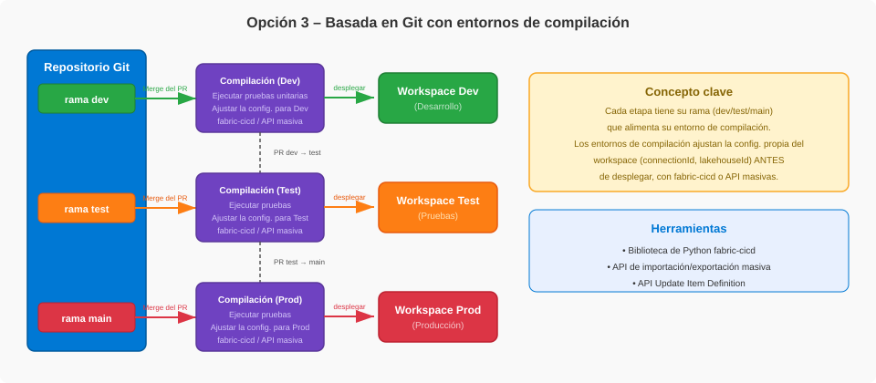

[English](../../fabric-cicd-release-options.md) | **Español**

<!-- source: fabric-cicd-release-options.md @ f7f949d | translated: 2026-10-15 -->

> 📄 **La versión en inglés de este documento es la de referencia.** En caso de discrepancia, [el original en inglés](../../fabric-cicd-release-options.md) tiene precedencia.

# Elegir una arquitectura de lanzamiento de CI/CD en Fabric

Esta guía de estrategia compara las opciones de la plataforma Fabric y sus posibles extensiones. Para las cuatro implementaciones de GitHub incluidas en este repositorio, véase la [matriz de métodos del README](README.md#elegir-un-método-de-despliegue); para los eventos y ejecutores exactos, véase la [referencia común de flujos de trabajo](fabric-release-process.md#flujos-de-trabajo-de-github-actions). Se recomienda empezar con fabric-cicd sin publicación masiva. La arquitectura híbrida con Pipelines de despliegue nativos descrita más adelante es una extensión opcional, no una quinta ruta implementada ni un requisito del método predeterminado.

## Índice

- [Introducción: por qué CI/CD en Fabric](#introducción-por-qué-cicd-en-fabric)
- [La integración de Git en Fabric](#la-integración-de-git-en-fabric)
- [Proceso de desarrollo](#proceso-de-desarrollo)
- [Opciones de lanzamiento](#opciones-de-lanzamiento)
  - [Opción 1 – Pipelines de despliegue de Fabric](#opción-1--pipelines-de-despliegue-de-fabric)
  - [Opción 2 – Despliegues con la integración de Git de Fabric](#opción-2--despliegues-con-la-integración-de-git-de-fabric)
  - [Opción 3 – Basada en Git con entornos de compilación](#opción-3--basada-en-git-con-entornos-de-compilación)
- [Infraestructura y aprovisionamiento de recursos](#infraestructura-y-aprovisionamiento-de-recursos)
- [Resumen comparativo](#resumen-comparativo)
- [Mi recomendación](#mi-recomendación)
  - [Empezar con fabric-cicd sin publicación masiva](#empezar-con-fabric-cicd-sin-publicación-masiva)
  - [Extensiones opcionales para elementos no compatibles](#extensiones-opcionales-para-elementos-no-compatibles)
- [Prácticas recomendadas](#prácticas-recomendadas)
- [Referencias](#referencias)
- [Agradecimientos](#agradecimientos)

---

## Introducción: por qué CI/CD en Fabric

Los workspaces de Microsoft Fabric contienen elementos —*Notebooks*, *Data Pipelines*, *Lakehouses*, *Semantic Models* y otros— que deben pasar de forma fiable entre los entornos de desarrollo, pruebas y producción. Además de los elementos, hay que ingerir y transformar **datos** en cada etapa para validar que todo funcione de principio a fin. CI/CD en Fabric aporta mecanismos para versionar esos elementos, seguir sus cambios a lo largo del tiempo y automatizar su despliegue y sus flujos de datos entre etapas.

---

## La integración de Git en Fabric

### Cómo funciona

- **Integración de ámbito de workspace:** se conecta un workspace de Fabric a un repositorio Git y se sincronizan todos los elementos compatibles en un único proceso.
- **Proveedores de Git compatibles:** Azure DevOps, GitHub y GitHub Enterprise, en sus versiones en la nube.
- **Sincronización bidireccional:** los cambios del workspace de Fabric se **confirman** en la rama de Git. Los cambios del repositorio se **traen** al workspace mediante una actualización. Solo se puede sincronizar una dirección a la vez.
- **Conectar un workspace:** quien administra el workspace lo conecta a un repositorio, una rama y una carpeta concretos. Después, cualquier persona con los permisos necesarios puede confirmar y actualizar.
- **Definiciones guardadas como archivos:** los elementos de Fabric se serializan en definiciones basadas en archivos del repositorio —JSON, Python y otros formatos—. La estructura de carpetas del workspace se conserva en Git.
- **Los elementos no compatibles se ignoran:** permanecen en el workspace, pero no se sincronizan ni se eliminan.
- **Branch Out:** se pueden crear una rama y un workspace nuevos a partir de un workspace conectado para desarrollar de forma aislada.
- **Se requiere configuración del inquilino:** la sincronización con Git, la sincronización con GitHub y la creación de workspaces deben estar habilitadas en el portal de administración de Fabric.
- **Se requiere Fabric Capacity:** la integración de Git necesita una *Fabric Capacity* o una capacidad de Power BI Premium.

### Elementos no compatibles

La integración de Git solo funciona con un conjunto concreto de elementos de Fabric. **Los elementos que no estén en la lista de compatibles se ignoran**: permanecen en el workspace, pero no se sincronizan, confirman ni eliminan.

La [documentación oficial](https://learn.microsoft.com/en-us/fabric/cicd/git-integration/intro-to-git-integration#supported-items), enlazada también en las referencias, contiene la lista completa de elementos compatibles.

> **Importante:** la integración de Git no admite todos los tipos de elemento de Fabric. Debe consultarse la [lista oficial de elementos compatibles](https://learn.microsoft.com/en-us/fabric/cicd/git-integration/intro-to-git-integration#supported-items) antes de dar por hecho que un elemento tiene seguimiento.

---

## Proceso de desarrollo

### Entornos aislados

El proceso de desarrollo es el mismo con independencia de la opción de despliegue elegida. Se debe trabajar de forma aislada, nunca directamente en el workspace compartido del equipo.

En Fabric, el enfoque recomendado para la mayoría de quienes desarrollan es **hacer Branch Out a un workspace independiente**:

1. El workspace compartido de Dev está conectado a la rama de integración del equipo.
2. Se utiliza **Branch out** en la interfaz de Fabric para crear una *feature branch* y un workspace aislado nuevos a partir de Dev.
3. Se realizan los cambios en el **workspace de feature**, sincronizado con la feature branch.
4. Cuando los cambios están listos, se **confirman** en la feature branch.
5. Se crea un *pull request* (PR) en el proveedor de Git para fusionar la feature branch en la rama de integración.
6. El PR pasa por el **proceso de revisión y aprobación** del equipo.
7. Tras la aprobación y el merge, se solicita al workspace de Dev que se **actualice** con el nuevo *commit*. La forma de hacerlo depende de la opción de lanzamiento, como se explica más adelante.

Como alternativa, quienes trabajan con elementos disponibles en herramientas cliente —Power BI Desktop o VS Code, por ejemplo— pueden **clonar el repositorio en local**, modificarlo, hacer commit y push y crear un PR sin un workspace de Fabric independiente.

Este repositorio usa `dev` como rama de integración, no `main`. El [Proceso de desarrollo](fabric-development-process.md) describe su contrato de Branch Out y traspaso de feature a Dev.

---

## Opciones de lanzamiento

### Opción 1 – Pipelines de despliegue de Fabric

En esta opción, Git se conecta únicamente al workspace de **Dev**. Desde ahí, los despliegues se realizan **entre workspaces** —Dev → Test → Prod— mediante los *Pipelines de despliegue* integrados en Fabric.

**Cómo funciona:**

- Se crea un Pipeline de despliegue de Fabric con etapas —por ejemplo, Dev, Test y Prod—, cada una asignada a un workspace.
- El contenido se promueve de una etapa a la siguiente. Los elementos emparejados en el destino se sobrescriben; los nuevos se crean.
- Se pueden configurar **reglas de despliegue** por etapa para sustituir configuraciones —conexiones de bases de datos o parámetros, por ejemplo— durante el despliegue.
- El pipeline admite entre 2 y 10 etapas, despliegue completo o selectivo y seguimiento del historial.

---

**Manual (interfaz):**

1. Abrir **Deployment Pipelines** en el portal de Fabric.
2. Comparar los cambios entre etapas.
3. Seleccionar los elementos que se van a desplegar y pulsar **Deploy**.
4. Opcionalmente, configurar **reglas de despliegue** para ajustar los valores propios de cada etapa, como cadenas de conexión y orígenes de datos.

---

**Automatizado (API):**

1. Se fusiona un PR, lo que activa un pipeline de **Azure DevOps** o **GitHub Actions**.
2. El pipeline llama a la **API REST de Pipelines de despliegue** para promover contenido entre etapas.
3. Las operaciones posteriores —pruebas, ingesta de datos y aprobaciones— se orquestan dentro del pipeline de CI/CD.
4. La misma API permite gestionar por programación el historial, el despliegue selectivo y las reglas de despliegue.

> El [acelerador de fabric-toolbox](https://github.com/microsoft/fabric-toolbox/tree/main/accelerators/CICD/Deploy-using-Fabric-deployment-pipelines) ofrece una implementación de referencia con ADO y GitHub Actions.

---

**API utilizadas en la automatización:**

| Paso | Trigger | Origen | Destino | API REST de Fabric |
|---|---|---|---|---|
| Sincronizar Dev | Merge del PR → rama `main` | Git: rama `main` | Fabric: workspace de Dev | [Actualización desde Git](https://learn.microsoft.com/en-us/rest/api/fabric/core/git/update-from-git) |
| Promover a Test | Promoción manual o automatizada | Fabric: workspace de Dev | Fabric: workspace de Test | [Deploy Stage Content](https://learn.microsoft.com/en-us/rest/api/fabric/core/deployment-pipelines/deploy-stage-content) |
| Promover a Prod | Promoción manual o automatizada | Fabric: workspace de Test | Fabric: workspace de Prod | [Deploy Stage Content](https://learn.microsoft.com/en-us/rest/api/fabric/core/deployment-pipelines/deploy-stage-content) |

---

**Cuándo considerar esta opción:**

- Se quiere usar el **control de código fuente solo para desarrollo** y desplegar los cambios directamente entre etapas.
- Las reglas de despliegue, las vinculaciones automáticas y las API disponibles bastan para gestionar las diferencias de configuración entre etapas.
- Se necesitan funciones nativas de Fabric, como **comparación visual de cambios** e **historial de despliegues**.
- Los Pipelines de despliegue tienen una **estructura lineal** y exigen permisos concretos para crearlos y gestionarlos.

---

**Consideraciones y contrapartidas:**

- **La API no reconoce los elementos relacionados:** a diferencia de la interfaz, la API REST de Pipelines de despliegue no incluye ese concepto. Hay que desplegar todo el contenido o enumerar cada elemento y sus dependencias.
- **Solo estructura lineal:** se impone una ruta como Dev → Test → Prod. No se pueden omitir etapas ni desplegar de forma no lineal.
- **Git conectado solo a Dev:** Git no es la única fuente de verdad de todas las etapas. Test y Prod se convierten, de hecho, en la referencia de sus etapas. Si Dev se pierde o se corrompe, las etapas posteriores no se pueden recuperar solo desde Git.
- **Gestión de configuración limitada:** las reglas solo admiten un subconjunto de propiedades, como conexiones a orígenes de datos y parámetros. Los cambios complejos específicos de cada workspace pueden necesitar llamadas adicionales después del despliegue.
- **Sobrecarga de permisos:** crear y gestionar Pipelines de despliegue requiere permisos de administración en los workspaces de todas las etapas asignadas y una Fabric Capacity para cada workspace.

### Opción 2 – Despliegues con la integración de Git de Fabric

Todos los despliegues parten del repositorio Git y utilizan la integración de Git de Fabric para sincronizar el contenido en cada workspace. Cada etapa del pipeline de lanzamiento tiene su propia rama —por ejemplo, `dev`, `test` y `prod`—, conectada a su workspace. El contenido pasa entre etapas mediante PR entre ramas, no entre workspaces.

**Cómo funciona:**

- El repositorio Git es la **única fuente de verdad** de todas las etapas.
- Cada etapa —Dev, Test y Prod— tiene una rama principal propia que alimenta su workspace.
- El workspace se sincroniza desde su rama mediante la API de **Actualización desde Git**, el mismo mecanismo que pulsar **Update all** en el panel **Source control** de Fabric.
- No hace falta un entorno de compilación: los archivos se suben directamente del repositorio al workspace.
- Después del despliegue pueden llamarse otras API de Fabric para cambiar la configuración o ingerir datos.

---

**Flujo de promoción:**

1. Se fusiona un PR en `dev` y se activa un pipeline de lanzamiento.
2. El pipeline llama a la **API de Actualización desde Git de Fabric** para sincronizar Dev con el último commit.
3. Se crea un PR de `dev` a `test`, a menudo mediante una rama de lanzamiento que selecciona contenido con *cherry-pick*. El PR pasa por revisión y aprobación.
4. Tras el merge, otro pipeline llama a la Actualización desde Git en el workspace de Test.
5. Se crea un PR de `test` a `prod` con el mismo proceso de revisión y aprobación.
6. Tras el merge, Prod se actualiza con la misma API.

---

**API utilizadas:**

| Paso | Trigger | Origen | Destino | API REST de Fabric |
|---|---|---|---|---|
| Sincronizar Dev | Merge del PR → rama `dev` | Git: rama `dev` | Fabric: workspace de Dev | [Actualización desde Git](https://learn.microsoft.com/en-us/rest/api/fabric/core/git/update-from-git) |
| Sincronizar Test | Merge del PR `dev` → rama `test` | Git: rama `test` | Fabric: workspace de Test | [Actualización desde Git](https://learn.microsoft.com/en-us/rest/api/fabric/core/git/update-from-git) |
| Sincronizar Prod | Merge del PR `test` → rama `prod` | Git: rama `prod` | Fabric: workspace de Prod | [Actualización desde Git](https://learn.microsoft.com/en-us/rest/api/fabric/core/git/update-from-git) |

---

**Qué la diferencia de la opción 1:**

- **No intervienen los Pipelines de despliegue:** no existe ese recurso de Fabric. La promoción ocurre mediante PR de Git y la API de Actualización desde Git.
- **Definiciones versionadas para cada etapa:** la recuperación utiliza definiciones conocidas como correctas que se hayan conservado y una configuración de destino revisada. Los datos y demás estados del workspace requieren recuperación independiente.
- **La estrategia de ramas importa:** encaja con **Gitflow**, en el que varias ramas de larga duración corresponden a entornos.

---

**Cuándo considerar esta opción:**

- Se quiere que Git sea la **única fuente de verdad** y el origen de todos los despliegues.
- El equipo sigue **Gitflow**, con varias ramas principales.
- Los archivos pueden subirse directamente al workspace sin un entorno de compilación que los modifique antes.
- Se necesita un origen versionado para recuperar las definiciones de cada etapa, junto con un plan independiente de recuperación de datos y configuración.

---

**Consideraciones y contrapartidas:**

- **Varias ramas de larga duración:** mantener y sincronizar ramas por etapa —dev, test y prod— añade complejidad al merge.
- **Sin comparación visual entre etapas:** no existe una interfaz nativa de Fabric equivalente a la de los Pipelines de despliegue. La comparación se basa en las diferencias de Git de la herramienta de PR.
- **Sin reglas de despliegue:** las diferencias entre etapas se gestionan mediante API posteriores al despliegue o parametrización de las definiciones.
- **Disciplina con los PR:** una revisión deficiente o un PR incompleto afecta directamente al workspace de destino.
- **Complejidad de cherry-pick:** promover un subconjunto suele necesitar ramas de lanzamiento con commits seleccionados, no un merge completo.
- **Dependencia de la integración de Git en los entornos posteriores:** Test y Prod también se sincronizan mediante Fabric Git. A algunos clientes y partners no les resulta adecuado incluir ese mecanismo en la ruta de producción. Entre los comportamientos conocidos están los «*ghost commits*»: cambios sin significado semántico que el motor AS, la normalización de saltos de línea o la serialización del servicio reintroducen al confirmar; también puede aparecer una desviación de cambios sin confirmar en **Source control** que nadie haya realizado. Véanse las [limitaciones de sincronización y confirmación](https://learn.microsoft.com/en-us/fabric/cicd/git-integration/git-integration-process#sync-and-commit-limitations).

### Opción 3 – Basada en Git con entornos de compilación

Todos los despliegues parten del **repositorio Git**, con una rama por etapa —por ejemplo, `dev`, `test` y `main`—. Cada etapa tiene su propio **pipeline de compilación y lanzamiento**, que crea un entorno de compilación para ejecutar pruebas y **adaptar la configuración específica del workspace** antes de desplegar.

Esta es la arquitectura genérica de la opción 3. El repositorio la adapta: Dev sigue conectado a Git y se actualiza y ejecuta manualmente; solo Test y Prod reciben publicaciones por API desde GitHub Actions. Véase el [Proceso de lanzamiento](fabric-release-process.md) implementado.

**Cómo funciona:**

- Git es la **única fuente de verdad** de todas las etapas. Cada una —Dev, Test y Prod— tiene una rama principal propia, como `dev`, `test` y `main`.
- El merge de un PR en la rama de una etapa activa su pipeline de compilación.
- El entorno ejecuta **pruebas unitarias** y aplica **cambios de configuración propios del entorno** antes del despliegue. Con **fabric-cicd**, se declaran en `parameter.yml`, sin un motor de sustituciones propio. El archivo define reglas de búsqueda y sustitución, sustituciones por clave con JSONPath, correspondencias de grupos de Spark y vinculaciones de Semantic Model por entorno.
- El contenido modificado se sube mediante fabric-cicd o un cliente directo de API. La documentación actual de Microsoft muestra el extremo v1 de Bulk Import sin el antiguo contrato Preview/`?beta=true`; las API de exportación son mecanismos independientes cuya madurez debe comprobarse por separado.
- **fabric-cicd realiza un despliegue completo en cada ejecución:** no calcula diferencias entre commits. Se publica cada elemento del ámbito en cada ejecución.
- Tras validar el despliegue de Dev, un PR `dev` → `test` activa el pipeline de Test. El mismo patrón promueve a Prod mediante un PR `test` → `main`.

---

**Flujo de promoción:**

1. El merge de un PR en `dev` activa el **pipeline de compilación** de Dev.
2. El entorno ejecuta las pruebas unitarias y un **pipeline de lanzamiento** aplica la configuración de Dev —mediante `parameter.yml` en fabric-cicd— y sube el contenido.
3. Después se realiza la ingesta y las pruebas. Se crea un PR `dev` → `test`; tras revisarlo y fusionarlo, el pipeline de compilación y lanzamiento de Test repite el proceso con su configuración.
4. Superadas las pruebas automáticas y manuales, se crea un PR `test` → `main`. Tras la revisión y el merge, el pipeline de Prod despliega con la configuración de Prod.

---

**API utilizadas:**

| Paso | Trigger | Origen | Destino | API REST de Fabric |
|---|---|---|---|---|
| Desplegar en Dev | Merge del PR → rama `dev` | Git: rama `dev` → entorno de compilación | Fabric: workspace de Dev | [fabric-cicd](https://microsoft.github.io/fabric-cicd) encapsula [Create Item](https://learn.microsoft.com/en-us/rest/api/fabric/core/items/create-item) y [Update Item Definition](https://learn.microsoft.com/en-us/rest/api/fabric/core/items/update-item-definition) |
| Desplegar en Test | Merge del PR `dev` → rama `test` | Git: rama `test` → entorno de compilación | Fabric: workspace de Test | Igual |
| Desplegar en Prod | Merge del PR `test` → rama `main` | Git: rama `main` → entorno de compilación | Fabric: workspace de Prod | Igual |

> Alternativa: la [API Bulk Import Item Definitions](https://learn.microsoft.com/en-us/rest/api/fabric/core/items/bulk-import-item-definitions) puede usarse directamente en lugar de fabric-cicd. El cliente versionado aún utiliza el parámetro antiguo `?beta=true`; debe ajustarse al contrato actual y verificarse en un entorno real.

---

**Qué la diferencia de la opción 2:**

- **Entorno de compilación con parametrización:** la opción 2 despliega los archivos tal como están mediante Fabric Git. La opción 3 transforma las definiciones antes de desplegar —por ejemplo, cadenas de conexión e IDs de Lakehouse—. Con fabric-cicd se declara en `parameter.yml`.
- **No requiere Fabric Git en Test ni Prod:** la opción 2 exige que todos los workspaces estén conectados a sus ramas. La opción 3 despliega por API REST desde el entorno de compilación sin esa conexión en Test y Prod; resulta útil para equipos que no quieren Fabric Git en la ruta de producción.
- **API distintas:** la opción 2 usa la Actualización desde Git. La opción 3 usa fabric-cicd o API directas de definiciones; hay que verificar el contrato actual de cada mecanismo de importación y exportación.

---

**Herramientas:**

La opción 3 tiene dos implementaciones de herramientas viables. Ambas despliegan desde un entorno de compilación y se activan por el merge de un PR en la rama correspondiente. La elección determina qué debe construir el propio equipo.

- **[fabric-cicd](https://microsoft.github.io/fabric-cicd)**, *GA y recomendado actualmente*: biblioteca de Python para workspaces de Fabric que admite automatización CI/CD con un enfoque basado en código. Usa `parameter.yml` declarativo para la configuración por entorno. Admite:
  - `find_replace`: búsqueda y sustitución de cadenas con expresiones regulares y filtros de archivo por tipo, nombre y ruta del elemento.
  - `key_value_replace`: sustitución por clave con JSONPath en JSON y YAML, como IDs de conexión de pipelines.
  - `spark_pool`: cambio de configuración de grupos de Spark por entorno.
  - `semantic_model_binding`: vinculación automática de Semantic Models a conexiones de origen de datos por entorno.
  - Sustitución dinámica: `$items.<type>.<name>.$id` resuelve el ID del elemento de destino durante el despliegue; `$workspace.$id`, el ID del workspace.
  - Variables `$ENV:`: toman valores de las variables de entorno del pipeline de CI/CD.
  - Plantillas: dividen archivos de parámetros grandes en otros menores mediante `extend`.
  - El [tutorial de fabric-cicd con Azure DevOps](https://learn.microsoft.com/en-us/fabric/cicd/tutorial-fabric-cicd-azure-devops) ofrece un ejemplo de principio a fin.
- **[API Bulk Import Item Definitions](https://learn.microsoft.com/en-us/rest/api/fabric/core/items/bulk-import-item-definitions):** solicitud de importación de definiciones de ámbito de workspace. La documentación actual muestra el extremo v1 sin `?beta=true`. La exportación masiva es una API independiente cuyo estado debe comprobarse por separado. Véase el [tutorial de Bulk Import](https://learn.microsoft.com/en-us/fabric/cicd/tutorial-bulkapi-cicd).
- **[API Update Item Definition](https://learn.microsoft.com/en-us/rest/api/fabric/core/items/update-item-definition):** operación de menor nivel para actualizar la definición de un elemento. fabric-cicd y las API masivas encapsulan esta y otras API de elementos; solo se usaría directamente si ninguna opción de mayor nivel encaja.

---

#### Herramientas dentro de la opción 3: fabric-cicd frente a las API masivas

Ambas implementaciones pertenecen a la opción 3: rama y entorno de compilación por etapa, con despliegue desde Git. La decisión es entre una biblioteca que resuelve problemas habituales de CI/CD y una API de menor nivel que el equipo debe encapsular.

| Dimensión | fabric-cicd sin publicación masiva | Cliente directo de Bulk Import |
|---|---|---|
| **Madurez** | GA | La documentación actual del servicio muestra v1 sin `?beta=true`; el cliente de este repositorio con el parámetro antiguo sigue sin verificar |
| **Configuración por entorno** | `parameter.yml`: `find_replace` y `key_value_replace` declarativos, resolución de `$items` | Ninguna en la API: el cliente debe preprocesar archivos o basarse por completo en Variable Libraries e IDs lógicos. Este repositorio muestra una solución en el código del cliente, descrita bajo la tabla. |
| **Limpieza de huérfanos** | `unpublish_all_orphan_items()` incorporado | Ninguna: la API solo crea y actualiza; el cliente debe eliminar |
| **Orden de dependencias** | Orden de la biblioteca y fases del cliente de este repositorio, o adaptador opcional de planes sin publicación masiva | El servicio resuelve relaciones de IDs lógicos compatibles; la ordenación explícita y las sustituciones de IDs físicos pueden exigir trabajo del cliente |
| **Operaciones de larga duración** | La biblioteca las abstrae | Con `202 Accepted`, el cliente consulta `/operations/{id}` y después `/operations/{id}/result`. Con `200 OK`, el resultado llega directamente, sin sondeo. |
| **Forma de las llamadas** | Muchas llamadas REST por elemento | Este ejemplo usa tres lotes masivos directos: elementos base, dependientes distintos de Data Pipeline y Data Pipeline |
| **Compatibilidad con Service principals** | Por elemento: un tipo no compatible hace fallar ese elemento | Por solicitud: todos los elementos de la carga útil deben admitir Service principals |

> **Nota sobre las carencias de este repositorio.** La API no ofrece estas funciones de configuración. El repositorio implementa dos en el cliente; eso no demuestra compatibilidad de la identidad de CI en un entorno real ni equivalencia de las rutas de principio a fin:
>
> - **Sustitución:** `bulk-parameter.yml` y el ejecutor REST directo resuelven IDs de destino entre tres lotes. Lakehouse y Ontology preceden a los dependientes distintos de Data Pipeline; se captura el ID del Semantic Model antes de publicar el Data Pipeline.
> - **Activación del conjunto de valores de VariableLibrary:** una llamada posterior al despliegue a `PATCH /v1/workspaces/{ws}/variableLibraries/{id}` establece el conjunto activo por entorno.
>
> Son soluciones alternativas, no correcciones de la plataforma. La limpieza de huérfanos, las demás funciones de fabric-cicd —`key_value_replace`, `spark_pool` y `semantic_model_binding`— y la compatibilidad con Service principals por elemento siguen sin implementarse en la ruta masiva directa. Adoptarla implica asumir ese trabajo del cliente. La [Guía de CI/CD masivo con llamadas REST directas](fabric-bulk-cicd-guide.md) describe la implementación completa.

**Cuándo elegir fabric-cicd:**

- Se necesita configuración por entorno declarativa.
- Se necesita limpiar huérfanos durante el despliegue.
- Se quiere una dependencia GA con estabilidad de versionado semántico en la ruta de producción.
- El workspace combina tipos de elemento con compatibilidad desigual con Service principals.

**Cuándo considerar las API masivas:**

- El repositorio usa exclusivamente IDs lógicos y conjuntos de valores de Variable Library, sin necesitar sustituciones de tipo `parameter.yml`.
- Se prefiere una solicitud de importación de ámbito de workspace a llamadas por elemento gestionadas por el cliente; esto no garantiza una reversión si hay un fallo.
- Se mueven muchos elementos y se busca reducir los intercambios de solicitudes y respuestas.
- Se necesita exportación de ámbito de workspace mediante la API Bulk Export, por ejemplo para instantáneas de recuperación ante desastres.

La recomendación actual es fabric-cicd. Bulk Import directo no ofrece compatibilidad con `parameter.yml` ni limpieza de huérfanos en la API, por lo que el cliente debe implementar las sustituciones, la activación de conjuntos y la eliminación. El repositorio demuestra ese coste, pero su cliente con el parámetro antiguo no está verificado en un entorno real frente a la documentación v1 actual.

> El repositorio muestra ambas alternativas. El punto de partida recomendado es fabric-cicd sin publicación masiva; los flujos de REST masivo directo y fabric-cicd masivo se incluyen para evaluación. `DEPLOY_METHOD` selecciona la ruta. La publicación masiva de fabric-cicd ahora usa 1.4.x con el archivo de parámetros existente; si vuelve de forma inesperada a la publicación estándar, el despliegue falla. Véase el [inicio rápido del README](README.md#inicio-rápido).

**La publicación masiva de fabric-cicd en 1.4.x es distinta de REST masivo directo.** Aplica sustituciones filtradas de `$items` y `$workspace`, gestiona las dependencias dinámicas compatibles dentro de una llamada y activa la Variable Library. La mera presencia de un archivo de parámetros no obliga a volver al modo estándar. Los tipos no compatibles o las sustituciones `$items` del workspace actual sin filtrar todavía pueden provocar ese comportamiento; el adaptador estricto del repositorio lo rechaza y comprueba que se haya usado realmente el modo masivo y que todos los elementos hayan terminado correctamente. Esto sustituye la demostración de vuelta al modo estándar anterior a 1.4, no las sustituciones propias del método REST directo que se conserva.

Los dos [adaptadores aislados de Deployment Plan](fabric-deployment-plan-guide.md) interpretan una ordenación explícita y conservan la parametrización de fabric-cicd. El adaptador sin publicación masiva publica un grupo cada vez; el masivo combina grupos independientes que ya pueden ejecutarse. Ninguno ejecuta un plan nativo ni descubre todo el linaje. La API REST directa permite adjuntar un plan, pero fabric-cicd 1.4.0 no expone esa opción.

Todos los intervalos de dependencias de fabric-cicd son `>=1.4.0,<1.5.0`; Actions sigue usando Python 3.12. La [guía de Deployment Plan](fabric-deployment-plan-guide.md#aplicabilidad-de-los-cambios-de-la-versión-140) documenta los demás cambios aplicables de esa versión y los límites de funciones no utilizadas. Las funciones de publicación masiva e inclusión de elementos de la biblioteca siguen siendo experimentales: que la biblioteca sea GA no convierte en GA todas sus funciones opcionales.

---

**Cuándo considerar esta opción:**

- Se quiere Git como **única fuente de verdad** y origen de los despliegues.
- El equipo usa una rama por etapa —`dev`, `test`, `main`— y promoción mediante PR.
- Se necesita un entorno de compilación para **adaptar atributos del workspace**, como `connectionId` y `lakehouseId`, antes de desplegar.
- Se necesita un pipeline de lanzamiento que obtenga contenido de Git y llame a las API de elementos de Fabric para crear, actualizar o eliminar. Con fabric-cicd, buena parte se declara en `parameter.yml`.

---

**Consideraciones y contrapartidas:**

- **Mayor complejidad inicial:** hay que construir y mantener pipelines de compilación y lanzamiento por etapa. Requiere más ingeniería que las opciones 1 y 2, aunque `parameter.yml` reduce el código propio.
- **Mantenimiento de parámetros:** `parameter.yml` debe mantenerse alineado con las definiciones. Si cambian los IDs de Lakehouse, conexiones o nombres de elementos, hay que actualizarlo.
- **Despliegue completo siempre:** se publica cada elemento del ámbito, sin calcular diferencias; puede alargar las ejecuciones en workspaces grandes.
- **Sin interfaz nativa de Fabric:** no hay comparación visual entre etapas ni historial de despliegue de esta ruta en Fabric. La visibilidad la aporta la herramienta de CI/CD.
- **Coste del entorno de compilación:** cada despliegue lo crea y añade tiempo y coste de cómputo.
- **Varias ramas de larga duración:** mantenerlas sincronizadas añade complejidad. Un commit defectuoso puede propagarse al workspace de esa etapa en el siguiente despliegue.

---

## Infraestructura y aprovisionamiento de recursos

### Bicep y Terraform

Bicep y Terraform operan en una **capa distinta** de las opciones de lanzamiento anteriores. Son herramientas de **infraestructura como código (IaC)** para aprovisionar y gestionar los *contenedores y recursos* sobre los que se ejecuta Fabric, no para desplegar contenido entre entornos.

> **Distinción clave:** Bicep y Terraform aprovisionan **infraestructura** —Fabric Capacity, workspaces y asignaciones de rol—. fabric-cicd, los Pipelines de despliegue y las API de Git gestionan el **despliegue de contenido**: Notebooks, Data Pipelines y Semantic Models que pasan por Dev → Test → Prod.

---

**Bicep y plantillas ARM:**

- Solo pueden aprovisionar **recursos de Fabric Capacity**, `Microsoft.Fabric/capacities`, el recurso de Azure que respalda Fabric.
- Permiten configurar la SKU, la región y sus administradores.
- **No gestionan** workspaces, elementos, Pipelines de despliegue, conexiones de Git ni otros recursos del plano de Fabric.
- Existe un [Azure Verified Module (AVM)](https://aka.ms/avm) para `Microsoft.Fabric/capacities`.

---

**Terraform, proveedor microsoft/fabric:**

- El [proveedor oficial de Terraform para Microsoft Fabric](https://registry.terraform.io/providers/microsoft/fabric/latest/docs), v1.9.1, tiene bastante más cobertura que Bicep.
- **Infraestructura:** recursos de Fabric Capacity, workspaces, roles de workspace, dominios, asignaciones de dominio, puertas de enlace y sus roles, conexiones y opciones del inquilino.
- **Configuración de CI/CD:** Pipelines de despliegue, sus roles y conexiones de Git de workspace.
- **También crea elementos individuales:** Notebooks, Lakehouses, Data Pipelines, Variable Libraries, Environments, Semantic Models, Reports, Ontologies y otros.

---

**¿Puede Terraform desplegar contenido entre entornos?**

Técnicamente puede *crear* elementos, como Notebooks, en un destino. Sin embargo, **no está pensado para la promoción de contenido en CI/CD**:

- **Sin parametrización equivalente:** no ofrece `parameter.yml`, `find_replace`, sustitución dinámica de `$items` ni vinculación de Semantic Models. Los cambios de configuración por entorno deben resolverse manualmente en archivos `.tf`.
- **Conflictos por desviación de estado:** Terraform sigue el estado de los recursos. Si se edita un Notebook en la interfaz de Fabric, detecta la desviación e intenta revertirla en el siguiente `apply`.
- **No es promoción:** gestiona de forma independiente los recursos de cada workspace; no tiene el concepto de promover contenido entre etapas.
- **fabric-cicd se creó para esto:** Microsoft lo diseñó para desplegar contenido de Fabric; Terraform se orienta al aprovisionamiento de infraestructura.

---

**Recomendación de infraestructura:**

- Usar **Bicep** para aprovisionar **Fabric Capacity** dentro de los pipelines de IaC de Azure existentes.
- Para **configurar workspaces**, **crear Pipelines de despliegue**, **asignar roles** y **conectar Git**, usar el proveedor de Terraform para Fabric, las API REST o el portal, según la preferencia de IaC del equipo.
- Empezar con **fabric-cicd sin publicación masiva** para desplegar contenido. Añadir otro publicador compatible solo si lo necesita la arquitectura; la ruta predeterminada no requiere Pipelines de despliegue nativos.

---

## Resumen comparativo

| | **Opción 1 – Pipelines de despliegue** | **Opción 2 – Integración de Git de Fabric** | **Opción 3 – Git con entorno de compilación** |
|---|---|---|---|
| **Fuente de verdad** | Git solo para Dev y los workspaces | Git para todas las etapas | Git para todas las etapas |
| **Estrategia de ramas** | Cualquiera; Git solo para Dev | Gitflow, una rama por etapa | Una rama y un entorno de compilación por etapa |
| **Mecanismo de despliegue** | Pipelines de despliegue de Fabric, interfaz o API | API de Actualización desde Git | fabric-cicd sin publicación masiva, recomendado, o cliente directo de API verificado por separado |
| **Configuración** | Reglas y vinculaciones automáticas | API posteriores o parametrización | `parameter.yml` declarativo o scripts propios previos al despliegue |
| **Comparación visual** | Sí, interfaz nativa de Fabric | No, solo diferencias de Git | No, solo diferencias de Git |
| **Historial de despliegues** | Sí, integrado en Fabric | No | No |
| **Recuperación de definiciones** | Conservar contenido y configuración de origen conocidos como correctos; el historial de operaciones no es una copia de seguridad | Revisión conservada de Git y configuración de destino revisada | Origen o paquete conservado, versión de herramientas y configuración de destino |
| **Complejidad de configuración** | Baja | Media | Alta |
| **¿Requiere pipeline de CI/CD?** | Opcional; puede usarse la interfaz manualmente | Sí | Sí |
| **Reconoce elementos relacionados** | Interfaz: sí; API: no | No aplica | Sí: `$items` resuelve IDs de elementos en el despliegue |
| **Limitación principal** | Estructura lineal; la API no resuelve dependencias | Complejidad de merge multirrama; sin reglas de despliegue | Publicación completa siempre; mantenimiento de parámetros |
| **Idóneo para** | Equipos que quieren herramientas nativas con poca configuración | Equipos que quieren Git como referencia completa con Gitflow | Equipos que necesitan transformar configuración en compilación por etapa |

---

## Mi recomendación

### Empezar con fabric-cicd sin publicación masiva

Para este repositorio, recomiendo **fabric-cicd sin publicación masiva** como punto de partida. Publica los elementos de la carga de trabajo a partir de definiciones conservadas, usa `parameter.yml` para la configuración del despliegue y mantiene Dev conectado a Git mientras Test y Prod reciben despliegues por API.

La ruta predeterminada se selecciona estableciendo `DEPLOY_METHOD=fabric-cicd` o dejando la variable sin definir. La [Guía de CI/CD con fabric-cicd sin publicación masiva](fabric-hybrid-cicd-guide.md) describe su implementación y la [matriz de métodos](README.md#elegir-un-método-de-despliegue) presenta las alternativas de planes leídos por el cliente y REST directo. Es una recomendación de punto de partida para este repositorio, no la afirmación de que un método sirva para todas las cargas de Fabric.

**Híbrido** describe una arquitectura que combina publicadores cuando hace falta, no el nombre del método predeterminado. Usar Fabric Git para desarrollo y fabric-cicd para publicar no requiere Pipelines de despliegue nativos.

> **Límite de la implementación:** los cuatro métodos publican mediante su ruta seleccionada de GitHub y comparten el mismo Data Pipeline posterior: carga → validación de solo lectura → actualización nativa del modelo. Ninguno invoca Pipelines de despliegue nativos para promover entre workspaces. DeploymentPlan, leído por el cliente, ordena la publicación; no ejecuta la carga de trabajo.

La rama de Pipelines de despliegue nativos del diagrama es una extensión opcional, no parte del flujo predeterminado. Sus requisitos se describen [más adelante](#extensiones-opcionales-para-elementos-no-compatibles).

---

### Ramas de Git y workspaces

- `dev` corresponde al workspace de Dev conectado a Git.
- `test` corresponde al workspace de Test publicado por API.
- `main` corresponde al workspace de Prod publicado por API.
- Los métodos incluidos no requieren ni crean Pipelines de despliegue nativos.

---

### Flujo de desarrollo

El [Proceso de desarrollo](fabric-development-process.md) documenta el procedimiento implementado de Branch Out, conexiones de feature, cambios de referencias, validación y traspaso de feature a Dev.

---

### Flujo de despliegue

El [Proceso de lanzamiento](fabric-release-process.md) describe el procedimiento común de `dev` a `test` y de `test` a `main`/Prod. En resumen:

1. Dev se actualiza desde Git y se ejecuta manualmente.
2. El trabajo seleccionado de Test o Prod valida automáticamente el acceso a GitHub; crea o reutiliza y verifica el par de conexiones de Workspace Identity de destino; verifica Owner para el grupo administrador de conexiones; guarda los IDs que faltan; publica; y ejecuta el Data Pipeline de Fabric de la misma revisión.
3. `DEPLOY_METHOD` cambia el publicador, no el contrato común de conexiones y Data Pipeline.

La mecánica específica se mantiene en las guías sin publicación masiva, de planes y de REST masivo directo.

---

### Estrategia de configuración

Dos mecanismos complementarios gestionan la configuración por entorno:

| | **Variable Libraries en tiempo de ejecución** | **`parameter.yml` en el despliegue** |
|---|---|---|
| **Cuándo actúa** | Cuando se ejecuta la carga de trabajo | Antes de subir los elementos al workspace |
| **Qué gestiona** | Valores de workspace y Lakehouse de carga y validación; vinculación de la Library del pipeline para el mínimo de validación | GUID de Notebook META, IDs físicos de modelo y conexiones del pipeline, configuración de grupos de Spark y vinculaciones de Semantic Model |
| **Cómo funciona** | La carga lee el conjunto de valores activo; la herramienta de despliegue o una persona debe seleccionar y verificar el conjunto previsto | `find_replace`, `key_value_replace` y `$items` reescriben las definiciones antes de subirlas |

**Se recomienda usar Variable Libraries como mecanismo principal** de vinculación automática. Resuelven los valores en tiempo de ejecución sin reescrituras en el despliegue. `parameter.yml` cubre los metadatos que no alcanzan, como los GUID de `default_lakehouse` de Notebook META y los IDs de conexión en JSON de Data Pipeline.

El ejemplo separa la política del entorno —`minimum_patient_count`, Integer positivo, referencia `5`— de la entrada de cada ejecución —`run_label`, String, predeterminado `manual`, modificable desde CI—. Las conexiones Notebook y Power BI de Workspace Identity se crean fuera de Git. Dev se aprovisiona manualmente; las conexiones de feature las crea una persona; y los trabajos seleccionados de Test y Prod crean o reutilizan y verifican sus pares automáticamente. Los GUID son dos variables del entorno de GitHub, no secretos. El Service principal gestiona las ACL de conexión de Test y Prod antes de que el publicador utilice el par en modo de solo lectura. El uso de las conexiones, el acceso del propietario del modelo al origen y el acceso de quienes consumen los datos se verifican por separado de los permisos de la identidad de despliegue.

---

### Por qué este enfoque

- **Git como fuente de verdad** de las definiciones de la carga de trabajo conservadas y desplegadas en cada etapa.
- **`parameter.yml` de fabric-cicd** para sustituciones del despliegue sin un motor propio.
- **Un publicador para el ámbito actual** evita promoción y coordinación innecesarias entre herramientas.
- **Variable Libraries** para la configuración en tiempo de ejecución de los elementos que las consumen, reduciendo la parametrización del despliegue.
- **Un proceso posterior explícito** inicia un único pipeline de Fabric; la carga y la validación de solo lectura deben terminar correctamente antes de completar la actualización nativa. GitHub no actualiza dos veces.

La ruta predeterminada de fabric-cicd en Test está verificada en un entorno real hasta la preparación de conexiones, la publicación y el Data Pipeline de la misma revisión. Prod, los otros tres métodos y un ciclo completo de Branch Out con la revisión actual siguen sin verificar. Véase el [estado de la verificación](fabric-release-process.md#estado-de-la-verificación).

---

### Extensiones opcionales para elementos no compatibles

No debe deducirse una ruta de despliegue a partir de una única lista de elementos no compatibles. Hay que comprobar por separado:

1. **Integración de Git:** ¿Fabric puede sincronizar la definición con Git?
2. **Publicador seleccionado:** ¿La versión de fabric-cicd o la API elegida puede exportar o desplegar la definición con la identidad prevista?
3. **Pipelines de despliegue nativos:** ¿El servicio admite el subtipo de elemento, la operación de promoción y la identidad?

Que un elemento no admita integración de Git no implica que quede fuera de fabric-cicd u otra API basada en archivos. Tampoco la ausencia de compatibilidad con fabric-cicd demuestra que los Pipelines de despliegue nativos puedan promoverlo. Deben conservarse definiciones revisadas e información de recuperación mediante los mecanismos admitidos por el elemento.

Cuando los Pipelines de despliegue nativos satisfagan esos requisitos, se puede diseñar una **extensión híbrida**: publicar los elementos independientes con fabric-cicd, promover los adicionales con [Deploy Stage Content](https://learn.microsoft.com/en-us/rest/api/fabric/core/deployment-pipelines/deploy-stage-content) y después publicar los dependientes. Este patrón «sándwich» requiere implementación adicional: gestión de dependencias, bloqueo compartido de despliegue, coordinación de ámbitos de limpieza y comprobaciones de fallo y recuperación entre publicadores. No es un método seleccionable ni un flujo incluido en el repositorio.

Si ninguna ruta automática cubre un elemento, debe definirse un proceso manual aprobado con evidencias de recuperación, no excluirlo silenciosamente. Solo debe añadirse un segundo publicador por una necesidad demostrada de la carga de trabajo, no para cumplir una etiqueta de «híbrido».

---

### Estado futuro

El ejemplo actual no necesita una extensión con Pipelines de despliegue nativos:

Merge del PR → fabric-cicd publica definiciones → GitHub inicia un Data Pipeline → Fabric carga, valida y actualiza → comprobaciones independientes de consumo y lanzamiento.

Si una carga necesita hoy una extensión híbrida, debe reevaluarse a medida que el publicador gane compatibilidad. Solo debe retirarse después de verificar una configuración, gestión de dependencias y recuperación equivalentes. Un trabajo de despliegue único puede hacer varias llamadas de publicación; publicar no equivale a completar la validación del lanzamiento.

Los cuatro métodos comparten el [proceso posterior al ETL](fabric-release-process.md#actualización-del-semantic-model-posterior-al-etl). Para este modelo Direct Lake on OneLake, la actualización realiza el *framing* de las referencias Delta después de las escrituras del Notebook de carga; no es otro ETL ni modifica la ordenación del despliegue. Un flujo de ETL correcto exige que el pipeline llegue a un estado final de éxito después de la actualización nativa, pero no garantiza consultas de fechas del modelo, resultados de DAX ni acceso de quienes consumen los datos.

La publicación y el ETL automáticos usan una única cadena `needs` de la misma revisión. Los flujos de ETL manuales son herramientas de recuperación, no receptores de la rama predeterminada. Reejecutar un flujo antiguo sigue usando su revisión original.

---

### Correcciones urgentes y reversiones

La arquitectura no elimina las obligaciones de recuperación:

- La ruta incluida no permite pasar directamente de una rama de feature o corrección urgente a `main`. Una corrección sigue feature → `dev` → `test` → `main`, salvo que la organización diseñe, apruebe e implemente una ruta de emergencia independiente.
- La publicación por API no es una transacción de todo el workspace. Deben conservarse las definiciones exactas conocidas como correctas, la configuración, la versión de las herramientas y las evidencias del destino.
- Revertir definiciones no restaura datos, revierte cambios de esquema ni deshace efectos externos.
- Una extensión con Pipelines de despliegue nativos necesita su propio origen conservado y método de recuperación; la etapa anterior no es automáticamente el último lanzamiento de Prod aceptado.

Los pasos operativos se documentan en el [Proceso de lanzamiento](fabric-release-process.md#límites-ante-fallos-y-reintentos) y en [Controles de calidad: gestión de fallos y recuperación](fabric-cicd-quality-gates-and-release-controls.md#6-gestión-de-fallos-y-recuperación). Una demostración específica de reversión sigue siendo trabajo futuro en #81.

---

## Prácticas recomendadas

- Usar Service principals para la automatización.
- Usar Terraform o Bicep según su cobertura de infraestructura; Fabric Capacity, workspace y despliegue de contenido son ámbitos distintos.
- Parametrizar con Variable Libraries los valores que cambian entre entornos.
- Encapsular la lógica de ETL en elementos del workspace, como Notebooks y Data Pipelines.
- Automatizar la ejecución del ETL como parte esencial del ciclo de CI/CD.
- Basar el desarrollo en workspaces de feature y PR.
- Desarrollar flujos que automaticen la sincronización de elementos desde las ramas de Git.
- Desarrollar flujos que automaticen el despliegue continuo con fabric-cicd.

---

## Referencias

- [¿Qué es la integración de Git de Microsoft Fabric?](https://learn.microsoft.com/en-us/fabric/cicd/git-integration/intro-to-git-integration)
- [Primeros pasos con la integración de Git](https://learn.microsoft.com/en-us/fabric/cicd/git-integration/git-get-started)
- [Gestionar ramas de Git en workspaces de Microsoft Fabric](https://learn.microsoft.com/en-us/fabric/cicd/git-integration/manage-branches)
- [Elegir la mejor opción de flujo de CI/CD para Fabric](https://learn.microsoft.com/en-us/fabric/cicd/manage-deployment)
- [Introducción a los Pipelines de despliegue](https://learn.microsoft.com/en-us/fabric/cicd/deployment-pipelines/intro-to-deployment-pipelines)
- [Primeros pasos con los Pipelines de despliegue](https://learn.microsoft.com/en-us/fabric/cicd/deployment-pipelines/get-started-with-deployment-pipelines)
- [Automatizar Pipelines de despliegue mediante API de Fabric](https://learn.microsoft.com/en-us/fabric/cicd/deployment-pipelines/pipeline-automation-fabric)
- [fabric-toolbox: despliegue con Pipelines de despliegue de Fabric, ADO y GitHub](https://github.com/microsoft/fabric-toolbox/tree/main/accelerators/CICD/Deploy-using-Fabric-deployment-pipelines)
- [API de Git de Fabric: Actualización desde Git](https://learn.microsoft.com/en-us/rest/api/fabric/core/git/update-from-git)
- [Automatizar la integración de Git con API y Azure DevOps](https://learn.microsoft.com/en-us/fabric/cicd/git-integration/git-automation)
- [Biblioteca de Python fabric-cicd](https://microsoft.github.io/fabric-cicd)
- [Parametrización de fabric-cicd: parameter.yml](https://microsoft.github.io/fabric-cicd/latest/how_to/parameterization/)
- [Tipos de elemento compatibles con fabric-cicd](https://microsoft.github.io/fabric-cicd/latest/#supported-item-types)
- [Tutorial de fabric-cicd con Azure DevOps](https://learn.microsoft.com/en-us/fabric/cicd/tutorial-fabric-cicd-azure-devops)
- [Tutorial de CI/CD de Fabric con Bulk Import Item Definitions](https://learn.microsoft.com/en-us/fabric/cicd/tutorial-bulkapi-cicd)
- [API Bulk Import Item Definitions](https://learn.microsoft.com/en-us/rest/api/fabric/core/items/bulk-import-item-definitions)
- [Bicep: Microsoft.Fabric/capacities](https://learn.microsoft.com/en-us/azure/templates/microsoft.fabric/capacities)
- [Proveedor de Terraform para Microsoft Fabric](https://registry.terraform.io/providers/microsoft/fabric/latest/docs)
- [Proveedor de Terraform para Fabric: recurso Workspace](https://registry.terraform.io/providers/microsoft/fabric/latest/docs/resources/workspace)
- [Prácticas recomendadas de gestión del ciclo de vida en Fabric](https://learn.microsoft.com/en-us/fabric/cicd/best-practices-cicd)
- [FabricDevCamp: fabric-cicd-best-practices](https://github.com/FabricDevCamp/fabric-cicd-best-practices)

---

## Agradecimientos

Gracias a **Ted Pattison** por sus excelentes presentaciones de CI/CD en Fabric y al **equipo de Microsoft Fabric CAT** por el CAT AI Agent; ambos fueron recursos valiosos para elaborar este contenido.

---

## Sobre esta traducción

Este documento es una traducción de [fabric-cicd-release-options.md](../../fabric-cicd-release-options.md). La versión en inglés es la fuente de referencia y puede estar más actualizada.

La actualización del 15-10-2026 se ha revisado con asistencia de IA, sin nueva validación por hablantes nativos. Se conservan las decisiones anteriores de [`GLOSARIO.md`](GLOSARIO.md) y se aplica [`GUIA-DE-ESTILO.md`](GUIA-DE-ESTILO.md).

Los enlaces externos apuntan a la documentación en inglés. Los errores pueden comunicarse mediante una incidencia que indique el idioma. Si el error también existe en inglés, debe corregirse primero allí; véanse [`REVISION.md`](REVISION.md) y [`TRANSLATION.md`](../../TRANSLATION.md).
