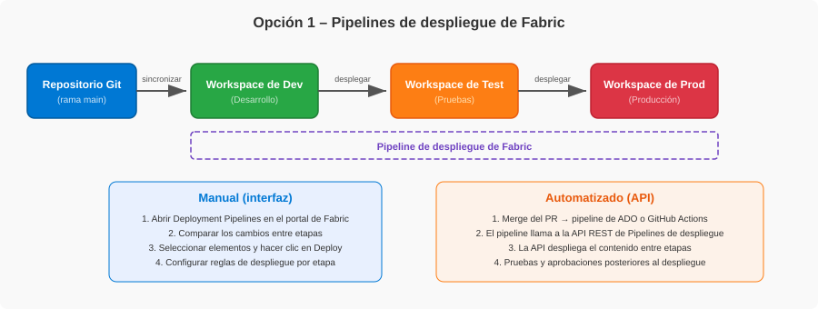
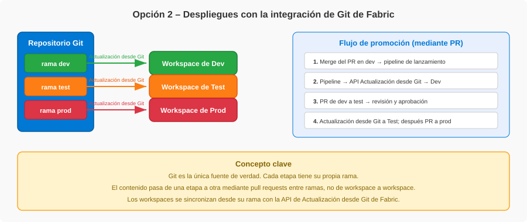
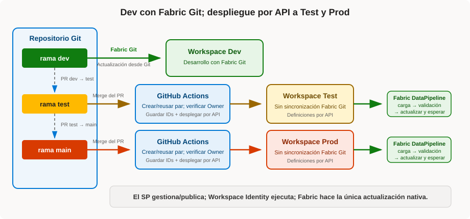
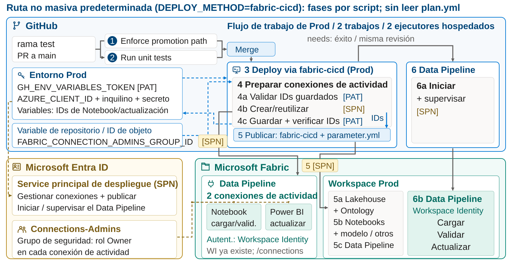

<!-- source: presentations/fabric-sdlc-cd.md @ 137df6d | translated: 2026-10-20 -->

<!-- _class: title -->
<!-- _paginate: false -->
<!-- _header: "" -->
<!-- _footer: "" -->

# Entrega continua en Microsoft Fabric

## Por qué es difícil, qué opciones hay y una implementación real en GitHub

**Michael Green**<br/>
*[CSA / DevSquad / MCSA]*

[Implementación de referencia](https://github.com/michaeldeongreen/microsoft-fabric-sdlc-patterns)

<!--
Presentar la sesión como la continuación sobre CD de la presentación anterior sobre CI e introducir a quien expone.
La documentación oficial de Microsoft es la canónica; este repositorio presenta una implementación en GitHub con decisiones de diseño propias.
Novedades que mencionar brevemente, sin citar una revisión anterior: despliegue del Data Pipeline, conexiones de actividad del Data Pipeline con Connections-Admins como Owner, ETL de la misma revisión y recursos en español con asistencia de IA.
Cronograma de 50 minutos: 0:00 diap. 1–5 · 0:05 diap. 6–11 · 0:10 diap. 12–15 · 0:17 diap. 16–17 · 0:20 EN VIVO (15) · 0:35 diap. 18–20 · 0:40 diap. 21–23 · 0:43 preguntas y respuestas, que absorben cualquier exceso de tiempo. Si hay retraso a las 0:20, omitir las diap. 4, 7–8, 15 y 22.
-->

---

# El problema de la entrega en Fabric

Un workspace de Fabric es, a la vez, un **entorno de desarrollo y de ejecución**.

Una sola solución puede abarcar:

- *Notebooks* y *pipelines*
- *Lakehouses* y datos
- *Semantic Models* e informes
- *Variable Libraries* y conexiones
- *Ontologies* y agentes

> **¿Cómo reproducir una solución funcional en Test y Prod sin reconstruirla a mano ni convertir cada workspace en una fuente de verdad independiente?**

<!--
No definir CD de forma genérica. Empezar por el problema operativo concreto de Fabric.
Editar directamente en el navegador es potente, pero por eso mismo hace falta una ruta de promoción disciplinada.
-->

---

<!-- _class: customer-challenges dense -->

# Por qué CI/CD en Fabric es difícil

**Para clientes y partners:** la entrega de datos e IA abarca infraestructura, elementos de plataforma, datos y estado, vinculaciones, identidades y operaciones, no solo código. Ese acoplamiento hace que la elección de plataforma tenga consecuencias: cambiar más adelante suele ser un programa de migración, no un cambio de herramienta.

| | |
|---|---|
| **Compatibilidad desigual del ciclo de vida**<br>Git, los *pipelines* de despliegue, `fabric-cicd` y las API admiten conjuntos de elementos distintos. | **Las dependencias se convierten en lógica de despliegue**<br>Los elementos base deben existir antes de que se resuelvan los IDs de destino y las definiciones dependientes. |
| **La configuración está fragmentada**<br>Variables en tiempo de ejecución, metadatos, conexiones, reglas y secretos tienen responsables y momentos de aplicación distintos. | **Las definiciones no son todo el entorno**<br>Datos, credenciales, permisos, programaciones y vinculaciones del primer despliegue necesitan planes aparte. |
| **Varias vías de actualización generan desviación**<br>Las ediciones directas, la sincronización con Fabric Git y el despliegue por API no deberían competir por el mismo workspace. | **La seguridad y la gobernanza abarcan varios sistemas**<br>Los roles de Fabric y la configuración de inquilino deben encajar con la identidad de Entra, los controles de GitHub, las aprobaciones, la auditoría y la gobernanza de datos corporativa. |

<!--
Esta es la diapositiva central del problema del cliente. La CD en Fabric es difícil porque el workspace es heterogéneo, no porque el YAML sea complicado.
El reto no es solo si Fabric es seguro: tiene que encajar en el modelo de control corporativo existente sin crear un proceso paralelo.
Usar «dependencia del proveedor» con cuidado: toda plataforma de datos e IA genera acoplamiento por gravedad de los datos, metadatos propietarios, configuración de seguridad y gobernanza, capacidades operativas e integración del ecosistema.
La idea no es que no se pueda cambiar, sino que migrar es un programa estratégico, no un cambio de herramienta de despliegue.
-->

---

<!-- _class: dense -->

# Antes de elegir herramientas de CI/CD, definir el alcance de la entrega

**Empezar por la solución, no por la herramienta de despliegue.**

| Pregunta | Qué decidir |
|---|---|
| **¿Qué forma parte de la solución?** | Inventariar los elementos de Fabric y la configuración o el estado necesarios para que funcione. |
| **¿Qué puede mover cada mecanismo?** | Registrar por separado la compatibilidad con Git, el publicador o API, los pipelines nativos y la identidad para cada elemento o subtipo. |
| **¿Qué grado de portabilidad tienen las referencias?** | Distinguir entre valores de ejecución, IDs lógicos e IDs físicos que hay que sustituir. |
| **¿Qué hay que aprovisionar?** | Inventariar las instancias de Fabric Capacity, los workspaces, vínculos privados, shortcuts y conexiones, roles y configuración de inquilino; elegir Bicep, Terraform o API según la cobertura. |
| **¿Qué se mueve más allá de las definiciones?** | Planificar datos, credenciales, permisos, conexiones, programaciones, vinculaciones y configuración del destino. |
| **¿Quién es responsable del destino y del resultado?** | Establecer una única vía activa de actualización de definiciones, el ETL o la actualización posterior al despliegue, la validación y las evidencias del lanzamiento. |

> **Compatible no significa completo:** las definiciones de los elementos son solo una parte de un entorno utilizable. Deben conservarse cuando sea posible, aunque el publicador elegido no pueda desplegar el elemento.

<!--
Esta lista resume los conceptos clave del README sobre las capacidades de seguimiento y despliegue de elementos y los metadatos dinámicos frente a estáticos.
Las listas de elementos compatibles evolucionan, así que conviene enlazar a las oficiales en lugar de congelar una matriz detallada en la presentación.
El seguimiento en Git y la compatibilidad del publicador son independientes: una carencia de publicación no implica que no haya Git o historial de versiones.
Bicep y ARM cubren sobre todo el plano de control de Azure, incluida la Fabric Capacity. El proveedor de Terraform para Fabric tiene más cobertura del plano de Fabric, pero también evoluciona.
Los shortcuts, las conexiones y la red privada pueden cruzar las superficies de contenido, workspace, administración de Fabric y red de Azure; conviene verificar la cobertura actual del proveedor o de la API antes de elegir la ruta de IaC.
-->

---

<!-- _class: dependency-contract compact -->

# Un reto en detalle: las dependencias se convierten en lógica de despliegue

Dentro de los problemas generales de CD, las dependencias muestran por qué copiar definiciones no basta. Las referencias determinan el orden de despliegue y la parametrización.

| Referencias portables o lógicas | Referencias físicas que hay que sustituir |
|---|---|
| *Report* → *Semantic Model* mediante [`definition.pbir`](../../../data/fabric/Patterns_Report.Report/definition.pbir)<br><br>*Ontology* → ID lógico del *Lakehouse* mediante su [vinculación de datos](../../../data/fabric/Patterns_Ontology.Ontology/EntityTypes/2525121373138/DataBindings/6e4524f9-ea6d-4535-ab49-a72f73fc08a0.json)<br><br>*Data Agent* → ID lógico de la *Ontology* mediante [`datasource.json`](../../../data/fabric/Patterns_Data_Agent.DataAgent/Files/Config/draft/ontology-Patterns_Ontology/datasource.json) | Modelo Direct Lake → ruta física de OneLake en [`expressions.tmdl`](../../../data/fabric/Patterns_Semantic_Model.SemanticModel/definition/expressions.tmdl)<br><br>*Notebook* → IDs de workspace y *Lakehouse* en [`notebook-content.py`](../../../data/fabric/Import_Patterns_Data.Notebook/notebook-content.py)<br><br>*Data Pipeline* → IDs físicos de modelo y conexiones |

```text
Fase 1:   Lakehouse ──▶ Variable Library / Notebooks / Semantic Model
          Ontology  ──▶ Data Agent

Fase 2:   Publicar los elementos dependientes salvo el Data Pipeline
Fase 3:   Consultar de nuevo los IDs de Notebook/SemanticModel → publicar Data Pipeline
```

<!--
Abrir los archivos enlazados si resulta útil. El Data Agent referencia directamente la Ontology, no el Lakehouse.
El Lakehouse y la Ontology son elementos base de la fase 1 para cadenas de dependencia distintas.
El estado del workspace de fabric-cicd se conserva en caché durante una llamada; la fase 3 vuelve a consultar los IDs de las dependencias del Data Pipeline creadas en la fase 2.
Este es un ejemplo concreto de los retos generales de la diapositiva anterior, no un tema nuevo.
-->

---

<!-- _class: divider -->
<!-- _paginate: false -->
<!-- _header: "" -->
<!-- _footer: "" -->

# Tres opciones de entrega en Fabric

## Cada una optimiza un modelo operativo distinto

---

<!-- _class: diagram -->

# Opción 1

## Pipelines de despliegue de Fabric



**Puntos fuertes**

- Interfaz del portal, automatización por API REST, comparación e historial
- El menor costo de configuración
- Despliegue completo o selectivo
- Reglas de despliegue y vinculación automática

**Contrapartidas**

- Git no es necesariamente el origen directo de Test y Prod
- Topología de etapas lineal
- Las reglas no cubren todos los valores propios del destino
- El despliegue selectivo por API exige planificar las dependencias

**Encaje ideal:** operaciones nativas de Fabric con poca automatización propia.

<!--
Los pipelines de despliegue están disponibles desde el portal de Fabric y desde las API REST. Las API pueden crear y gestionar pipelines, asignar workspaces a etapas, desplegar el contenido de una etapa e inspeccionar operaciones.
Conviene tratar las API como la superficie de automatización de esta opción, no como una cuarta opción de entrega.
-->

---

<!-- _class: diagram -->

# Opción 2

## Integración de Git de Fabric en todas las etapas



**Puntos fuertes**

- Fabric Git representa directamente todas las etapas
- Un único modelo de ramas y PR para desarrollo y promoción
- Sin biblioteca de despliegue aparte

**Contrapartidas**

- La sincronización con Fabric Git pasa a formar parte de la ruta de despliegue a producción
- Todos los workspaces de destino deben estar conectados a Fabric Git y gobernados
- Algunos clientes informan de cambios de definición generados por la plataforma o sin significado semántico («*ghost commits*»)
- Las ramas de larga duración, la desviación y las vías de actualización en conflicto aumentan la complejidad operativa

**Encaje ideal:** equipos cómodos operando todas las etapas con la integración de Git de Fabric.

<!--
Presentar los «ghost commits» como una preocupación comunicada por clientes y equipos de campo, no como una afirmación oficial universal de la plataforma:
algunos clientes informan de cambios de definición sin significado semántico o generados por la plataforma en el control de código fuente.
-->

---

<!-- _class: diagram -->

# Opción 3

## Despliegue basado en Git: Dev con Fabric Git y API para Test y Prod



**Puntos fuertes**

- Dev puede seguir sincronizado con Fabric Git para desarrollar
- Test y Prod se despliegan desde ramas de etapa mediante API
- Parametrización en el momento de la compilación
- Aprobaciones, secretos y registros de la plataforma de CI/CD
- El despliegue, el ETL y la validación pueden encadenarse

**Contrapartidas**

- La mayor responsabilidad de ingeniería
- El equipo se hace cargo de la identidad, el diagnóstico y la gestión de fallos
- La compatibilidad de herramientas y API sigue variando
- Desplegar el estado completo puede ser más lento que aplicar solo una diferencia pequeña

**Encaje ideal:** equipos que necesitan repetibilidad y control de la configuración.

<!--
La opción 3 puede usar un entorno de compilación en todas las etapas. Este repositorio usa una variante de desarrollo y lanzamiento basada en Git:
Dev está sincronizado con Fabric Git; Test y Prod se despliegan por API.
Esta separación no es un híbrido de varios publicadores. El publicador predeterminado es fabric-cicd no masivo.
Otro publicador solo es una ampliación arquitectónica opcional si se ha verificado la compatibilidad de elementos e identidades y se ha implementado la coordinación; este repositorio no incluye Pipelines de despliegue nativos.
-->

---

<!-- _class: dense -->

# Comparar los modelos operativos

| | Pipelines de despliegue | Fabric Git por etapa | Entorno de compilación / API |
|---|---|---|---|
| Origen de Test y Prod | Etapa anterior del workspace | Rama de la etapa | Rama de la etapa + configuración de despliegue |
| Comparación integrada | Etapas de Fabric adyacentes | Workspace ↔ rama conectada | Ninguna |
| Transformación en compilación | Reglas limitadas | No | **Sí** |
| Conexión de Fabric Git en Test y Prod | No | **Sí** | No |
| Esfuerzo de ingeniería | Bajo | Medio | Alto |
| Quién opera la publicación | Operadores del workspace y de la publicación | Responsables de la solución + de mantener el repositorio | DevOps/DevSecOps + responsables de la solución |
| Evidencia del despliegue | Historial de despliegues de Fabric; Git si se usa | Historial de Git + estado de Fabric Git del workspace | Historial de Git + registros de ejecución de CI/CD |

**Elegir según la fuente de verdad, la configuración, los elementos compatibles, la gobernanza y cuánto código de despliegue quiera mantener el equipo.**

> La automatización no elimina la necesidad de conocer Fabric: cambia dónde se codifica ese conocimiento y quién lo mantiene.

<!--
Pipelines de despliegue: reglas de Fabric, vinculaciones y conocimiento operativo.
Fabric Git: definiciones, ramas y estado de Git del workspace.
Compilación y API: parametrización, fases del despliegue, validación y procedimientos.
La comparación integrada no es igual en todas las columnas: los pipelines de despliegue comparan etapas adyacentes, mientras que Fabric Git compara un workspace con su rama conectada.
El historial de Git sirve para cualquier opción respaldada por Git; la fila de evidencias destaca la prueba adicional de que una revisión llegó a su destino.
-->

---

<!-- _class: dense -->

# Dentro de la opción 3: orden y vinculaciones de destino

**Dos rutas no masivas:** `fabric-cicd` (predeterminada) usa **fases en el script, sin plan**.
Con `fabric-cicd-plan` (experimental), **el script lee `plan.yml`** para ordenar la publicación elemento a elemento.

| | `fabric-cicd` (predeterminada)<br>Biblioteca de Python, llamadas por elemento | `fabric-cicd-bulk` (experimental)<br>Publicación masiva; el script lee el plan | `bulk`<br>Ejemplo directo de la API Bulk |
|---|---|---|---|
| ¿Lee `plan.yml`? | No | Sí: **el script** interpreta el YAML | No: la API admite planes; este script no adjunta ninguno |
| Orden entre llamadas | **El script**: 3 llamadas por fases; elementos base → dependientes → Data Pipeline tras volver a leer el workspace | **El script**: lotes ordenados por dependencias a partir de `plan.yml` | **El script**: 3 lotes manuales; captura los IDs físicos del destino |
| Orden dentro de una llamada | **fabric-cicd** ordena los elementos | **fabric-cicd** calcula las etapas de `$items` y agrupa los elementos relacionados; **el servicio de Fabric** resuelve las referencias por ID lógico | **El servicio de Fabric** resuelve las dependencias admitidas por ID lógico |
| Vinculación + conjunto de valores de la Library | **fabric-cicd** aplica `parameter.yml` antes de subir y selecciona el conjunto de valores del entorno de destino | **fabric-cicd** aplica el mismo `parameter.yml` y selecciona el conjunto de valores; las reglas literales funcionan y las dinámicas necesitan filtros | **El script** sustituye los IDs con `bulk-parameter.yml`; un PATCH activa el conjunto de valores tras importar |
| Limpieza | **fabric-cicd** elimina los huérfanos que corresponda tras publicar | Igual, tras todos los lotes | No implementada en este ejemplo |

**Plan = orden de publicación; parámetros = IDs de destino. El script debe cubrir todas las dependencias.**

<!--
fabric-cicd es una biblioteca de despliegue en Python. Usar tres nombres de actor de forma coherente: el script del repositorio, la biblioteca fabric-cicd y el servicio de Fabric. La ruta no masiva predeterminada sigue siendo el punto de partida recomendado.
El repositorio limita fabric-cicd a >=1.4.0,<1.5.0. La vuelta a la publicación estándar por variables dinámicas anterior a 1.4 es histórica; la mera presencia de un archivo de parámetros no provoca esa vuelta en 1.4.0. La versión 1.4.0 instalada tiene el indicador enable_bulk_publish y ningún indicador nativo de Deployment Plan.
El plan redactado es un archivo YAML en data/fabric/DeploymentPlan.DeploymentPlan/plan.yml, localizado mediante la variable DEPLOYMENT_PLAN_PATH. La ruta predeterminada nunca lo lee. fabric-cicd-plan lo lee para llamadas secuenciales sin publicación masiva; fabric-cicd-bulk lo interpreta con PyYAML para agrupar en lotes los grupos listos. Ambos son adaptadores del repositorio que solo ordenan, no Fabric ejecutando un plan desplegado. La API Bulk Import puede admitir la asociación de un plan nativo; este script directo envía definitionParts con allowPairingByName=false, no adjunta ninguno y deja fuera de la subida los elementos de control DeploymentPlan.
La ordenación tiene tres capas. El script se encarga del orden entre llamadas y de que las dependencias estén completas. Dentro de una llamada, la biblioteca fabric-cicd ordena los elementos, y solo su ruta masiva calcula las etapas dinámicas de $items y mantiene juntos los elementos relacionados. El servicio de Fabric resuelve las referencias por ID lógico admitidas dentro de una solicitud masiva. fabric-cicd-plan también hace la limpieza de huérfanos que corresponda después de sus grupos ordenados y de los elementos restantes.
Las vistas previas sin conexión (dry-run) de ambos adaptadores pasaron con el plan real. La ruta masiva genera los lotes listos [1,5,2] más 3 elementos no listados: cuatro selecciones y cuatro POST masivos de importación de definiciones esperados en el contrato sin conexión, no cuatro solicitudes HTTP en total. El plan no masivo genera 8 grupos ordenados más esos mismos 3. Se superaron sin conexión 323 pruebas específicas de los scripts, del plan y de las vinculaciones. El HTTP simulado y las vistas previas locales no son una verificación en un entorno real de las rutas masiva o con plan.
El script directo captura primero los IDs de Lakehouse y Ontology, después el ID del modelo y, por último, publica el Data Pipeline; las dependencias por ID lógico admitidas son otra capacidad del servicio. Library, Import, Validation y Model son requisitos previos explícitos del Data Pipeline. Debe previsualizarse tras cambiar el plan o el inventario. Las vinculaciones byPath del Report aún necesitan validación real.
Vincular no es eliminar: la vinculación corrige las referencias de destino; la limpieza de huérfanos elimina los elementos ausentes del origen. La documentación actual de Bulk Import muestra v1 sin ?beta=true; el script directo del repositorio, que usa la consulta antigua, sigue sin verificar.
-->

---

<!-- _class: divider -->
<!-- _paginate: false -->
<!-- _header: "" -->
<!-- _footer: "" -->

# Qué implementa este repositorio

## Dev con Fabric Git; Test y Prod con GitHub Actions

---

<!-- _class: diagram -->

# Dev usa Fabric Git; Test y Prod usan API


| Rama | Workspace | Entrega |
|---|---|---|
| `dev` | Dev | Integración de Git de Fabric |
| `test` | Test | GitHub Actions |
| `main` | Prod | GitHub Actions |

Una única vía activa de actualización de definiciones por workspace

- Dev lo gestiona Fabric Git.
- Las definiciones de Test y Prod se gestionan por API.
- Los trabajos seleccionados de Test/Prod crean o reutilizan las conexiones
  de actividad del Data Pipeline antes de publicar.
- GitHub inicia un único Data Pipeline de Fabric: carga → validación →
  actualización nativa.

---

<!-- _class: dense -->

# El conocimiento de Fabric queda codificado en el contrato de entrega

| | Variable Libraries | `parameter.yml` |
|---|---|---|
| Se aplica | En tiempo de ejecución | Antes de subir |
| Se ocupa de | Valores que las cargas de trabajo pueden resolver de forma dinámica | IDs físicos y metadatos que no se pueden diferir |
| Ejemplos | Valores de la carga; vinculación del mínimo de pacientes en la Library | IDs de Notebook/Direct Lake; modelo y conexiones del Data Pipeline |

```text
Publicación 1: Lakehouse + Ontology
Publicación 2: Variable Library + Notebooks + Semantic Model + Report + Data Agent
Publicación 3: Data Pipeline (nueva consulta de IDs de Notebook/SemanticModel)
          ↓ limpieza de los huérfanos que corresponda
Después: un Data Pipeline — carga → validación → actualización nativa
```

También se codifican: ámbito de elementos; creación o reutilización de conexiones de actividad; asignación y comprobación del rol Owner; persistencia de IDs solo si faltan; búsqueda del Data Pipeline por nombre; dependencias de éxito y gestión de fallos. La ruta predeterminada no lee DeploymentPlan; los adaptadores experimentales lo usan solo para ordenar la publicación.

> El *pipeline* deja de depender del conocimiento no documentado del equipo cuando ese conocimiento queda explícito y verificable en el repositorio.

<!--
Las dos conexiones de actividad del Data Pipeline son conexiones de Fabric que se pueden compartir; se gestionan en /connections, en el plano de control de Fabric, fuera de los elementos del workspace de Prod. La conexión de Notebook se usa en las actividades de carga y validación, y la conexión de Power BI datasets, en la actualización nativa del Semantic Model; ambas usan credenciales de Workspace Identity. No son conexiones de Git ni la vinculación del origen de datos del propio Semantic Model. La Workspace Identity existente y el acceso de la carga de trabajo son requisitos previos, y el lanzamiento no concede roles de workspace. Los IDs de conexión de la ejecución actual llegan a parameter.yml como valores $ENV mediante salidas de pasos dentro del trabajo de despliegue, y las variables guardadas del entorno de GitHub se reutilizan en ejecuciones posteriores.
-->

---

<!-- _class: dense -->

# Cuatro rutas de despliegue

[Comparación de métodos](../README.md#elegir-un-método-de-despliegue) ·
[Flujos de trabajo](../fabric-release-process.md#flujos-de-trabajo-de-github-actions)

| `DEPLOY_METHOD` | Resultado |
|---|---|
| sin definir o `fabric-cicd` | No masivo: predeterminado y recomendado |
| `fabric-cicd-bulk` | Masivo experimental + plan interpretado por el adaptador; exige `DEPLOYMENT_PLAN_PATH` |
| `bulk` | REST directo de Bulk Import; revalidar el *endpoint* actual |
| `fabric-cicd-plan` | Adaptador secuencial no masivo + plan; independiente y experimental |
| cualquier otro valor | Se omiten todos los trabajos de despliegue |

ETL común tras éxito; planes solo de ordenación, no ejecución nativa.
Sin Pipelines de despliegue nativos: otro publicador exige compatibilidad
verificada de elementos/identidades y coordinación compartida del lanzamiento.

### Por qué REST directo exige más código

El script empaqueta las definiciones, sustituye IDs con su propio `bulk-parameter.yml` antes de importar, sondea las importaciones, activa el conjunto de valores con un PATCH y comprueba los resultados por elemento. No lee `parameter.yml` ni elimina huérfanos.

---

<!-- _class: divider -->
<!-- _paginate: false -->
<!-- _header: "" -->
<!-- _footer: "" -->

# Recorrido en vivo

## Seguir un lanzamiento: `test` → `main` → Prod

<!--
Pasar de la presentación a GitHub después de la siguiente diapositiva de flujo.
Volver a comprobar antes, porque la configuración puede cambiar: DEPLOY_METHOD es fabric-cicd, el ruleset de main exige ambas comprobaciones, la ejecución de Test para este contenido está en verde y el PR no incluye cambios en data/fabric (editar el comentario del flujo de trabajo basta para cumplir la coincidencia de rutas de Prod).
Última comprobación: 20 de octubre de 2026. El entorno Prod no tiene control de aprobación y hay 0 aprobaciones obligatorias, de modo que el merge inicia la ejecución de inmediato.
Decir en voz alta que el cambio que activa el despliegue es solo un comentario del flujo de trabajo y que, aun así, se ejecutan el redespliegue completo, la limpieza de huérfanos y el ETL.
En Fabric, limitarse a la supervisión de solo lectura: sin ediciones, cambios de vinculación, un segundo Data Pipeline ni valores de secretos.
-->

---

<!-- _class: architecture -->

# Del *pull request* a un workspace utilizable



<!--
Pasar a GitHub aquí; t0 es el clic en el merge. Mostrar las dos comprobaciones obligatorias en paralelo (Enforce promotion path, Run unit tests), hacer el merge y seguir después los trabajos «Deploy via fabric-cicd (Prod)» (unos 2,5 min registrados) y «Run ETL (Prod)» (unos 3 min) con los números del diagrama.
Si a t0+9 la ejecución sigue sin terminar, pasar a la diap. 18 y volver en la 19. Si está en rojo o sigue en curso a t0+12, decirlo primero y abrir después la ejecución registrada de Prod, indicando que es registrada. Sin un segundo Data Pipeline ni ediciones en Fabric.
Esta es la ruta predeterminada de fabric-cicd sin publicación masiva: el script establece tres fases de publicación y no lee plan.yml, aunque la variable DEPLOYMENT_PLAN_PATH esté configurada. La ruta experimental independiente fabric-cicd-plan sí lee ese archivo; no añadir una entrada de plan a este diagrama ni cambiar la selección del despliegue para que coincida con ella.
Los trabajos de despliegue a Prod y de control del Data Pipeline se ejecutan en ejecutores hospedados distintos. El segundo depende del primero mediante needs: solo se inicia si el primero termina con éxito y usa la misma revisión. Los scripts se ejecutan en GitHub; el Service principal de despliegue autentica ante Fabric la gestión de conexiones, la publicación y las llamadas de inicio y de estado del Data Pipeline. La Workspace Identity autentica las actividades dentro de Fabric. El PAT y las salidas de los pasos permanecen en el trabajo de despliegue; el trabajo de control del Data Pipeline localiza el Data Pipeline por nombre y no usa PAT. Esa búsqueda es un detalle de implementación, no una acción independiente de cara a la audiencia.
El paso 4 empieza en «Preparar conexiones de actividad» y contiene solo 4a–c. El paso 5 es una acción de publicación independiente. Los IDs de conexión de la ejecución actual pasan de 4b a 5 mediante steps.connections.outputs; 4c los guarda para lanzamientos posteriores y su éxito condiciona la publicación, pero no genera salidas de ID.
Las tres llamadas del paso 5 publican Lakehouse y Ontology; después Variable Library, Notebooks, Semantic Model, Report y Data Agent; y por último el Data Pipeline, tras volver a leer el workspace. La limpieza de huérfanos que corresponda va después de toda la publicación y debe terminar con éxito antes del paso 6; ese detalle queda en las notas para no saturar el marco de ejecución.
El paso 6 ejecuta el Data Pipeline: 6a inicia y supervisa un único Data Pipeline; 6b es la carga, la validación de solo lectura y la actualización nativa del Semantic Model de esa ejecución, no un segundo inicio. El marco 6b está separado de los elementos publicados, pero permanece dentro del workspace de Prod, justo debajo del trabajo del paso 6. El trabajo real de GitHub sigue llamándose «Run ETL (Prod)» y su paso «Run Fabric item job»; esos nombres de registro van en las notas, no en los rótulos del diagrama.
Indicaciones por paso: 1 enforce-promotion-path y 2 run-tests se ejecutan en paralelo; 3 deploy-prod selecciona el flujo de trabajo de Prod; 4a «Validate saved connection IDs and GitHub access», 4b «Ensure WI connections and verify admin-group Owner» y 4c «Save and verify connection IDs for future releases» están en reusable-deploy-fabric-cicd; 5 «Deploy with fabric-cicd» es el script de despliegue con parameter.yml, tres llamadas y después la limpieza que corresponda; 6 reusable-fabric-etl, «Run Fabric item job», inicia y supervisa el Data Pipeline.
Archivos: [1 Comprobación del origen](../../../.github/workflows/enforce-promotion-path.yml) · [2 Pruebas](../../../.github/workflows/run-tests.yml) · [3 Flujo de Prod](../../../.github/workflows/deploy-prod.yml) · [4 Conexiones de actividad](../../../.github/workflows/reusable-deploy-fabric-cicd.yml) · [5 Publicador](../../../scripts/deploy_fabric_cicd_non_bulk.py) + [reglas](../../../data/fabric/parameter.yml) · [6 ETL](../../../.github/workflows/reusable-fabric-etl.yml).
-->

---

<!-- _class: dense -->

# La gobernanza aparece en cada paso

| Paso | Control |
|---|---|
| Promover a `main` | El *ruleset* exige PR, **Enforce promotion path** y **Run unit tests** |
| Seleccionar y entrar en Prod | `DEPLOY_METHOD`; secretos del entorno; el flujo de trabajo restringe Prod a `main` |
| Conexiones y publicación | Service principal de despliegue (SPN); Contributor en el destino |
| Acceso a las conexiones de actividad | Grupo de seguridad Connections-Admins (Owner) |
| Guardar los IDs de conexión | El PAT de GitHub solo lee o crea dos variables de ID; `GITHUB_TOKEN` es de solo lectura |
| Ejecutar las actividades | Workspace Identity de Prod |
| Demostrar el resultado | SHA de *commit*, registros, resultado del ETL y auditoría de Fabric |

### Recomendado para producción

- Revisores del entorno + política de ramas de despliegue
- Una identidad de despliegue distinta por entorno
- Evaluar OIDC de GitHub en lugar de un secreto de cliente almacenado

<!--
Antes de mostrar Settings en una sesión en vivo, volver a comprobar las reglas
de rama, la protección de los entornos y DEPLOY_METHOD. No presentar como actual
una configuración de una demostración anterior.
Según la última comprobación, del 20 de octubre de 2026, el entorno Prod no tiene revisores ni política de ramas de despliegue, de modo que la rama main solo está restringida en el flujo de trabajo, y el ruleset «Protect main» exige un PR y ambas comprobaciones con 0 aprobaciones. Los revisores y la política de ramas de la diapositiva son recomendaciones, no controles configurados.
El PAT solo se usa para leer o crear las dos variables de ID del entorno; no se han verificado los ámbitos de su token ni si es un PAT independiente, así que no afirmar ninguna de las dos cosas. Tampoco se han verificado los IDs de cliente por etapa.
Connections-Admins son administradores humanos de confianza con acceso Owner a cada una de las dos conexiones de actividad: Notebook para carga y validación, y Power BI datasets para la actualización nativa del modelo. No equivale al rol Admin del workspace, ni a la propiedad del Data Pipeline, ni a una propiedad exclusiva, ni a una identidad de ejecución. La Workspace Identity, el acceso de la carga de trabajo, el rol Contributor del SPN y la autorización del inquilino para usar las API se configuran de antemano.
Orígenes de configuración, solo nombres y nunca valores: la variable de repositorio FABRIC_CONNECTION_ADMINS_GROUP_ID (Settings → Secrets and variables → Actions → Variables; hoy no hay una sustitución a nivel del entorno Prod, aunque tendría prioridad) llega al flujo de trabajo como vars y después al entorno del proceso del script, donde se valida el GUID y se concede al grupo el rol Owner, o se actualiza a Owner, en cada conexión; el resultado se comprueba con una lectura posterior de las asignaciones mediante la API; no hay búsqueda por nombre de grupo ni con Graph. DEPLOY_METHOD también es una variable de repositorio.
El entorno Prod contiene las credenciales del SPN (AZURE_TENANT_ID, AZURE_CLIENT_ID y AZURE_CLIENT_SECRET; el ID de cliente por sí solo no autentica), el secreto del PAT GH_ENV_VARIABLES_TOKEN y las variables guardadas NOTEBOOK_CONNECTION_ID y SEMANTIC_MODEL_REFRESH_CONNECTION_ID. El trabajo de ETL no usa PAT, y el SPN también inicia y sondea el Data Pipeline.
-->

---

<!-- _class: dense -->

# El despliegue no es el final

El trabajo dependiente `run-etl` del flujo de despliegue inicia y sondea
`Patterns_Load_Validate_And_Refresh` después de publicar correctamente, desde
la misma revisión del flujo de trabajo.

- Fabric se encarga de **carga → validación de solo lectura → actualización nativa**. No hay una segunda actualización.

```text
Publicar definiciones + vinculaciones de destino
  → éxito final del Data Pipeline, incluida la actualización nativa
  → comprobaciones aparte de fechas del modelo, DAX y consumidores
```

> **Ejecuciones registradas:** la ruta predeterminada `fabric-cicd` completó con éxito, en Test y Prod, la preparación de conexiones, la publicación en tres fases y la ejecución del Data Pipeline de la misma revisión. Las comprobaciones de quienes consumen los datos son independientes.

<!--
El acceso al origen del propietario del modelo y las comprobaciones de fechas/DAX
de los consumidores siguen siendo independientes. La cadena needs de la misma
revisión sustituye a los flujos workflow_run de la rama predeterminada.
Los flujos ETL independientes siguen siendo herramientas manuales de recuperación;
los nombres actualizados de los flujos de despliegue evitan que los flujos
antiguos que recibían esos eventos inicien trabajos duplicados del Data Pipeline
durante la transición.
Parámetros: minimum_patient_count de la Library es una política Integer positiva con valor de referencia 5; run_label del Data Pipeline es una entrada String independiente, con manual como valor predeterminado y sustitución desde CI.
Las ejecuciones registradas son un registro histórico: no son la ejecución de hoy ni certifican todos los estados o publicadores.
Test, configuración inicial: https://github.com/michaeldeongreen/microsoft-fabric-sdlc-patterns/actions/runs/38581072000 en e87f435.
Test, reutilización del par guardado: https://github.com/michaeldeongreen/microsoft-fabric-sdlc-patterns/actions/runs/38614382201 en cdfc4e8.
Prod: https://github.com/michaeldeongreen/microsoft-fabric-sdlc-patterns/actions/runs/38616456778 en d0987a9, el 14 de octubre de 2026; despliegue de unos 2 min 38 s y ETL de unos 3 min 11 s.
Mantener separadas las ejecuciones registradas y la ejecución en vivo; si la ejecución en vivo falla, decirlo antes de mostrar las registradas. No extenderlas a las comprobaciones de DAX o fechas de los consumidores ni a publicadores alternativos.
-->

---

<!-- _class: compact -->

# El hilo de auditoría es el SHA del commit

| Pregunta | Evidencia |
|---|---|
| ¿Qué cambió y por qué? | Diferencia de Git, *commit*, *pull request* |
| ¿Quién lo revisó y promovió? | Historial del PR y de las reglas de rama |
| ¿Qué revisión se desplegó? | SHA de *commit* de la ejecución de Actions |
| ¿Quién autorizó el despliegue? | Revisión del entorno, cuando está habilitada |
| ¿Qué hizo la automatización? | Registros del flujo de trabajo y del script |
| ¿La preparación de datos funcionó? | Resultado del ETL |
| ¿Qué ocurrió dentro de Fabric? | Fuentes de auditoría de Fabric y de la organización |

GitHub Actions aporta evidencia del despliegue. No sustituye:

- la auditoría del workspace de Fabric;
- la validación de la calidad de los datos;
- la política de retención de registros de la organización.

---

<!-- _class: divider -->
<!-- _paginate: false -->
<!-- _header: "" -->
<!-- _footer: "" -->

# Reversión

## Las definiciones son más fáciles de revertir que los datos

---

# Llevar las definiciones a un estado correcto conocido

```text
Identificar el cambio incorrecto
  → crear un commit con git revert
  → revisarlo y promoverlo
  → ejecutar la misma ruta de despliegue
  → validar el destino
```

La reversión conserva el historial y usa los mismos controles que cualquier otro lanzamiento.

### La recuperación de datos va aparte

Git no puede deshacer las modificaciones de un *Lakehouse*, el estado de una actualización, los efectos colaterales aguas abajo ni las escrituras en sistemas externos.

Hay que planificar el reprocesamiento, las instantáneas, la retención, las capacidades de restauración a un momento dado o los procedimientos de reversión propios de cada carga de trabajo.

---

<!-- _class: title compact -->
<!-- _paginate: false -->
<!-- _header: "" -->
<!-- _footer: "" -->

# Lo difícil no es subir archivos

Es reproducir una solución de Fabric que funcione, entre tipos de elemento cuyas definiciones, dependencias, vinculaciones de entorno, datos y compatibilidad con la automatización no se comportan de forma uniforme.

## Elegir de forma deliberada

- Etapas nativas de Fabric: **pipelines de despliegue**
- Etapas conectadas a Fabric Git: **Fabric Git por workspace**
- Control en la compilación: **Git + API**

## Y después hacer que el lanzamiento sea fácil de demostrar y seguro de repetir

**¿Preguntas?**

[Repositorio](https://github.com/michaeldeongreen/microsoft-fabric-sdlc-patterns)

---

<!-- _class: dense -->

# Apéndice: prácticas recomendadas y referencias

### Prácticas que conviene mantener

- Establecer una única fuente de verdad y una única vía activa de actualización de definiciones por workspace.
- Preferir despliegues completos y repetibles; usar el despliegue selectivo solo si se tienen en cuenta las dependencias.
- Separar la entrega de elementos, la vinculación de entorno, la identidad y los permisos, y la validación de datos.
- Usar identidades de ámbito de entorno, controles de aprobación y el SHA del *commit* como hilo del lanzamiento.

**Novedad del grupo de producto de Fabric:** [centro de recursos de CI/CD](https://learn.microsoft.com/en-us/fabric/cicd/cicd-overview) · [anuncio de los recursos](https://community.fabric.microsoft.com/blog/fbc_fabricupdatesblogs/new-cicd-resources-for-microsoft-fabric-from-concepts-to-end-to-end-automation/5358502)

| Guía oficial | Este repositorio |
|---|---|
| [Planificar CI/CD para soluciones de Fabric](https://learn.microsoft.com/en-us/fabric/fundamentals/understand-best-practices-fabric-cicd)<br>[Elegir un flujo de CI/CD para Fabric](https://learn.microsoft.com/en-us/fabric/cicd/manage-deployment)<br>[Tutorial de automatización de principio a fin](https://learn.microsoft.com/en-us/fabric/cicd/tutorial-end-to-end-automation) | [Configuración](../SETUP.md)<br>[Proceso de desarrollo](../fabric-development-process.md)<br>[Proceso de lanzamiento](../fabric-release-process.md)<br>[Controles de calidad y recuperación](../fabric-cicd-quality-gates-and-release-controls.md) |
| [Parametrización de `fabric-cicd`](https://microsoft.github.io/fabric-cicd/1.4.0/how_to/parameterization/)<br>[Funciones opcionales y selectivas](https://microsoft.github.io/fabric-cicd/1.4.0/how_to/optional_feature/)<br>[Referencia de código](https://microsoft.github.io/fabric-cicd/1.4.0/reference/code_reference/) | [Implementación directa con la API masiva](../fabric-bulk-cicd-guide.md)<br>[Adaptadores de Deployment Plan](../fabric-deployment-plan-guide.md)<br>[Implementación de referencia](https://github.com/michaeldeongreen/microsoft-fabric-sdlc-patterns) |

**Recursos en español** (con asistencia de IA; revisión humana pendiente; posibles desfases respecto al inglés): [documentación](../README.md) · [presentación](fabric-sdlc-cd.md)
